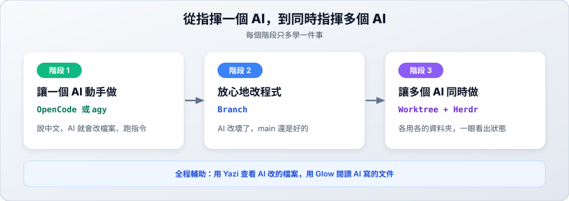

<h1 align="center">終端機 AI 開發入門</h1>

  <strong>從第一次用 AI 寫程式，到同時指揮多個 AI 開發的實作教材</strong>

  <a href="#學習路線">學習路線</a> ·
  <a href="#教材總覽">教材總覽</a> ·
  <a href="#核心概念">核心概念</a>

這是一份寫給終端機初學者的操作手冊。內容以實際操作為主，帶你安裝工具、學會指揮 AI coding agent，再用 Git 隔開每個 AI 的工作，逐步建立一套可以重複使用的開發流程。

## 學習路線

## 教材總覽

| 階段 | 教材 | 你會學到 | 內容 |
| :--- | :--- | :--- | :--- |
| **1. 讓一個 AI 動手做** | [OpenCode](opencode/README.md) | 開源的 AI coding agent，可使用免費模型，是本教材的主要範例 | 10 站 |
| | [Antigravity CLI (agy)](agy/README.md) | Google Antigravity 的終端機 agent，可切換 Gemini、Claude 等模型 | 10 站 |
| **2. 放心地改程式** | [Branch 分支篇](worktree/01-why-branch.md)（第 01～03 站） | 開分支、合併、解決衝突，AI 改壞了也不影響 main | 3 站 |
| **3. 讓多個 AI 同時做** | [Worktree 多工篇](worktree/04-why-worktree.md)（第 04～07 站） | 每個 AI 一個資料夾，同時開發互不干擾 | 4 站 |
| | [Herdr](herdr/README.md) | 在同一個終端機管理多個 AI，用燈號掌握狀態 | 6 站＋6 關練習 |
| **全程輔助** | [Yazi](yazi/README.md) | 用鍵盤瀏覽與管理檔案，驗收 AI 改的內容 | 6 站 |
| | [Glow](glow/README.md) | 在終端機裡閱讀排版好的 Markdown 文件 | 4 站 |

> [!NOTE]
> 每一章都從入門排到進階，並標示難度（★～★★★）。遇到問題時，可以查閱各章附的速查表與疑難排解。

> [!TIP]
> Agent 工具選一個學就好。兩者的章節安排相近，本教材的範例主要使用 OpenCode。

> [!IMPORTANT]
> **需要先會的 Git 基礎**：Branch 與 Worktree 章節假設你已經知道 commit 是什麼。還不熟的話，請先看 [Git 學習筆記](https://github.com/roberthsu2003/git)。

## 核心概念

| 名詞 | 一句話說明 |
| :--- | :--- |
| **AI coding agent** | 能直接操作專案的 AI，由模型和 Harness 組成 |
| **Harness** | 把模型接上真實開發環境的那一層，讓 AI 能讀寫檔案、執行指令，並根據結果繼續修正（[深入了解](harness.md)） |
| **Branch（分支）** | 一條獨立的開發路線，確定沒問題再合併回 main |
| **Worktree** | 讓同一個專案同時有多個工作資料夾，每個資料夾停在各自的分支上 |
| **ADE** | Agentic Development Environment，以 agent 工作流程為中心的開發環境。這類工具還在發展中，介面和標準都尚未定型，本教材以 Herdr 為例 |
