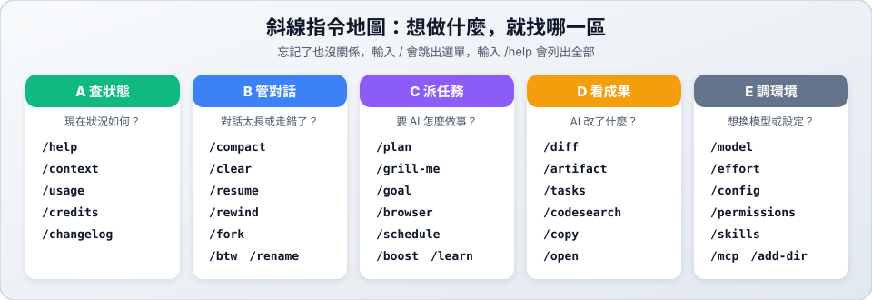

# 03　斜線指令

> ★ 入門　｜　[← 02 基本操作](02-basics.md)　｜　[章節首頁](README.md)　｜　下一站：[04 環境配置 →](04-config.md)

**這一站你會學到**：什麼是斜線指令、新手必學的 8 個指令，並透過五大分區連結進入各區介紹與動手練習（全程只建立 Markdown 筆記檔，**完全不用寫程式**！）。



---

## 1. 怎麼使用斜線指令？

斜線指令（Slash Command）是 `agy` 對話框裡的快捷功能，以 `/` 開頭。

1. 在對話框輸入 `/`，會自動跳出指令選單。
2. 繼續打字可以篩選，例如輸入 `/co` 會看到 `/compact`、`/config`、`/context`。
3. 按 `Enter` 執行。

有些指令後面可以直接接上一句中文，把你要做的事交給 AI：

```text
/plan 幫我規劃一份三天兩夜的台南美食之旅，存成 travel.md
```

> [!TIP]
> 不用背！本章與各區的範例都能直接複製來試。真的忘記時，輸入 `/help` 就能看到完整清單。

---

## 2. 新手必學 8 個指令

剛開始使用時，先認識這 8 個最常用的指令就夠了：

| 指令 | 一句話說明 | 什麼時候用 | 所屬分區 |
| :--- | :--- | :--- | :---: |
| [`/help`](03-slash-commands/a-status.md#help查看所有指令) | 查看所有指令 | 忘記指令時 | [A 區](03-slash-commands/a-status.md) |
| [`/plan`](03-slash-commands/c-tasks.md#plan先規劃再動手) | 先規劃，再動手 | 想先看大綱再讓 AI 建立或修改檔案時 | [C 區](03-slash-commands/c-tasks.md) |
| [`/diff`](03-slash-commands/d-output.md#diff看-ai-改了什麼) | 看 AI 改了什麼 | AI 修改完 `.md` 檔案後 | [D 區](03-slash-commands/d-output.md) |
| [`/compact`](03-slash-commands/b-session.md#compact壓縮對話) | 壓縮對話 | 對話太長、回應變慢時 | [B 區](03-slash-commands/b-session.md) |
| [`/clear`](03-slash-commands/b-session.md#clear開始新對話) | 開始新對話 | 換一個新主題時 | [B 區](03-slash-commands/b-session.md) |
| [`/rewind`](03-slash-commands/b-session.md#rewind回到之前的對話時光機) | 回到之前的對話 | AI 寫錯方向、想退回重來時 | [B 區](03-slash-commands/b-session.md) |
| [`/model`](03-slash-commands/e-config.md#model切換-ai-模型) | 切換模型 | 想換快一點或強一點的模型時 | [E 區](03-slash-commands/e-config.md) |
| [`/exit`](03-slash-commands/e-config.md#exit離開-agy) | 離開 agy | 下課或結束練習時 | [E 區](03-slash-commands/e-config.md) |

---

## 3. 五大分區教學與練習（點擊進入）

為了讓你好找、好練，我們把所有斜線指令分成 **A～E 五大區**。每一區點進去都有詳細說明，以及**只用 Markdown 檔案、不寫程式的動手練習**：

### 🟢 [A 區：查狀態 (Status) →](03-slash-commands/a-status.md)
- **解決問題**：現在狀況如何？額度與空間還夠嗎？
- **包含指令**：`/help`、`/context`、`/usage`、`/credits`、`/changelog`
- **動手練習**：建立 `hello.md` 並觀察對話空間與額度變化

### 🔵 [B 區：管對話 (Session) →](03-slash-commands/b-session.md)
- **解決問題**：對話太長、想順便提問或退回重來？
- **包含指令**：`/btw`、`/rename`、`/compact`、`/rewind`、`/fork`、`/clear`、`/resume`
- **動手練習**：用 `travel.md` 旅遊筆記體驗對話時光機與壓縮

### 🟣 [C 區：派任務 (Tasks) →](03-slash-commands/c-tasks.md)
- **解決問題**：要 AI 怎麼先問清楚、先規劃再做事？
- **包含指令**：`/plan`、`/grill-me`、`/learn`、`/goal`、`/schedule`、`/browser`、`/boost`、`/swarm`、`/teamwork`
- **動手練習**：讓 AI 採訪你並規劃 `weekend.md` 週末充電計畫

### 🟠 [D 區：看成果 (Output) →](03-slash-commands/d-output.md)
- **解決問題**：AI 改了哪幾行？怎麼搜尋或打開檔案？
- **包含指令**：`/diff`、`/artifact`、`/copy`、`/open`、`/codesearch`、`/tasks`
- **動手練習**：修改 `reading-notes.md` 讀書筆記並用 `/diff` 檢查差異

### ⚪ [E 區：調環境 (Config) →](03-slash-commands/e-config.md)
- **解決問題**：想換模型、調整思考深度或離開？
- **包含指令**：`/model`、`/effort`、`/config`、`/exit`、進階管理與其他指令速查
- **動手練習**：調高思考強度整理 `summary.md` 複習表並離開

---

## 4. ✅ 5 分鐘初體驗（不寫程式，只建 Markdown 檔！）

還沒點進各分區前，你可以先在任何空資料夾啟動 `agy`，跟著下面 6 步體驗一次最核心的流程：

| 步驟 | 在對話框輸入 | 觀察重點 |
| :---: | :--- | :--- |
| **1** | `/help` | 看看有哪些指令可以用（按 `Esc` 關閉） |
| **2** | `/plan 請幫我建立一個 todo.md，列出準備期末報告的 5 個步驟清單` | AI 先寫出計畫給你確認，同意後它就會建立 `todo.md` |
| **3** | `請幫我在 todo.md 最下面加上一段「注意事項」` | 讓 AI 修改剛剛建立的 Markdown 檔案 |
| **4** | `/diff` | 看清楚 AI 剛剛在 `todo.md` 新增了哪幾行（按 `Esc` 返回） |
| **5** | `/btw Markdown 的粗體字要怎麼寫？` | 順便問個小問題，觀察主對話不會被打亂 |
| **6** | `/context` → 接著輸入 `/compact` | 看看對話空間用量，並體驗把對話濃縮成摘要 |

體驗完上面 6 步後，就可以從 **[🟢 A 區：查狀態](03-slash-commands/a-status.md)** 開始依序逛進去了！

---

[← 02 基本操作](02-basics.md)　｜　[章節首頁](README.md)　｜　下一站：[04 環境配置 →](04-config.md)
