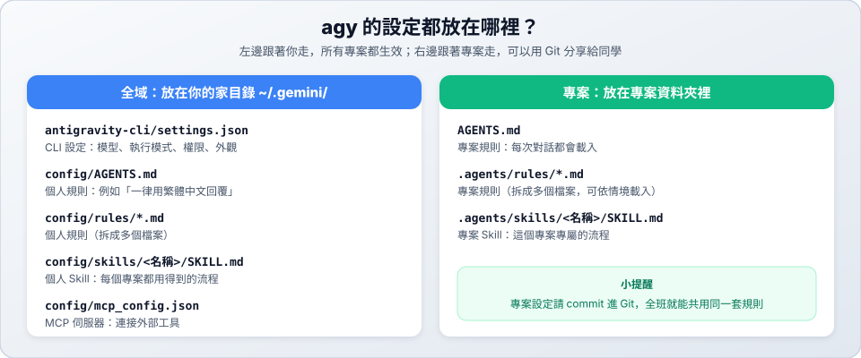

# 04　環境配置

> ★★ 進階　｜　[← 03 斜線指令](03-slash-commands.md)　｜　[章節首頁](README.md)　｜　下一站：[05 Skill 配置 →](05-skills.md)

**這一站你會學到**：`agy` 的設定檔放在哪裡、三種修改設定並立刻驗證的方法、如何用 `AGENTS.md` 或 `GEMINI.md` 設定跨專案生效的全域個人規則，以及如何連接、驗證與移除 MCP 外部工具。



---

## 開始前：建立本節練習資料夾

先完成[課堂練習準備](../practice/README.md)的工具確認與教材下載，再在**一般終端機**逐行執行：

```bash
python3 ~/terminal-ai-course/practice/prepare.py ~/terminal-ai-labs/agy/04
cd ~/terminal-ai-labs/agy/04
agy
```

看到目的資料夾已存在時，直接 `cd` 進去接續；要重做則把路徑最後一段改成 `04-retry`。本節的程式、筆記與初始 Git commit 都已準備好。

---

## 1. 先記住兩個層級：全域 vs 專案

| 層級 | 存放位置 | 生效範圍 | 適合放什麼 | 例子 |
| :--- | :--- | :--- | :--- | :--- |
| **全域（個人）** | `~/.gemini/antigravity-cli/`<br>`~/.gemini/config/` | **你電腦上的所有專案** | 個人介面偏好、通用規則、常用工具 | 外部編輯器設為 `nano`、永遠用繁體中文回覆 |
| **專案（區域）** | `<專案根目錄>/AGENTS.md`（或 `GEMINI.md`）<br>`<專案根目錄>/.agents/` | **只有這個專案** | 團隊共同規範、專案專用工具 | 這個專案一律用 `uv` 跑測試、連接專案專用 MCP |

> [!TIP]
> 判斷方法：**換一個專案還用得到嗎？** 用得到就放**全域**，只有這個專案需要就放**專案**。

---

## 2. 修改 CLI 設定的三種方式（含完整驗證範例）

`agy` 的介面、外部編輯器、執行模式與通知設定，都存在全域設定檔 `~/.gemini/antigravity-cli/settings.json` 裡。以下三種修改方式，我們直接動手做並親眼驗證設定檔真的有改變！

### 方式一：用 `/config` 互動選單修改（最推薦新手）

不需要記設定檔路徑，也不用擔心改壞格式：

```text
# 步驟 1：在 agy 對話框打開設定選單（別名：/settings）
/config
```

1. **步驟 2（動手改一項設定）**：
   用 `↑` / `↓` 方向鍵找到 **`Notifications`**（任務完成或需要確認時發出通知），按 `Enter` 把它切換為開啟（`true`）；再找到 **`Editor`**（外部編輯器），按 `Enter` 設為 `vim`（或選 `other…` 輸入 `nano`），按 **`Esc`** 關閉選單。
2. **步驟 3（立刻驗證設定已寫入檔案！）**：
   在 `agy` 對話框直接用 `!` 執行終端機指令檢查設定檔內容：
   ```text
   !grep -E '"editor"|"notifications"' ~/.gemini/antigravity-cli/settings.json
   ```
   - **驗收結果**：畫面上會直接印出 `"editor": "nano"`（或 `"vim"`）與 `"notifications": true`，代表 `/config` 選單已經幫你自動存檔了！

---

### 方式二：直接用中文請 AI 幫你改（最快！）

不想自己翻選單時，可以直接用白話文叫 AI 修改 `settings.json`，並立刻用 `/open` 驗證：

```text
# 步驟 1：直接請 AI 修改設定（並保留其他既有設定）
請幫我把 ~/.gemini/antigravity-cli/settings.json 裡的 editor 設為 "nano"、showTips 設為 false，並保留其他所有設定。

# 步驟 2：用 /open 打開設定檔，親眼驗證剛剛的修改！（因為步驟 1 已把 editor 設為 nano，現在 /open 可直接運作）
/open ~/.gemini/antigravity-cli/settings.json

# 步驟 3：測試完請 AI 把 showTips 改回預設的 true
請幫我把 ~/.gemini/antigravity-cli/settings.json 的 showTips 改回 true。
```

- **驗收結果**：
  1. 步驟 2 執行 `/open` 後，終端機會直接用 **`nano` 編輯器**打開 `settings.json`，你會在裡面親眼看到 `"editor": "nano"` 與 `"showTips": false`（看完按 **`Ctrl+X`** 即可離開 `nano` 回到 `agy`）。
  2. 步驟 3 改回 `true` 後，輸入 `/config` 可以看到 **Show Tips** 已經恢復開啟。

---

### 方式三：從終端機手動編輯 `settings.json`（進階，含語法檢查）

如果你習慣自己在終端機改 JSON 設定檔，建議「先備份、改完用 Python 檢查語法」，避免少打一個逗號導致格式錯誤：

```bash
# 步驟 1：先離開 agy（輸入 /exit），在一般終端機備份原本的設定檔
cp -i ~/.gemini/antigravity-cli/settings.json ~/.gemini/antigravity-cli/settings.json.bak

# 步驟 2：用 nano 打開編輯（例如把 notifications 改成 false，按 Ctrl+O 存檔、Enter 確認、Ctrl+X 離開）
nano ~/.gemini/antigravity-cli/settings.json

# 步驟 3（關鍵驗收！）：檢查 JSON 格式是否完全正確（沒報錯並印出整齊 JSON 就代表語法正確）
python3 -m json.tool ~/.gemini/antigravity-cli/settings.json
```

常見的 `settings.json` 結構範例：

```json
{
  "agentMode": "accept-edits",
  "editor": "nano",
  "notifications": true,
  "verbosity": "medium",
  "permissions": {
    "allow": ["command(git status)", "command(ls)"],
    "deny": ["command(sudo)"]
  }
}
```

> [!WARNING]
> JSON 格式很嚴格：不能寫 `//` 註解，最後一個項目後面也不能多加逗號 `,`。若不小心改壞，用備份檔還原即可：`cp ~/.gemini/antigravity-cli/settings.json.bak ~/.gemini/antigravity-cli/settings.json`。

---

## 3. 常用設定項目

### 常用設定項目速查表

| 設定名稱 | 用途 | 預設值 | 常見設定值 |
| :--- | :--- | :---: | :--- |
| `agentMode` | 啟動時的預設執行模式 | `""`（預設 `default` 模式） | `"plan"`、`"accept-edits"`、`"auto"` |
| `model` | 預設使用的 AI 模型 | `""` | 建議用 `/model` 選單切換 |
| `colorScheme` | 終端機配色主題 | `"terminal"` | 建議用 `/config` 預覽後選擇 |
| `editor` | `/open` 與 `Ctrl+G` 開啟的外部編輯器 | `"auto"`（讀 `$EDITOR`，否則 `vim`） | `"nano"`、`"vim"`、`"code"`、`"open -a TextEdit"` |
| `notifications` | 需要你確認或任務完成時發出通知 | `false` | `true` |
| `verbosity` | 畫面顯示工具過程的詳細程度 | `"medium"` | `"low"`、`"medium"`、`"high"` |
| `showTips` | 顯示底部使用小提示 | `true` | `false` |
| `queuedMessages` | AI 工作中收到你新訊息的處理方式 | `"queue"`（排隊等這輪結束） | `"send-immediately"`（立刻插話） |
| `toolPermission` | 工具的整體授權策略 | `"request-review"` | 詳見 [08 權限設定與沙盒](08-permissions.md) |
| `enableTerminalSandbox` | 在安全沙盒裡執行終端機指令 | `false` | `true`（詳見 [08](08-permissions.md)） |

完整清單請見[官方 CLI Reference](https://antigravity.google/docs/cli/reference/)。

---

### 完整範例：用啟動參數讓設定「只在這一次生效」（不改設定檔）

有時候你只想**這一次啟動**用 `plan`（規劃模式）或指定某個設定，不想動到 `settings.json` 裡的長期設定。請在**一般終端機**跟著做：

```bash
# 步驟 1：在一般終端機，加上 --mode plan 與 --settings 啟動 agy
agy --mode plan --settings '{"notifications": true}'
```

進入 `agy` 後，在對話框依序驗證：

```text
# 步驟 2：觀察輸入框下方狀態列，確認目前顯示為 plan 模式
# 接著故意請 AI 修改 main.py，驗證 plan 模式「只規劃、不直接改檔」：
請幫我規劃在 main.py 的輸出加上「計算結果：」四個字，先不要實作。

# 步驟 3：確認 main.py 完全沒被偷改（應無任何輸出）
!git status --short

# 步驟 4：離開 agy，再不帶參數正常啟動一次，驗證原本的設定完全沒被覆蓋！
/exit
```

回到一般終端機再次輸入 `agy`，你會發現執行模式已經自動回到原本的 `default` 模式——證明 `--mode`、`--model` 與 `--settings` **只對當次工作階段有效，不會覆蓋設定檔**！

---

## 4. 設定個人規則（全域）：`AGENTS.md` 或 `GEMINI.md`

想讓 AI 在**你電腦上的每一個專案**都自動遵守你的個人習慣（例如一律用繁體中文、回答要精簡）？只要寫進全域規則檔 **`AGENTS.md` 或 `GEMINI.md`**（兩個檔名作用完全相同，`agy` 都會自動載入）！

### 規則可以放在哪裡？

| 層級 | 位置（`AGENTS.md` 與 `GEMINI.md` 皆可） | 生效範圍與說明 |
| :--- | :--- | :--- |
| **全域（單檔）** | `~/.gemini/config/AGENTS.md` 或 `~/.gemini/config/GEMINI.md`<br>（亦相容 `~/.gemini/GEMINI.md`） | 對這台電腦上的**所有專案與資料夾**永遠生效 |
| **全域（多檔）** | `~/.gemini/config/rules/*.md` | 拆成多個檔案管理，可設定 `trigger` 觸發條件 |
| **專案（單檔）** | `AGENTS.md` 或 `GEMINI.md`（放在專案根目錄或子資料夾） | 只對該專案資料夾（及子資料夾）永遠生效（詳見 [06](06-agents-md.md)） |
| **專案（多檔）** | `.agents/rules/*.md` | 拆成多個檔案管理，可設定 `trigger` 觸發條件（詳見 [06](06-agents-md.md)） |

---

### 完整驗證範例：加上「通關暗號」，親眼驗證跨資料夾都生效！

如果只寫「一律用繁體中文回覆」，當你用中文問問題時，本來就會得到中文回答，看不出規則有沒有生效。我們加上一句**「通關暗號」**，並故意**用英文提問**、**換到另一個空資料夾提問**，讓你 100% 確定全域規則真的有作用！

#### 步驟 1：建立全域規則檔（含測試暗號）

在 `agy` 對話框輸入（如果原本已有 `~/.gemini/config/AGENTS.md` 或 `GEMINI.md`，請 AI 用「追加」的方式加上去）：

```text
請幫我在全域規則檔 ~/.gemini/config/AGENTS.md 加上以下兩條個人規則（若檔案已存在請保留原內容並追加在最後）：
1. 無論使用者用什麼語言提問，一律使用繁體中文（Traditional Chinese）回覆。
2. 每次回覆的最後一行，都必須加上「🎯 全域個人規則已生效！」這句話。
```

#### 步驟 2：重新載入並故意用「英文」提問驗證

全域規則會在啟動對話時載入。請先輸入 `/exit` 離開，再重新輸入 `agy` 啟動，然後**故意用英文**輸入：

```text
Explain what README.md is in one short sentence.
```

- **驗收結果 1**：雖然你全英文提問，但 AI 不但用**繁體中文**回答你，而且回答的最後一行出現了 **`🎯 全域個人規則已生效！`**！

#### 步驟 3：換到電腦上另一個「全新空資料夾」驗證跨專案生效

現在我們離開本專案，去 `/tmp` 建一個完全不相干的空資料夾測試：

```bash
# 在一般終端機執行：建立空資料夾並直接用 agy 提問
mkdir -p /tmp/test-global-rule && cd /tmp/test-global-rule
agy -i "What is 1 + 1?"
```

- **驗收結果 2**：就算在 `/tmp/test-global-rule` 這個空資料夾裡（裡面沒有任何專案檔案），AI 依然會用繁體中文回答，並且最後一行照樣印出 **`🎯 全域個人規則已生效！`**！這就證明全域規則對整台電腦的所有資料夾都有效！

#### 步驟 4：練習完畢，移除測試暗號、只保留實用規則

在對話框對 AI 說：

```text
請幫我把 ~/.gemini/config/AGENTS.md 裡面「每次回覆最後一行加上 🎯 全域個人規則已生效！」那條測試規則刪掉，只保留「一律使用繁體中文回覆」即可。
```

最後離開並切回原本的練習資料夾：`cd ~/terminal-ai-labs/agy/04`。

---

## 5. 連接外部工具：MCP

**MCP（Model Context Protocol）** 能讓 AI 連接外部工具（例如讀寫特定資料夾、查資料庫、操作 GitHub 或 Figma）。

MCP 設定檔同樣分兩個層級：
- **專案層級**：`<專案根目錄>/.agents/mcp_config.json`（只給這個專案用）
- **全域層級**：`~/.gemini/config/mcp_config.json`（所有專案都能用，可用 `agy mcp` 指令管理）

以下我們用官方的 Filesystem MCP 伺服器（`lab-files`）做完整實測，讓你親眼看到 AI 呼叫 MCP 工具讀檔，最後再把它停用與刪除。

> **前置確認**：在一般終端機執行 `node --version` 與 `npx --version` 確認有輸出（需安裝 Node.js 且有網路可下載套件）。

---

### 完整範例 A：用 `agy mcp` 指令新增、驗證、停用與刪除（推薦！）

不需要自己手寫 JSON 括號，直接用終端機指令就能把 MCP 伺服器加好：

#### 步驟 1：在一般終端機新增 `lab-files` MCP 伺服器並檢查清單

請先離開 `agy`（`/exit`），在 `~/terminal-ai-labs/agy/04` 資料夾執行：

```bash
# 1. 新增一個名叫 lab-files 的本機 MCP 伺服器（$(pwd) 會自動帶入目前資料夾的完整路徑）
agy mcp add lab-files npx -y @modelcontextprotocol/server-filesystem "$(pwd)"

# 2. 查看目前已設定的 MCP 伺服器清單
agy mcp list
```

- **驗收結果**：`agy mcp list` 會列出 `lab-files` 以及它的執行指令。

#### 步驟 2：啟動 `agy`，用 `/mcp` 與實際讀檔驗證它真的能用！

在終端機輸入 `agy` 啟動，接著在對話框依序執行：

```text
# 1. 先打開 MCP 管理面板，確認 lab-files 狀態為已連線（Connected），看完按 Esc 返回
/mcp

# 2. 指定 AI 必須使用 lab-files MCP 工具來讀取 README.md
請使用 lab-files MCP 伺服器的讀檔工具讀取 README.md，並回報裡面的測試指令。請在回答中寫出你呼叫的 MCP 工具名稱，不要使用一般的內建讀檔工具。
```

- **驗收結果**：
  1. 畫面上會顯示 AI 呼叫了 `lab-files` 的 MCP 工具（如 `read_file` / `read_text_file`）。
  2. AI 正確回報 `README.md` 裡的測試指令為 `python3 -m unittest discover -s tests -v`。

#### 步驟 3：練習停用、重新啟用與徹底刪除（課後清理）

測試成功後，離開 `agy`（`/exit`），在一般終端機練習完整管理生命週期：

```bash
# 1. 暫時停用（保留設定，但啟動 agy 時不載入）
agy mcp disable lab-files

# 2. 重新啟用
agy mcp enable lab-files

# 3. 徹底刪除（從 ~/.gemini/config/mcp_config.json 移除）
agy mcp remove lab-files

# 4. 驗證是否已刪除乾淨（清單中不應再有 lab-files）
agy mcp list
```

---

### 完整範例 B：手動撰寫專案專屬 `.agents/mcp_config.json`（選做）

如果你想把 MCP 設定放在**專案資料夾**裡（`.agents/mcp_config.json`）分享給組員，檔案格式如下（請將路徑換成你在終端機執行 `pwd` 看到的完整絕對路徑，不要寫 `~`）：

```json
{
  "mcpServers": {
    "lab-files": {
      "command": "npx",
      "args": ["-y", "@modelcontextprotocol/server-filesystem", "/請換成pwd顯示的完整絕對路徑"]
    }
  }
}
```

| 欄位名稱 | 適用類型 | 說明 |
| :--- | :--- | :--- |
| `command`、`args`、`env` | 本機工具（stdio） | 要執行的程式名稱、參數陣列、環境變數 |
| `url`、`headers` | 遠端服務（HTTP） | 遠端 MCP 伺服器的網址與標頭（例如 `"url": "https://mcp.example.com/mcp"`） |

- **驗證與刪除方式**：存檔後重新啟動 `agy`，輸入 `/mcp` 即可看到 `lab-files`；練習完畢直接刪除 `.agents/mcp_config.json`（`rm -f .agents/mcp_config.json`）即可恢復乾淨環境。

> [!CAUTION]
> 請不要把含有私密 API 金鑰（API Key / Token）的設定檔 commit 進公開的 Git 儲存庫。MCP 伺服器能代替 AI 操作外部服務，請只安裝你信任的來源。

---

## 6. 登入狀態與自訂 API 金鑰驗證

大多數同學使用第 01 站的 **Google 帳號登入**即可。若需要切換帳號或改用自己的 Gemini API Key，可依下表操作並驗證：

| 情境 | 操作步驟 | 如何驗證成功？ |
| :--- | :--- | :--- |
| **切換 Google 帳號** | 1. 在 `agy` 對話框輸入 `/logout` 登出<br>2. 重新執行 `agy`，依畫面指示在瀏覽器登入新帳號 | 登入後送出 `你好`，能正常收到回覆，且 `/usage` 顯示新帳號的額度 |
| **修正「找不到 `agy` 指令」** | 在一般終端機執行 `~/.local/bin/agy install`，並**重新打開終端機視窗** | 在新終端機執行 `agy --version` 能正常印出版本號 |
| **改用自己的 Gemini API 金鑰（選做）** | 1. 在終端機設定環境變數：`export GEMINI_API_KEY="你的金鑰"`<br>2. 在 `settings.json` 加上 `"modelProvider": "gemini"`<br>3. 啟動 `agy` | 送出 `請只回覆「API 連線成功」` 能收到回覆；測完把 `modelProvider` 刪掉並執行 `unset GEMINI_API_KEY` 即可還原 |

---

## 7. ✅ 課堂動手練習與環境健康檢查（10 分鐘總驗收）

把這一站學到的四個核心技能一次走完並打勾驗收：

| 步驟 | 你要做的操作 | 驗收重點（看到什麼才算成功？） |
| :---: | :--- | :--- |
| **1** | 在 `agy` 輸入 `/config`，把 **`Editor`** 改為 `nano`（或 `vim`），按 `Esc` 後輸入：<br>`!grep "editor" ~/.gemini/antigravity-cli/settings.json` | 終端機輸出 `"editor": "nano"`，且輸入 `/open ~/.gemini/antigravity-cli/settings.json` 能順利打開設定檔（按 `Ctrl+X` 離開） |
| **2** | 請 AI 在 `~/.gemini/config/AGENTS.md`（或 `GEMINI.md`）加上：<br>`1. 一律使用繁體中文回覆`<br>`2. 回覆最後一行加上「🎯 規則生效」`<br>重啟 `agy` 後用英文問：`What is Python?` | AI 用**繁體中文**介紹 Python，且最後一行出現 **`🎯 規則生效`**（驗證完請 AI 把第 2 條測試暗號刪掉，保留第 1 條即可） |
| **3** | 離開 `agy`，在終端機執行：<br>`agy mcp add lab-files npx -y @modelcontextprotocol/server-filesystem "$(pwd)"`<br>再進入 `agy` 輸入 `/mcp` | 在 `/mcp` 面板看到 `lab-files` 已連線，並能請 AI 用 `lab-files` 讀取 `README.md`（驗證完執行 `agy mcp remove lab-files` 刪掉） |
| **4** | 依下方「環境健康檢查表」快速巡檢一輪 | 所有面板都能正常打開、按 `Esc` 返回 |

### 環境健康檢查速查表

| 檢查項目 | 輸入指令 | 預期看到的正常結果 |
| :--- | :--- | :--- |
| **CLI 版本** | 在一般終端機執行 `agy --version` | 顯示目前安裝的版本號 |
| **目前模型** | `/model` | 標示目前選用的模型名稱 |
| **個人設定** | `/config` | 顯示你剛剛調整過的 `Editor` 等設定值 |
| **個人規則** | `請告訴我你現在遵守哪些全域或專案規則？` | AI 能清楚說出你寫在 `AGENTS.md` / `GEMINI.md` 的規則（如一律用繁體中文回覆） |
| **可用額度** | `/usage` | 顯示各模型的剩餘額度百分比與重置時間 |
| **外部工具** | `/mcp` | 顯示目前已啟用的 MCP 伺服器連線狀態（若已全部移除則顯示空清單） |

---

[← 03 斜線指令](03-slash-commands.md)　｜　[章節首頁](README.md)　｜　下一站：[05 Skill 配置 →](05-skills.md)
