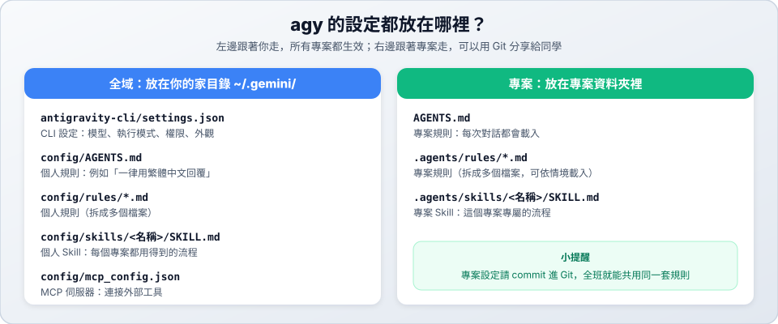

# 04　環境配置

> ★★ 進階　｜　[← 03 斜線指令](03-slash-commands.md)　｜　[章節首頁](README.md)　｜　下一站：[05 Skill 配置 →](05-skills.md)

**這一站你會學到**：agy 的設定檔放在哪裡、怎麼修改常用設定、怎麼設定個人規則與 MCP，以及如何檢查環境。



---

## 1. 先記住兩個層級

| 層級 | 生效範圍 | 適合放什麼 | 例子 |
| :--- | :--- | :--- | :--- |
| **全域** | 你電腦上的所有專案 | 個人偏好 | 一律用繁體中文回覆 |
| **專案** | 只有這個專案 | 團隊規範 | 這個專案一律用 `uv` |

> [!TIP]
> 判斷方法：**換一個專案還用得到嗎？** 用得到就放全域，只有這個專案需要就放專案。

---

## 2. 修改設定的三種方式

### 方式一：用 `/config` 選單（推薦）

```text
/config
```

用方向鍵選擇、按 `Enter` 修改，存檔由 agy 處理，不用擔心格式打錯。

### 方式二：請 AI 幫你改

直接用中文說：

```text
請幫我把 agy 設定成任務完成時要發出通知
```

### 方式三：直接編輯 `settings.json`（進階）

設定檔位置：

```text
~/.gemini/antigravity-cli/settings.json
```

可以用這個指令開啟：

```text
/open ~/.gemini/antigravity-cli/settings.json
```

範例：

```json
{
  "agentMode": "accept-edits",
  "notifications": true,
  "verbosity": "medium",
  "permissions": {
    "allow": ["command(git status)", "command(ls)"],
    "deny": ["command(sudo)"]
  }
}
```

> [!WARNING]
> JSON 格式很嚴格：不能寫註解，最後一項後面不能有逗號。改壞時，agy 會提示設定檔格式錯誤。

---

## 3. 常用設定項目

| 設定 | 用途 | 預設值 | 常見的值 |
| :--- | :--- | :---: | :--- |
| `agentMode` | 啟動時的執行模式 | 空白（預設模式） | `plan`、`accept-edits`、`auto` |
| `model` | 預設模型 | 空白 | 建議用 `/model` 選擇 |
| `colorScheme` | 配色 | `terminal` | 建議用 `/config` 預覽後選擇 |
| `notifications` | 需要你處理時發出通知 | `false` | `true` |
| `verbosity` | 畫面顯示的詳細程度 | `medium` | 建議用 `/config` 選擇 |
| `showTips` | 顯示使用小提示 | `true` | `false` |
| `queuedMessages` | AI 工作中收到新訊息的處理方式 | `queue` | `send-immediately` |
| `toolPermission` | 工具的整體授權方式 | `request-review` | 詳見 [08](08-permissions.md) |
| `enableTerminalSandbox` | 在沙盒裡執行終端指令 | `false` | `true` |
| `permissions` | 允許、詢問、禁止的規則 | 無 | 詳見 [08](08-permissions.md) |

完整清單請見[官方 CLI Reference](https://antigravity.google/docs/cli/reference/)。

### 只想這次生效？

啟動時加上參數，不會改到存好的設定：

```bash
# 這次用規劃模式
agy --mode plan

# 這次用指定的模型
agy --model gemini-3.8-flash-medium

# 這次套用指定的設定，不會存檔
agy --settings '{"notifications": true}'
```

---

## 4. 設定個人規則（全域）

想讓 AI 在**每個專案**都用繁體中文回覆？用一句話就能完成：

```text
請幫我在全域規則檔 ~/.gemini/config/AGENTS.md 加上：一律使用繁體中文回覆
```

檔案內容會像這樣：

```markdown
# 我的個人規則

- 一律使用繁體中文回覆。
- 修改檔案之前，先說明要改什麼、為什麼要改。
```

### 規則可以放在哪裡？

| 層級 | 位置 | 說明 |
| :--- | :--- | :--- |
| 全域 | `~/.gemini/config/AGENTS.md` | 永遠生效 |
| 全域 | `~/.gemini/config/rules/*.md` | 拆成多個檔案，需要設定 `trigger` |
| 專案 | `AGENTS.md`（專案根目錄或子資料夾） | 永遠生效，對該資料夾和子資料夾有效 |
| 專案 | `.agents/rules/*.md` | 拆成多個檔案，需要設定 `trigger` |

`GEMINI.md` 的作用和 `AGENTS.md` 相同。專案規則的寫法請看 [06 專案規範與規則](06-agents-md.md)。

---

## 5. 連接外部工具：MCP

MCP（Model Context Protocol）讓 AI 能使用外部工具，例如資料庫、GitHub、Figma。不需要的話可以先跳過。

設定檔位置：

```text
~/.gemini/config/mcp_config.json
```

內容範例：

```json
{
  "mcpServers": {
    "sqlite-helper": {
      "command": "sqlite-mcp-server",
      "args": ["/path/to/database.db"]
    },
    "remote-service": {
      "url": "https://mcp.example.com/mcp"
    }
  }
}
```

| 欄位 | 用在哪裡 | 說明 |
| :--- | :--- | :--- |
| `command`、`args`、`env` | 本機工具 | 要執行的程式、參數、環境變數 |
| `url` | 遠端服務 | 伺服器的網址 |

也可以用指令新增和查看：

```bash
# 新增遠端伺服器
agy mcp add --type http remote-service https://mcp.example.com/mcp

# 查看目前的伺服器
agy mcp list
```

> [!CAUTION]
> 請不要把 API 金鑰寫在要 commit 進 Git 的檔案裡。MCP 伺服器能代替 AI 操作外部服務，只安裝你信任的來源。

---

## 6. 登入與 API 金鑰

大多數同學用 Google 帳號登入就好，第一次執行 `agy` 時會引導你完成，請見 [01 安裝與登入](01-install.md)。

| 狀況 | 做法 |
| :--- | :--- |
| 想換帳號 | 輸入 `/logout`，再重新啟動 `agy` |
| 想用自己的 Gemini API 金鑰 | 設定環境變數 `GEMINI_API_KEY`，並把 `settings.json` 的 `modelProvider` 設為 `"gemini"` |
| 終端機找不到 `agy` | 確認 `~/.local/bin` 在 PATH 裡，或執行 `agy install` 並重開終端機 |

---

## 7. 環境健康檢查

設定完成後，進入 `agy` 逐項確認：

| 檢查項目 | 輸入 | 應該看到 |
| :--- | :--- | :--- |
| 版本 | 在終端機執行 `agy --version` | 顯示版本號 |
| 模型 | `/model` | 目前選擇的模型 |
| 設定 | `/config` | 你調整過的值 |
| 權限 | `/permissions` | 你設定的規則 |
| 額度 | `/usage` | 還有可用額度 |
| Skill | `/skills` | 你安裝的 Skill |
| MCP | `/mcp` | 伺服器的連線狀態 |
| 規則 | `請告訴我你現在遵守哪些規則？` | AI 能說出你寫的規則 |

---

← [← 03 斜線指令](03-slash-commands.md)　｜　[章節首頁](README.md)　｜　下一站：[05 Skill 配置 →](05-skills.md)
