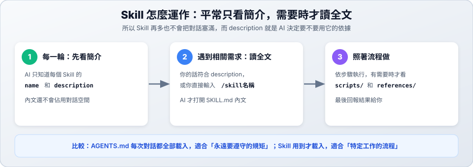

# 05　Skill 配置

> ★★ 進階　｜　[← 04 環境配置](04-config.md)　｜　[章節首頁](README.md)　｜　下一站：[06 專案規範與規則 →](06-agents-md.md)

**這一站你會學到**：Skill 的「區域 vs 全域」差異、如何安裝**外部 Skill**、如何從零建立**自訂 Skill**，以及怎麼測試、停用與刪除 Skill。



---

## 1. Skill 是什麼？

**Skill 就像交給 AI 的一份工作手冊。** 你把某件事的做法寫下來，之後 AI 遇到這件事就會翻開手冊照做，你不用每次重新交代。

| | `AGENTS.md`（規則） | Skill（工作手冊） |
| :--- | :--- | :--- |
| **何時載入** | 每次對話都載入 | 用到時才載入 |
| **適合內容** | 永遠要遵守的規矩 | 特定工作的步驟 |
| **例子** | 一律用繁體中文回覆 | 幫我出複習測驗、檢查作業有沒有漏交 |

> [!TIP]
> 同一件事交代 AI 超過兩次，就值得做成 Skill。

---

## 2. 區域（專案） vs 全域（個人）

Skill 可以放在**專案資料夾（區域）**，也可以放在**電腦個人目錄（全域）**，另外還有從市集安裝的**外部外掛（Plugin）**：

| 類型 | 存放路徑 | 適用範圍 | 適合放什麼 | 優先順序 |
| :--- | :--- | :--- | :--- | :---: |
| **區域（專案）** | `<專案根目錄>/.agents/skills/<名稱>/` | **只有這個專案**（可 commit 進 Git 分享給組員） | 專案專用的檢查流程、部署步驟、團隊規範 | 1（最高，會覆蓋同名全域 Skill） |
| **全域（個人）** | `~/.gemini/config/skills/<名稱>/` | **你電腦上的所有專案** | 個人習慣用的工具（出題複習、筆記整理、程式解說） | 2 |
| **外部外掛（Plugin）** | `~/.gemini/config/plugins/<外掛名稱>/skills/` | **所有專案**（透過 `/plugin` 或 `agy plugin` 安裝） | 官方或社群打包好的專業能力（如前端、Firebase、瀏覽器除錯） | 3 |

> [!NOTE]
> - 專案資料夾名稱是 `.agents`，有 **s**，而且前面有一個點（Finder 預設看不到）。
> - 如果區域和全域有**同名的 Skill**，AI 會優先使用**區域（專案）**的版本。

---

## 3. 使用「外部 Skill」的兩種方式

別人寫好的 Skill 不用自己重寫，常見有兩種取得方式：

### 方式 A：透過官方／社群市集安裝 Plugin（推薦）

**Plugin（外掛）** 是把「Skills + MCP 工具 + 規則」打包在一起的擴充套件包，安裝後裡面的 Skill 會自動載入。

```text
# 在 agy 對話框開啟外掛市集與管理面板
/plugin
```

也可以直接在終端機管理（以安裝官方外掛為例）：

```bash
# 1. 安裝外掛
agy plugin install modern-web-guidance-plugin

# 2. 查看已安裝的外掛
agy plugin list

# 3. 暫時停用 / 重新啟用
agy plugin disable modern-web-guidance-plugin
agy plugin enable modern-web-guidance-plugin

# 4. 刪除（解除安裝）外掛
agy plugin uninstall modern-web-guidance-plugin
```

#### 動手實作：試用 `modern-web-guidance-plugin`

這個外掛能讓 AI 在寫網頁（HTML / CSS / JS）前，先查詢最新的現代網頁標準，避免寫出過時的寫法。安裝完成後照著以下步驟試用：

1. **確認 Skill 已載入**：開啟 `agy`，在對話框輸入 `/skills`，應該會看到 `modern-web-guidance`。
2. **實際下指令測試**（在對話框輸入）：
   ```text
   請用現代網頁標準幫我做一個確認刪除的彈跳視窗（demo.html），點背景空白處就能關閉，並支援深色模式。
   ```
3. **觀察外掛運作**：
   - AI 會自動觸發 `modern-web-guidance` Skill，先執行 `npx -y modern-web-guidance@latest search ...` 與 `retrieve ...` 查詢最新規範。
   - 產出使用原生 `<dialog>` 與現代 CSS 寫法的 `demo.html`。
   - 回覆最後還會附上一個 **`### Modern Web Guidance`** 小節，列出它參考了哪些規範項目。
4. **課後清理（選用）**：測試完可刪除 `demo.html`；如果想練習移除外掛，執行 `agy plugin uninstall modern-web-guidance-plugin` 即可。

### 方式 B：從 GitHub 或同學分享取得單一 Skill

如果網路上或同學分享了一個 Skill 資料夾（裡面有 `SKILL.md`），只要把整個資料夾放進對應目錄即可：

- **只給這個專案用（區域）**：放到 `<專案>/.agents/skills/<skill-名稱>/`
- **所有專案都要用（全域）**：放到 `~/.gemini/config/skills/<skill-名稱>/`

#### 動手實作：從 GitHub 安裝非程式類 Skill（以製作簡報 `pptx` 為例）

[anthropics/skills](https://github.com/anthropics/skills) 是官方開源的 Skill 寶庫，裡面有很多**非寫程式**的實用 Skill（如製作簡報 `pptx`、Word 文件 `docx`、PDF 處理 `pdf`）。

1. **下載並放到專案（區域）目錄**：
   ```bash
   git clone --depth 1 https://github.com/anthropics/skills.git /tmp/ext-skills
   mkdir -p .agents/skills
   cp -r /tmp/ext-skills/skills/pptx .agents/skills/pptx
   rm -rf /tmp/ext-skills
   ```
   > 想改成**全域**（所有專案都能用），把 `.agents/skills/pptx` 換成 `~/.gemini/config/skills/pptx` 即可。

2. **檢查並載入**：打開 `.agents/skills/pptx/SKILL.md` 確認內容安全後，在 `agy` 輸入 `/skills reload`（再用 `/skills` 確認看到 `pptx`）。

3. **實際試用（非程式任務）**：
   ```text
   /pptx 請幫我根據這個資料夾的 README.md，規劃並製作一份 5 頁的專題介紹簡報（intro.pptx）。
   ```

4. **不想用了怎麼刪**：
   ```bash
   rm -rf .agents/skills/pptx
   ```
   回到 `agy` 輸入 `/skills reload` 就移除了。

> [!CAUTION]
> Skill 可以包含腳本或操作指示。使用來路不明的外部 Skill 前，**請先打開 `SKILL.md` 看過內容**，確認沒有危險指令再載入。

---

## 4. 自訂 Skill：兩個學生可直接動手做的範例

以下兩個範例不需要複雜專案環境，**任何程式碼或筆記資料夾都能立刻測試**。

### 範例 1（區域・專案 Skill）：用一句話請 AI 建立「程式碼白話解說員」

適合放在課堂專案的 `.agents/skills/`，組員 pull 下來就能一起用。

在 `agy` 對話框直接輸入：

```text
請幫我在這個專案建立一個 skill，名稱叫 explain-code，
用途是用初學者聽得懂的繁體中文解說指定程式碼，必須包含：
1. 一句話總結這段程式在做什麼
2. 用一個生活比喻說明核心邏輯
3. 逐段拆解關鍵步驟
4. 提醒一個初學者常踩的坑
```

AI 會自動建立 `.agents/skills/explain-code/SKILL.md`。接著重新載入並測試：

```text
/skills reload
```

測試看看：

```text
/explain-code 請解說這個專案裡的主要程式檔案
```

---

### 範例 2（全域・個人 Skill）：自己動手寫「複習出題小老師」

這個 Skill 放在**全域目錄**，以後不管寫哪一科的作業都能叫它出題考你！

#### 步驟 1：在全域目錄建立資料夾與 `SKILL.md`

```bash
mkdir -p ~/.gemini/config/skills/study-quiz
```

用編輯器打開 `~/.gemini/config/skills/study-quiz/SKILL.md`，貼入以下內容：

````markdown
---
name: study-quiz
description: 根據指定的程式碼或筆記內容，出 3 題繁體中文選擇題幫助學生複習。當使用者想複習、自我測驗或輸入 /study-quiz 時使用。
---

# 複習出題小老師

## 步驟

1. 閱讀使用者指定的檔案或段落內容。
2. 設計 **3 題繁體中文單選題**（每題 A、B、C、D 四個選項），難度由淺入深。
3. **先不要直接公布答案**，請使用者回覆他的答案（例如 `1A 2C 3B`）。
4. 等使用者作答後，再逐題批改並用白話文解釋為什麼。

## 輸出格式

```text
### 第 1 題：...
A. ...
B. ...
C. ...
D. ...
```
````

#### 步驟 2：重新載入並測試

```text
/skills reload
```

用兩種方式試試看：

| 測試方式 | 輸入範例 | 預期結果 |
| :--- | :--- | :--- |
| **手動斜線呼叫** | `/study-quiz 根據 README.md 出題考我` | 出現 3 題選擇題，等你作答 |
| **自然語言觸發** | `幫我針對這份程式出幾題測驗複習一下` | AI 自動載入 `study-quiz` 並出題 |

---

## 5. 看懂 `SKILL.md` 結構

### 資料夾結構

```text
<skill-名稱>/
├── SKILL.md       # 必要：設定欄位與操作步驟
├── scripts/       # 選用：輔助腳本
├── examples/      # 選用：參考範例
├── resources/     # 選用：範本或資料檔
└── references/    # 選用：比較長的參考文件
```

大多數自訂 Skill 只需要一個 `SKILL.md`。

### 開頭的設定欄位（Frontmatter）

`SKILL.md` 最上面兩條 `---` 之間的內容：

| 欄位 | 必填 | 說明 |
| :--- | :---: | :--- |
| `name` | ✅ | Skill 名稱，小寫英文＋連字號（例如 `study-quiz`），也是 `/` 後面的指令名稱 |
| `description` | ✅ | **最重要的欄位**：寫清楚「做什麼」和「什麼時候用」 |
| `disable-slash-command` | | 設為 `true` 時不會出現在 `/` 選單，但 AI 仍可自動觸發 |

### `description` 決定 AI 會不會自動用它

AI 平常只看得到每個 Skill 的 `name` 和 `description`，寫太短就不會被觸發：

| | 範例 | 原因 |
| :---: | :--- | :--- |
| ❌ | `出題` | 太模糊，AI 不知道要出什麼題、何時用 |
| ✅ | `根據程式碼或筆記出 3 題繁體中文選擇題幫助複習。當使用者想自我測驗時使用。` | 清楚說明功能與觸發時機 |

---

## 6. 建立、停用與刪除總整理（區域 vs 全域）

| 操作 | 區域（專案 Skill） | 全域（個人 Skill） | 外部外掛（Plugin） |
| :--- | :--- | :--- | :--- |
| **查看已載入** | 在對話框輸入 `/skills` | 在對話框輸入 `/skills` | `agy plugin list` 或 `/plugin` |
| **建立** | `mkdir -p .agents/skills/<名稱>`<br>建立 `SKILL.md` | `mkdir -p ~/.gemini/config/skills/<名稱>`<br>建立 `SKILL.md` | `/plugin` 或<br>`agy plugin install <名稱>` |
| **套用變更** | `/skills reload` | `/skills reload` | 安裝後自動生效 |
| **暫時停用** | 把 `SKILL.md` 改名為 `SKILL.md.bak`<br>再輸入 `/skills reload` | 把 `SKILL.md` 改名為 `SKILL.md.bak`<br>再輸入 `/skills reload` | `agy plugin disable <名稱>` |
| **徹底刪除** | `rm -rf .agents/skills/<名稱>`<br>再輸入 `/skills reload` | `rm -rf ~/.gemini/config/skills/<名稱>`<br>再輸入 `/skills reload` | `agy plugin uninstall <名稱>`<br>或透過 `/plugin` 解除安裝 |
| **分享給同學** | Commit `.agents/skills/` 進 Git | 把該資料夾壓縮或複製給對方 | 請對方執行相同的 `install` 指令 |

> [!TIP]
> 也可以直接用自然語言請 AI 幫你刪除，例如：「請幫我刪除這個專案的 `explain-code` skill」，刪除後記得輸入 `/skills reload`。

---

## 7. 好 Skill 的四個原則

1. **一個 Skill 只做一件事**：「程式碼解說」和「自動部署」請分開。
2. **主檔保持精簡**：長篇參考資料放進 `references/`，AI 需要時才會去讀。
3. **寫出輸出格式或驗證方式**：告訴 AI 怎麼算做對（例如「先不要公布答案」、「執行 `npm test` 確認全部通過」）。
4. **不寫 AI 已經會的廢話**：只寫你的專屬流程與規則，「要寫乾淨的程式碼」這種話不用寫。

---

## 8. 常見問題

| 狀況 | 檢查方向 |
| :--- | :--- |
| 輸入 `/` 加名稱卻找不到 | 輸入 `/skills reload`，或確認路徑是 `.agents/skills/<名稱>/SKILL.md`（區域）或 `~/.gemini/config/skills/<名稱>/SKILL.md`（全域） |
| 還是找不到 | 確認資料夾是 `.agents`（有 s），檔名是全大寫 `SKILL.md` |
| Skill 載入失敗 | 確認 `SKILL.md` 第一行就是 `---`，且 `name` 與 `description` 都有填寫 |
| AI 沒有自動觸發 | 把 `description` 寫得更具體，或直接用 `/<skill-名稱>` 呼叫 |
| 區域和全域同時有同名 Skill | 區域（專案）會優先覆蓋全域；想用全域版請改名或刪除區域版 |

---

## 9. 課堂動手練習（10 分鐘完成）

1. **建立一個區域 Skill**：用第 4 節的「範例 1」請 AI 建立 `explain-code`，輸入 `/skills reload` 後，找一段專案裡的程式碼試用 `/explain-code`。
2. **建立一個全域 Skill**：用第 4 節的「範例 2」手動建立 `~/.gemini/config/skills/study-quiz/SKILL.md`，重載後用 `/study-quiz` 考自己 3 題。
3. **體驗刪除流程**：試著將剛建立的 `explain-code` 刪除（`rm -rf .agents/skills/explain-code`），再輸入 `/skills reload` 和 `/skills` 確認它已消失。
4. **探索外部 Skill**：輸入 `/plugin` 逛逛官方外掛市集，看看有哪些現成的工具包可以用。

---

[← 04 環境配置](04-config.md)　｜　[章節首頁](README.md)　｜　下一站：[06 專案規範與規則 →](06-agents-md.md)
