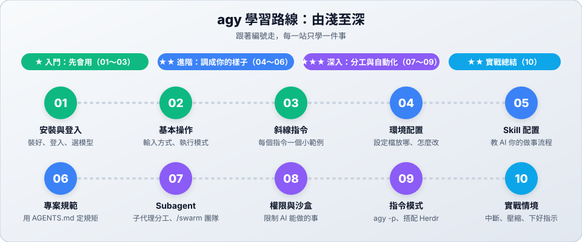

# Antigravity CLI (agy)：在終端機裡和 AI 代理協同開發

**Antigravity CLI (`agy`)** 是 Google Antigravity 的終端機 AI coding agent。它直接在終端機中執行，能讀懂專案、修改程式碼並執行指令。

- **說中文就能用**：用繁體中文說出需求，它會規劃任務、修改檔案並驗證成果。
- **斜線指令**：`/plan`、`/diff`、`/goal` 等快捷功能，一個指令完成常見操作。
- **可以調成你的樣子**：用設定檔、規則和 Skill，讓 AI 照你的方式做事。
- **多種模型可選**：支援 Gemini、Claude 等模型，可隨時切換。

---

## 學習路線

| 站 | 主題 | 難度 | 你會學到 |
| :---: | :--- | :---: | :--- |
| 01 | [安裝與登入](01-install.md) | ★ | 安裝 agy、登入帳號、查看與切換模型 |
| 02 | [基本操作](02-basics.md) | ★ | 啟動與離開、輸入方式、執行模式、快捷鍵 |
| 03 | [斜線指令](03-slash-commands.md) | ★ | 常用斜線指令，每個都有小範例 |
| 04 | [環境配置](04-config.md) | ★★ | 設定檔位置、常用設定、個人規則、MCP |
| 05 | [Skill 配置](05-skills.md) | ★★ | 建立、使用和管理自己的 Skill |
| 06 | [專案規範與規則](06-agents-md.md) | ★★ | 用 AGENTS.md 讓 AI 遵守專案規範 |
| 07 | [實戰情境](07-scenarios.md) | ★★ | 中斷任務、壓縮對話、Plan 模式、下好指示 |
| 08 | [Subagent 子代理](08-subagents.md) | ★★★ | 主代理與子代理如何分工 |
| 09 | [權限設定與沙盒](09-permissions.md) | ★★★ | 權限規則、終端機沙盒、工具授權 |
| 10 | [指令模式與 Herdr](10-cli-run.md) | ★★★ | `agy -p` 一行指令執行、搭配 Herdr 多工 |

> [!TIP]
> **時間不多？** 讀完 01～03 就能開始用；04～07 讓 AI 更符合你的需求；08～10 是進階的自動化與團隊工作流程。

---

## 📚 參考資料

| 文件 | 用途 |
| :--- | :--- |
| [維護指令與疑難排解](reference.md) | 常用 CLI 子指令、設定檔位置與常見問題排解 |
| [官方文件](https://antigravity.google/docs) | Google Antigravity 官方技術文件 |
| [官方 CLI Reference](https://antigravity.google/docs/cli/reference/) | 完整的斜線指令、設定項目與命令列參數 |
| [在 Herdr 中使用 agy](../herdr/README.md) | 搭配 Herdr 多工開發環境 |

← [回到專案首頁](../README.md)
