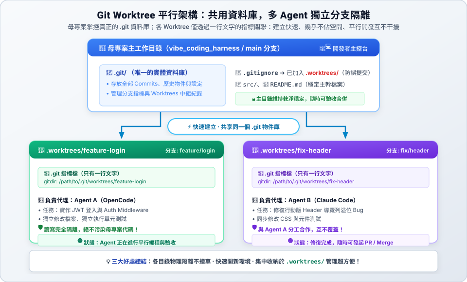

# 01　為什麼需要 Worktree

> ★ 入門　｜　[章節首頁](README.md)　｜　下一站：[02 目錄與原理 →](02-structure.md)

**這一站你會學到**：一般切換分支的限制，以及 worktree 怎麼解決多個 AI 同時開發的問題。

---

## 1. 一般的做法有什麼問題？

平常切換分支用 `git switch`（或 `git checkout`）。但**一個資料夾同一時間只能在一條分支上**。

想像你讓三個 AI 同時工作：

- AI A 開發登入功能
- AI B 修畫面上的 bug
- AI C 跑效能測試

如果它們都在同一個資料夾裡改檔案，就會互相覆蓋、互相干擾。

## 2. Worktree 的解法

| 問題 | 一般做法 | 用 Worktree |
| :--- | :--- | :--- |
| **多個 AI 同時改程式** | 同一個資料夾，檔案互相覆蓋 | 每個 AI 一個獨立資料夾，各做各的 |
| **想要多份程式碼** | 重複 `git clone`，又慢又佔空間 | 所有 worktree **共用同一個 `.git`**，建立快、幾乎不佔空間 |
| **主程式要保持穩定** | 切換分支時，改到一半的檔案很難處理 | 主資料夾一直停在 main，隨時可以去各 worktree 驗收 |

> 💡 比喻：一般的 Git 像「一張書桌，換作業就要把桌面清空」；worktree 像「同一本講義影印給每個人，各自在自己的桌子寫」，而且影印幾乎不用錢。

---

## ✅ 自我檢查

- [ ] 能說出「一個資料夾同時只能在一條分支」造成的問題
- [ ] 能說出 worktree 比重複 `git clone` 好在哪裡

> 下一站：[02 目錄與原理 →](02-structure.md)
