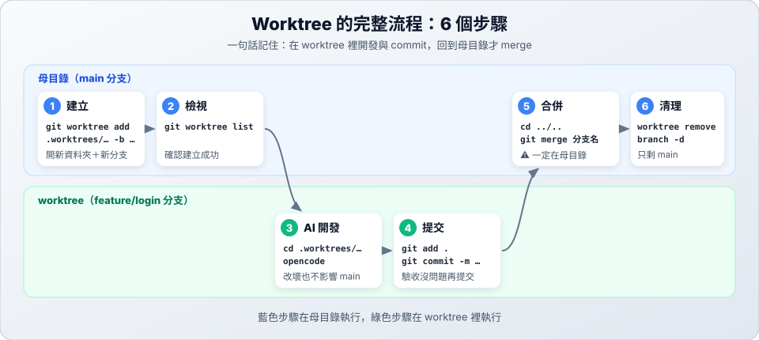

# 03　完整流程

> ★★ 進階　｜　[← 02 目錄與原理](02-structure.md)　｜　[章節首頁](README.md)　｜　下一站：[04 合併與衝突 →](04-merge-conflict.md)

**這一站你會學到**：worktree 從建立到清理的 6 個步驟，以及怎麼確認自己在哪個 worktree。

---



## 步驟 1：建立（在母目錄）

```bash
# 建立新分支 feature/login，並放在 .worktrees/feature-login
git worktree add .worktrees/feature-login -b feature/login
```

## 步驟 2：檢視（在母目錄）

```bash
git worktree list
```

```text
/path/to/my-project                          abc1234 [main]
/path/to/my-project/.worktrees/feature-login abc1234 [feature/login]
```

## 步驟 3：讓 AI 開發（在 worktree）

```bash
cd .worktrees/feature-login
opencode
```

AI 在這裡改的所有檔案、安裝的套件、跑的測試，都只影響 `feature/login` 分支，主專案完全不受影響。

## 步驟 4：驗收並提交（在 worktree）

```bash
git status          # 改了哪些檔案
git diff            # 改了什麼內容
uv run pytest       # 跑測試（依專案調整）

git add .
git commit -m "feat: 新增登入功能"
```

> 所有 worktree 共用同一個 `.git`，這裡的 commit 在母目錄**馬上看得到**，不需要 push / pull。

## 步驟 5：回到母目錄合併

```bash
cd ../..                       # 回到母目錄
git merge feature/login
```

詳細的合併步驟與衝突處理見 [04 合併與衝突](04-merge-conflict.md)。

## 步驟 6：清理（在母目錄）

```bash
git worktree remove .worktrees/feature-login   # 移除 worktree（有未 commit 的改動時會拒絕）
git branch -d feature/login                    # 刪除已合併的分支
git worktree list                              # 確認只剩母目錄
```

> [!WARNING]
> `git branch -d` 出現 `not fully merged` 時，代表這個分支還有 commit 沒合併。先回到步驟 5，**不要改用 `-D` 強制刪除**，否則那些 commit 會遺失。

---

## 💡 我現在在哪一個 worktree？

開了好幾個 worktree 後很容易搞混。執行指令前先確認：

```bash
git rev-parse --show-toplevel    # 目前所在資料夾的根目錄
git branch --show-current        # 目前的分支
git rev-parse --git-dir          # 判斷是母目錄還是 worktree
```

| `git rev-parse --git-dir` 的結果 | 代表 |
| :--- | :--- |
| `.git` | ✅ 母目錄（可以在這裡 merge） |
| 包含 `.git/worktrees/`，例如 `.../.git/worktrees/feature-login` | 🌿 worktree：`feature-login` |

> `git worktree list` 會列出所有 worktree，但**不會標示你在哪一個**。很多終端機提示字元（例如 Oh My Zsh、Starship）會顯示目前分支，看一眼就知道。

---

## ✅ 動手練習

在一個練習用的 Git 專案裡：

1. 確認 `.gitignore` 有 `.worktrees/`。
2. 建立 `.worktrees/practice`（分支 `practice`）。
3. 進入 worktree，新增一個檔案並 commit。
4. 回到母目錄，用 `git rev-parse --git-dir` 確認位置後合併。
5. 移除 worktree、刪除分支，`git worktree list` 只剩一行。

> 下一站：[04 合併與衝突 →](04-merge-conflict.md)
