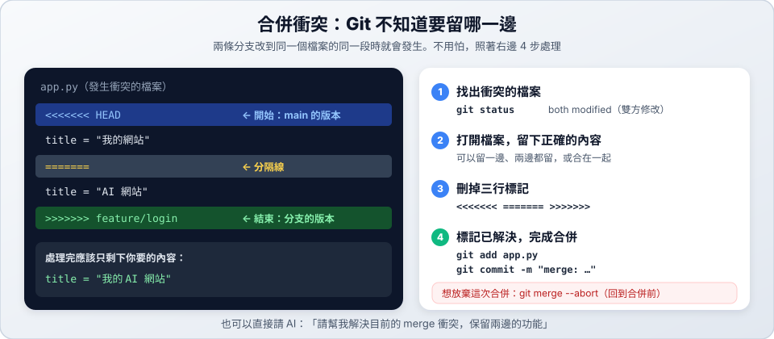

# 04　合併與衝突

> ★★ 進階　｜　[← 03 完整流程](03-lifecycle.md)　｜　[章節首頁](README.md)　｜　下一站：[05 實戰情境 →](05-scenarios.md)

**這一站你會學到**：為什麼要回母目錄合併、怎麼請 AI 安全地合併、遇到衝突怎麼處理，以及合併完才後悔怎麼辦。

---

## 1. 為什麼要回母目錄合併進 main？

`main` 分支已經被母目錄使用中，Git **不允許同一條分支同時在兩個地方使用**。所以在 worktree 裡切換到 main 會失敗：

```text
fatal: 'main' is already used by worktree at '/path/to/my-project'
致命錯誤: 「main」已被位於「/path/to/my-project」的工作區使用
```

👉 正確做法：回到母目錄的 AI，再請它合併。

> 反過來就可以：在 worktree 裡把 main 的最新內容合併**進來**是允許的，見[第 5 節](#5-先把-main-同步進-worktree)。

## 2. 請 AI 合併

對母目錄的 AI 說：

```text
請把 feature/login 合併進 main。合併前先確認我在母目錄的 main 上、沒有未提交的改動，並告訴我會多出哪些 commit，等我同意再合併。
```

## 3. 合併的兩種結果

| 結果 | 英文介面 | 中文介面 | 接下來 |
| :--- | :--- | :--- | :--- |
| ✅ 順利合併 | `Fast-forward`，或 `Merge made by the 'ort' strategy.` | 相同 | 完成，去清理 worktree |
| ⚠️ 發生衝突 | `CONFLICT (content): Merge conflict in 檔名` | `衝突（內容）：合併衝突於 檔名` | 照下面的步驟處理 |

---

## 4. 處理衝突

兩個 AI 改到同一個檔案的同一段時，先合併的會成功，後合併的就會衝突。這很常見，不用怕。

**最簡單的做法**，直接請 AI：

```text
請幫我解決目前的 merge 衝突，保留兩邊的功能。改完先讓我看結果，我確認後再完成合併。
```

想放棄這次合併：

```text
請放棄這次合併，回到合併前的狀態。
```

看 AI 改得對不對，或想自己處理時，可以對照這張圖：



1. **找出衝突的檔案**：`git status` 裡標示 `both modified`（中文介面：`雙方修改`）的就是。
2. **打開檔案**，在 `<<<<<<<` 和 `>>>>>>>` 之間決定要留哪些內容。
3. **刪掉三行標記**：`<<<<<<<`、`=======`、`>>>>>>>`。
4. **標記已解決並完成合併**（指令見最下方的進階段落）。

---

## 5. 先把 main 同步進 worktree

如果 main 已經前進了，可以先在 worktree 裡處理衝突，測試通過再合併回 main。這樣母目錄的 main 全程保持乾淨。

對 **worktree 裡的 AI** 說：

```text
請把最新的 main 合併進這個分支。如果有衝突請解決，保留兩邊的功能，然後跑測試確認沒問題。
```

接著回到母目錄合併時，就不會再有同樣的衝突。

---

## 6. 合併完才發現不對

對母目錄的 AI 說：

```text
我想復原剛才那次合併。請先告訴我這次合併有沒有 push 過，再用適合的方式復原，復原前讓我確認。
```

| 情況 | 做法 | 結果 |
| :--- | :--- | :--- |
| **還沒 push** | 把 main 退回合併前 | 就像沒合併過，分支還在，修好後可以再合併 |
| **已經 push** | 用一個新的 commit 抵銷這次合併 | 歷史會多一筆「Revert」紀錄，別人不受影響 |

> [!WARNING]
> **已經抵銷（revert）過的合併，不能直接再合併一次。** Git 會顯示 `Already up to date`（已經是最新的），改動不會回來。要先請 AI 處理：「我之前 revert 過這次合併，現在要重新把它合併回來。」

---

## ✅ 自我檢查

- [ ] 知道為什麼在 worktree 裡不能切換到 main
- [ ] 能看懂 `<<<<<<<`、`=======`、`>>>>>>>` 各代表什麼
- [ ] 能分辨「放棄合併」（合併途中）和「復原合併」（已經合併完）

---

## 進階（選修）：自己打指令

**合併：**

```bash
cd ../..                              # 1. 回到母目錄（要在 worktree 的最上層執行）
git branch --show-current             # 2. 應該顯示 main
git status                            # 3. 應該沒有未提交的改動
git pull                              # 4. （有遠端時）先更新 main
git log main..feature/login --oneline # 5. 預覽分支比 main 多了哪些 commit
git merge feature/login               # 6. 合併
git push                              # 7. （有遠端時）推送
```

> [!NOTE]
> **`git merge` 之後跳出編輯器？這不是當機。** main 和分支各有新 commit 時，Git 會請你確認合併訊息，直接存檔離開就好：
> - **nano**（畫面下方有 `^X Exit`）：按 `Ctrl+X`
> - **Vim**：輸入 `:wq`，按 `Enter`
>
> 不想看到編輯器：`git merge --no-edit feature/login`。

**解決衝突：**

```bash
git add 檔名
git commit -m "merge: 合併 feature/login"

git merge --abort                     # 想放棄這次合併時，回到合併前
```

**把 main 同步進 worktree（在 worktree 裡執行）：**

```bash
git merge main
```

**復原已完成的合併（在母目錄）：**

```bash
# 還沒 push：退回合併前。要在合併後馬上執行，中間不要做其他合併或 reset
git reset --merge ORIG_HEAD

# 已經 push：新增一個抵銷的 commit
git revert -m 1 HEAD
git push
```

> `-m 1` 用在有產生合併 commit 的情況。如果當時是 `Fast-forward`，就沒有合併 commit，請 AI 找出要抵銷的 commit 再處理。

> 下一站：[05 實戰情境 →](05-scenarios.md)
