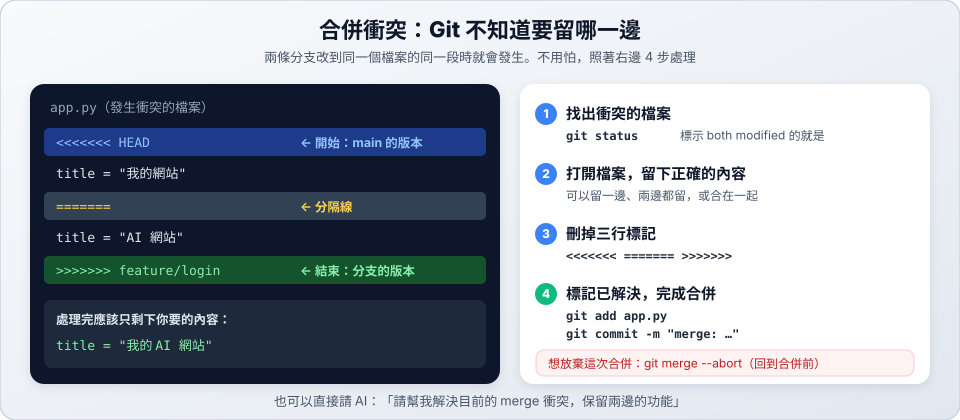

# 04　合併與衝突

> ★★ 進階　｜　[← 03 完整流程](03-lifecycle.md)　｜　[章節首頁](README.md)　｜　下一站：[05 實戰情境 →](05-scenarios.md)

**這一站你會學到**：為什麼一定要在母目錄合併、合併前要確認什麼，以及遇到衝突怎麼處理。

---

## 1. 為什麼一定要回母目錄合併？

`main` 分支已經被母目錄使用中，Git **不允許同一條分支同時在兩個地方使用**。所以在 worktree 裡切換到 main 會失敗：

```text
fatal: 'main' is already used by worktree at '/path/to/my-project'
```

（中文介面會顯示：「致命錯誤：『main』已被位於『…』的工作區使用」）

👉 正確做法：`cd` 回母目錄再合併。

## 2. 合併前的確認清單

```bash
cd ../..                              # 1. 回到母目錄
git branch --show-current             # 2. 應該顯示 main
git status                            # 3. 應該顯示 nothing to commit（沒有未提交的改動）
git pull                              # 4. （有遠端時）先更新 main
git log main..feature/login --oneline # 5. 預覽分支比 main 多了哪些 commit
git merge feature/login               # 6. 合併
git push                              # 7. （有遠端時）推送
```

## 3. 合併的兩種結果

| 結果 | 畫面上會看到 | 接下來 |
| :--- | :--- | :--- |
| ✅ 順利合併 | `Fast-forward`，或 `Merge made by the 'ort' strategy.` | 完成，去清理 worktree |
| ⚠️ 發生衝突 | `CONFLICT (content): Merge conflict in 檔名` | 照下面的步驟處理 |

---

## 4. 處理衝突



1. **找出衝突的檔案**：`git status`，標示 `both modified` 的就是。
2. **打開檔案**，在 `<<<<<<<` 和 `>>>>>>>` 之間決定要留哪些內容。
3. **刪掉三行標記**：`<<<<<<<`、`=======`、`>>>>>>>`。
4. **標記已解決並完成合併**：

```bash
git add 檔名
git commit -m "merge: 合併 feature/login"
```

想放棄這次合併，回到合併前：

```bash
git merge --abort
```

> 💡 也可以直接請 AI：「請幫我解決目前的 merge 衝突，保留兩邊的功能」。處理完記得自己看一下 `git diff` 確認。

---

## ✅ 自我檢查

- [ ] 知道為什麼在 worktree 裡不能切換到 main
- [ ] 能看懂 `<<<<<<<`、`=======`、`>>>>>>>` 各代表什麼
- [ ] 知道 `git merge --abort` 的用途

> 下一站：[05 實戰情境 →](05-scenarios.md)
