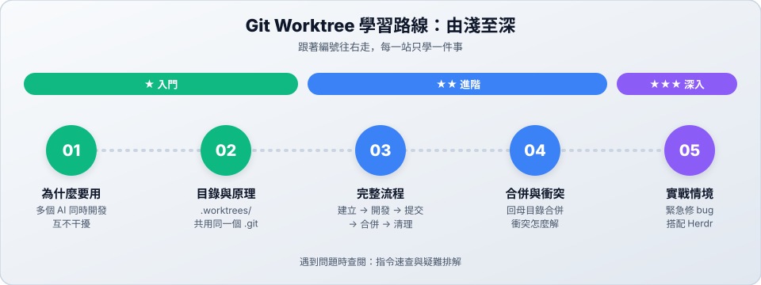

# Git 與 Worktree：讓多個 AI 同時開發、互不干擾

**Git** 是 AI 開發時的「安全網與時光機」：AI 改壞了，隨時能回到之前的版本。

**Git Worktree** 讓同一個專案同時擁有好幾個獨立的工作資料夾，每個資料夾各自在不同的分支上。這樣多個 AI 就能同時開發不同功能，誰也不會改到誰的檔案。

---

## 學習路線

| 站 | 主題 | 難度 | 你會學到 |
| :---: | :--- | :---: | :--- |
| 01 | [為什麼需要 Worktree](01-why-worktree.md) | ★ | 多個 AI 同時開發時會遇到的問題 |
| 02 | [目錄與原理](02-structure.md) | ★ | `.worktrees/` 放哪裡、為什麼不佔空間 |
| 03 | [完整流程](03-lifecycle.md) | ★★ | 建立 → 開發 → 提交 → 合併 → 清理 |
| 04 | [合併與衝突](04-merge-conflict.md) | ★★ | 回母目錄合併、看懂並解決衝突 |
| 05 | [實戰情境](05-scenarios.md) | ★★★ | 緊急修 bug、救回刪錯的 worktree、搭配 Herdr |

> [!TIP]
> **一句話記住**：在 worktree 裡開發與 commit，回到母目錄才 merge。

---

## 📚 參考資料

| 文件 | 用途 |
| :--- | :--- |
| [指令速查與疑難排解](reference.md) | 所有 worktree 指令、常見錯誤訊息 |
| [官方文件：git-worktree](https://git-scm.com/docs/git-worktree) | Git 官方說明 |

← [回到專案首頁](../README.md)
