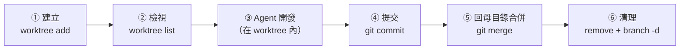

# Git 與 Worktree：AI Agent 平行開發指南

Git 是 AI 開發工作流程中不可或缺的「安全復原網與時間機器」。搭配 `git worktree`，同一個 Git 儲存庫可以同時擁有多個獨立的工作目錄，各自切換分支，徹底解放多 Agent 平行開發的潛力。

---

## 導覽目錄

1. [為什麼 AI Coding 需要 Worktree？（三大核心價值）](#1-為什麼-ai-coding-需要-worktree三大核心價值)
2. [目錄設計與原理解析：為什麼放在專案內的 .worktrees/？](#2-目錄設計與原理解析為什麼放在專案內的-worktrees)
3. [完整操作指令與生命週期（端到端實踐）](#3-完整操作指令與生命週期端到端實踐)
4. [實戰情境與解決方案（新手常見盲點）](#4-實戰情境與解決方案新手常見盲點)
5. [常用指令速查與疑難排解](#5-常用指令速查與疑難排解)

---

## 1. 為什麼 AI Coding 需要 Worktree？（三大核心價值）

在傳統開發中，切換分支需要使用 `git checkout`，同一個目錄在同一時間只能停留在一條分支上。

當搭配 AI Coding Agent 時，我們常常需要讓多個 Agent 同時處理不同任務（例如 Agent A 開發登入功能、Agent B 修復 Header Bug、Agent C 跑效能測試）。這時 `git worktree` 便是最佳武器：

| 核心價值 | 傳統單一目錄痛點 | Worktree 平行架構優勢 |
| :--- | :--- | :--- |
| **多 Agent 絕對隔離** | 多個 Agent 在同個目錄修改程式碼，容易引發檔案覆蓋、中途髒污或衝突 | 每個 Agent 擁有專屬的獨立工作目錄，各做各的、互不干擾 |
| **超高速建立與省硬碟** | 重複 `git clone` 耗時且數百 MB 的歷史紀錄被重複複製多次 | 所有 Worktree **共用母專案同一個 `.git` 資料庫**，毫秒級建立且幾乎零額外空間 |
| **主幹穩定與即時審查** | 切換分支測試時，未完成的改動會被 stash 搞得混亂不堪 | 主專案目錄維持穩定主幹，可隨時開窗切換到各 Worktree 驗收成果 |

---

## 2. 目錄設計與原理解析：為什麼放在專案內的 .worktrees/？

很多開發者會好奇：Worktree 應該建在專案內還是專案外？為什麼手冊推薦放在專案內的 `.worktrees/`？

### 2.1 專案內 vs. 專案外 方案對照

| 評比維度 | 專案內集中管理：`.worktrees/`（推薦 ⭐） | 專案外平級目錄：`../project-worktrees/` |
| :--- | :--- | :--- |
| **目錄整潔度** | **高**。所有分支工作區集中在專案內部的隱藏目錄，自成一格（Self-contained） | **低**。在電腦上一層目錄散落一堆平級資料夾，專案多了難以辨識管理 |
| **工具感知 (Herdr / IDE)** | **極佳**。Herdr 能透過相對路徑直接識別血緣，自動群組聚合在同一個專案樹下 | **稍弱**。不同目錄需要手動個別定位，無法自動關聯母專案 |
| **目錄隱蔽性** | 加點開頭（`.`）為隱藏資料夾，日常終端 `ls` 或檔案總管不干擾雜亂 | 需另開資料夾存放 |
| **關鍵前提條件** | **必須在 `.gitignore` 加上 `.worktrees/`**，避免子目錄被 Git 誤追蹤 | 不需要特別加 gitignore |

### 2.2 建議目錄結構

```text
vibe_coding_harness/              # 主專案目錄（母體）
├── .git/                         # 真正的 Git 物件資料庫（所有歷史與分支都在這）
├── .gitignore                    # 規範忽略 .worktrees/（必備！）
├── src/                          # 程式碼
└── .worktrees/                   # 集中存放所有 Agent 分支工作區的收納箱
    ├── feature-login/            # 專供 Agent A 開發登入功能的獨立工作目錄
    └── fix-header/               # 專供 Agent B 修復 Header 的獨立工作目錄
```

### 2.3 架構視覺化：共用資料庫與指標關係


### 2.4 底層原理揭秘：為什麼不會重複佔用空間？

當你在專案內執行 `git worktree add .worktrees/feature-login` 時，Git **並沒有**重新複製整份倉庫！

* **母專案根目錄**：擁有完整的 `.git/` 資料夾（存放所有提交、歷史物件與設定）。
* **`.worktrees/feature-login/` 目錄**：裡面**只有一個極小的 `.git` 檔案**（只有十幾 Bytes，不是資料夾！），裡面只記錄了一行指向母體的路徑指標：
  ```text
  gitdir: /path/to/vibe_coding_harness/.git/worktrees/feature-login
  ```

這意味著不管你開了 3 個還是 10 個 Worktree，它們全都是向母專案借用物件資料庫，建立只需要 **0.1 秒**，而且完全不耗費重複的硬碟空間！

> [!IMPORTANT]
> **必備前置設定**：請務必確認專案根目錄的 `.gitignore` 已加入：
> ```gitignore
> .worktrees/
> ```
> 這樣主目錄的 `git status` 就不會把 `.worktrees/` 當作待提交檔案。

---

## 3. 完整操作指令與生命週期（端到端實踐）

Worktree 的標準生命週期包含：**建立 → 檢視 → 賦予 Agent → 提交 → 回母目錄合併 → 清理**。

```text
① 建立 ➜ ② 檢視 ➜ ③ Agent 開發 ➜ ④ 提交 ➜ ⑤ 回母目錄合併 ➜ ⑥ 清理
```



> [!TIP]
> **一句話記住**：「**在 worktree 裡開發與 commit，回到母目錄才 merge**」。

### 步驟 1：建立存放目錄與分支工作區
```bash
# 建立新分支 feature/login，並將其掛載到 .worktrees/feature-login
# （.worktrees/ 目錄不存在時，Git 會自動建立）
git worktree add .worktrees/feature-login -b feature/login
```

### 步驟 2：檢視所有活躍中的 Worktree
```bash
git worktree list
```
輸出範例：
```text
/path/to/vibe_coding_harness                     abc1234 [main]
/path/to/vibe_coding_harness/.worktrees/feature-login   def5678 [feature/login]
```

### 步驟 3：進入 Worktree 啟動 AI Agent
```bash
cd .worktrees/feature-login

# 啟動 OpenCode 或其他 Agent 開始編程
opencode
```
> 此時 Agent 的所有檔案讀寫、安裝依賴（`uv add`）、終端測試，完全隔離在該目錄與 `feature/login` 分支上，主專案的代碼絲毫不受影響！

### 步驟 4：在 Worktree 內驗收並提交（Commit）
Agent 完成任務後，先在 **worktree 目錄內** 確認改動並提交：

```bash
# 目前位置：.worktrees/feature-login

# 1. 查看改了哪些檔案
git status
git diff

# 2. 執行測試，確認功能正常（依專案調整）
uv run pytest

# 3. 提交到 feature/login 分支
git add .
git commit -m "feat: 新增登入功能"
```

> [!NOTE]
> 因為所有 worktree **共用同一個 `.git` 資料庫**，這裡的 commit 在母目錄會**立即看得到**，不需要 `push` / `pull`。

### 步驟 5：回到母目錄，合併（Merge）回 main ⭐
合併一定要在 **母目錄** 執行，因為 `main` 分支已經被母目錄簽出（checkout），在 worktree 裡無法切換到 `main`。

```bash
# 1. 回到母目錄（從 .worktrees/feature-login 往上兩層）
cd ../..

# 2. 確認目前在 main 分支，且工作目錄是乾淨的
git branch --show-current     # 應顯示 main
git status                    # 應顯示 nothing to commit

# 3. （有遠端時）先把 main 更新到最新
git pull

# 4. 先預覽 feature/login 比 main 多了哪些 commit
git log main..feature/login --oneline

# 5. 合併分支
git merge feature/login

# 6. （有遠端時）推送到 GitHub
git push
```

**合併結果有兩種情況：**

| 結果 | 終端機訊息 | 該怎麼做 |
| :--- | :--- | :--- |
| ✅ **順利合併** | `Fast-forward` 或 `Merge made by the 'ort' strategy.` | 完成！直接進入步驟 6 |
| ⚠️ **發生衝突** | `CONFLICT (content): Merge conflict in <檔案>` | 依照下方「衝突處理」解決 |

<details>
<summary><b>⚠️ 遇到合併衝突（Conflict）怎麼辦？點我展開</b></summary>

衝突代表 `main` 與 `feature/login` **改到了同一個檔案的同一段**，Git 不知道要保留哪個版本。

1. 查看哪些檔案衝突：
   ```bash
   git status    # 標示為 both modified 的就是衝突檔案
   ```
2. 打開衝突檔案，會看到這樣的標記：
   ```text
   <<<<<<< HEAD
   main 分支的內容
   =======
   feature/login 分支的內容
   >>>>>>> feature/login
   ```
3. 手動保留正確內容，並**刪除 `<<<<<<<`、`=======`、`>>>>>>>` 三行標記**。
   （也可以直接請 AI Agent：「請幫我解決目前的 merge 衝突，保留兩邊的功能」）
4. 標記為已解決並完成合併：
   ```bash
   git add <衝突檔案>
   git commit -m "merge: 合併 feature/login"
   ```
5. 想放棄這次合併、回到合併前的狀態：
   ```bash
   git merge --abort
   ```

</details>

### 步驟 6：清理 Worktree 與分支
合併完成後，這個工作區與分支就功成身退了：

```bash
# 1. 安全移除該 worktree（若裡面還有未 commit 的改動，Git 會拒絕並提醒你）
git worktree remove .worktrees/feature-login

# 2. 刪除已合併的本地分支（-d 只會刪除「已合併」的分支，很安全）
git branch -d feature/login

# 3. （選用）整理已過期的中繼紀錄
git worktree prune

# 4. 確認清理完成，應只剩母目錄
git worktree list
```

> [!WARNING]
> 若 `git branch -d` 出現 `not fully merged` 錯誤，代表這個分支**還有 commit 沒合併進 main**。請先回到步驟 5 確認，**不要直接改用 `-D` 強制刪除**，否則那些 commit 會遺失。

---

## 4. 實戰情境與解決方案（新手常見盲點）

#### 情境一：主功能改到一半，突然要緊急開另一個 Hotfix 分支
* **痛點**：以往需要 `git stash` 暫存一堆未完成的檔案，修完 bug 回來 `stash pop` 常常遇到衝突。
* **解決方案**：
  直接開一個新 Worktree：
  ```bash
  git worktree add .worktrees/hotfix-auth -b hotfix/auth-crash
  ```
  原本的開發目錄檔案完全不動，直接切換到 `.worktrees/hotfix-auth` 讓 Agent 迅速修復並提交，優雅無痛。

#### 情境二：不小心手動用 `rm -rf` 刪除了 Worktree 資料夾
* **痛點**：手動刪除資料夾後，執行 `git worktree list` 依然看到該項目，或出現警告。
* **解決方案**：
  不要慌張！執行清理指令：
  ```bash
  git worktree prune
  ```
  Git 會自動檢查所有註冊的 Worktree，自動清除磁碟上已不存在的無效指標。

#### 情境三：Agent 剛 Commit 完才發現漏加檔案（善用 Amend）
* **痛點**：Agent 建立了 commit，但測試檔案忘了加入，產生多餘的修正 commit。
* **解決方案**：
  直接請 Agent：
  ```text
  剛才的 commit 漏掉了 tests/test_login.py，請將它加入後，使用 git commit --amend 合併進前一個 commit。
  ```
  這能讓該分支維持簡潔高質量的 Git Commit 歷史。

#### 情境四：搭配 Herdr 實現「多分支多 Agent 視覺化並行」
* **最佳協同模式**：
  1. 在 Herdr 的 Tab 1 開啟主目錄維護主幹代碼。
  2. 在 Tab 2 進入 `.worktrees/feature-login` 啟動 OpenCode 寫功能。
  3. 在 Tab 3 進入 `.worktrees/feature-pay` 啟動 Claude 寫支付模組。
  利用 Herdr 的分頁標籤與即時狀態圖示（🟡 working / 🟢 done），一人同時指揮多個 Agent 平行作戰！

---

## 5. 常用指令速查與疑難排解

### 指令速查表

| 操作需求 | Git 指令語法 | 說明 |
| :--- | :--- | :--- |
| **建立並開新分支** | `git worktree add <路徑> -b <分支名稱>` | 最常用！同時建立獨立目錄與新分支 |
| **掛載既有分支** | `git worktree add <路徑> <現有分支>` | 將遠端已有的分支拉到本地獨立目錄處理 |
| **列出所有工作區** | `git worktree list` | 查看當前所有的 worktree 路徑與分支狀態 |
| **安全移除工作區** | `git worktree remove <路徑>` | 刪除工作目錄並註銷 Git 內部指標（需先 commit） |
| **清理無效參照** | `git worktree prune` | 清除被手動刪除或過期的 worktree 中繼狀態 |
| **預覽待合併 commit** | `git log main..<分支名稱> --oneline` | 合併前先看分支比 main 多了哪些 commit |
| **合併回主幹** | `git merge <分支名稱>` | ⚠️ 必須在**母目錄**（main 分支）執行 |
| **放棄合併** | `git merge --abort` | 衝突解不開時，回到合併前的狀態 |
| **刪除已合併分支** | `git branch -d <分支名稱>` | 只刪除已合併的分支，安全不遺失 commit |

### 常見問題排解 (Troubleshooting)

1. **fatal: '...' is already checked out at '...'**：
   - Git 規定**同一條分支不能同時被兩個 Worktree 簽出（checkout）**。請為新 Worktree 建立新分支（使用 `-b <新分支名>`），或在原目錄切換至其他分支。
   - 最常見的情況是：在 worktree 裡執行 `git checkout main` 想合併。正確做法是 `cd` 回**母目錄**再執行 `git merge`（見步驟 5）。
2. **主目錄 `git status` 出現 `.worktrees/`，或不小心把它提交進 Git 了**：
   - **原因**：根目錄的 `.gitignore` 沒有忽略 `.worktrees/`，Git 把它當成一般資料夾追蹤。
   - **尚未提交**：在 `.gitignore` 加入 `.worktrees/` 即可，`git status` 就不會再顯示。
   - **已經提交**：除了加入 `.gitignore`，還要執行下列指令把它從 Git 追蹤中移除（不會刪除磁碟上的檔案）：
     ```bash
     git rm -r --cached .worktrees/
     git commit -m "chore: 停止追蹤 .worktrees/"
     ```
