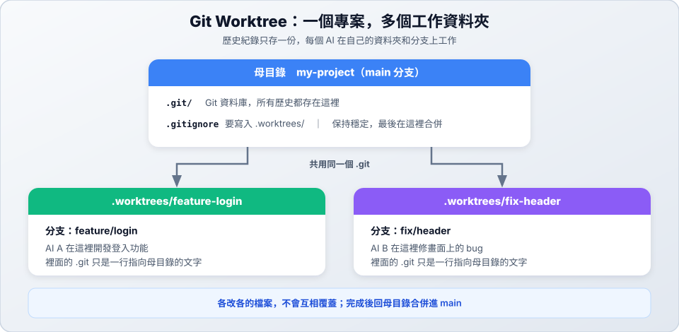
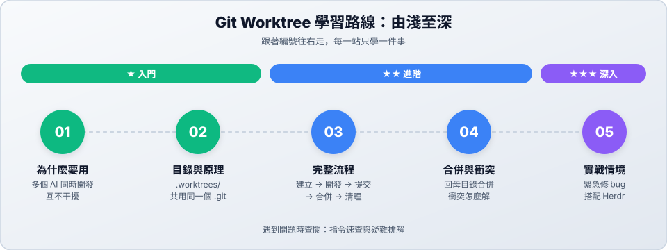

# Git Worktree：讓多個 AI 同時開發、互不干擾

**Git Worktree** 讓同一個專案同時擁有好幾個獨立的工作資料夾，每個資料夾各自在不同的分支上。這樣多個 AI 就能同時開發不同功能，不會改到彼此的檔案。

> [!NOTE]
> **這一章專門教 Worktree。** 還不熟 commit、分支和合併的話，請先看 [Git 學習筆記](https://github.com/roberthsu2003/git)的[環境設定](https://github.com/roberthsu2003/git/tree/main/環境安裝與設定)、[第 01 章](https://github.com/roberthsu2003/git/tree/main/開始使用Git)和[第 03 章 分支與合併](https://github.com/roberthsu2003/git/tree/main/分支)。想把改壞的檔案救回來，看[第 09 章 還原檔案](https://github.com/roberthsu2003/git/tree/main/回復被刪除的檔案或被編輯的內容)。

---

## 學習路線

| 站 | 主題 | 難度 | 你會學到 |
| :---: | :--- | :---: | :--- |
| 01 | [為什麼需要 Worktree](01-why-worktree.md) | ★ | 多個 AI 同時開發時會遇到的問題 |
| 02 | [目錄與原理](02-structure.md) | ★ | `.worktrees/` 放哪裡、什麼隔離了、什麼還是共用 |
| 03 | [完整流程](03-lifecycle.md) | ★★ | 建立 → 開發 → 提交 → 合併 → 清理 |
| 04 | [合併與衝突](04-merge-conflict.md) | ★★ | 回母目錄合併、解決衝突、合併後反悔 |
| 05 | [實戰情境](05-scenarios.md) | ★★★ | 緊急修 bug、處理誤刪的 worktree、搭配 Herdr |

> [!TIP]
> **一句話記住**：在 worktree 裡開發與 commit，回到母目錄才合併進 main。

> **不用背指令。** 每一站都會告訴你怎麼用一句話請 AI 做。想自己打指令的話，看每站最後的「進階（選修）」。

---

## 📚 參考資料

| 文件 | 用途 |
| :--- | :--- |
| [指令速查與疑難排解](reference.md) | 所有 worktree 指令、常見錯誤訊息（中英對照） |
| [Git 學習筆記](https://github.com/roberthsu2003/git) | 從第一筆 commit 開始的 Git 基礎教材 |
| [官方文件：git-worktree](https://git-scm.com/docs/git-worktree) | Git 官方說明 |

← [回到專案首頁](../README.md)
