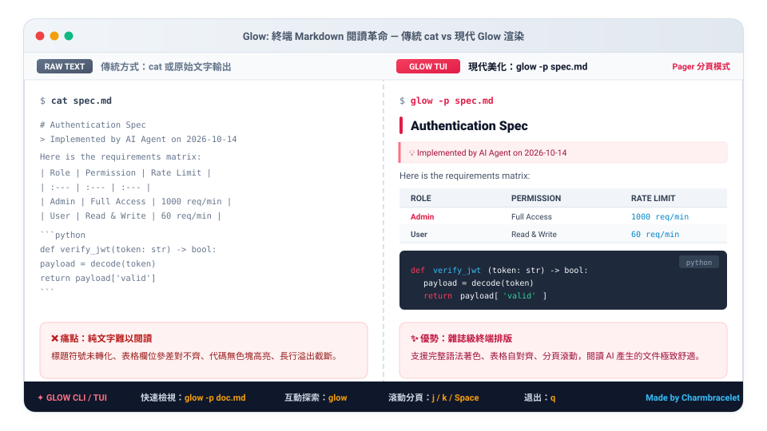

# Glow：在終端機裡舒服地讀 Markdown

**Glow** 會把 Markdown 文件排好版顯示在終端機裡：標題有顏色、表格對齊、程式碼有語法顏色。AI 寫出來的規格書、README、筆記，不用打開編輯器就能直接讀。

---

## 學習路線

| 站 | 主題 | 難度 | 你會學到 |
| :---: | :--- | :---: | :--- |
| 01 | [安裝與第一次使用](01-install.md) | ★ | 裝好 Glow、讀第一份文件 |
| 02 | [四種閱讀方式](02-reading.md) | ★ | 分頁閱讀、直接印出、瀏覽專案、讀網址 |
| 03 | [搭配 AI 與 Herdr](03-ai-workflow.md) | ★★ | 檢閱 AI 產出的文件、和 AI 並排工作 |
| 04 | [設定與主題](04-config.md) | ★★★ | 預設開啟分頁、固定行寬、換配色 |

> [!TIP]
> **只想馬上用？** 記住一行就夠了：`glow -p 檔名.md`，讀完按 `q`。

---

## 📚 參考資料

| 文件 | 用途 |
| :--- | :--- |
| [參數速查與疑難排解](reference.md) | 所有常用參數、按鍵、常見問題 |
| [官方 GitHub](https://github.com/charmbracelet/glow) | Glow 官方專案 |

← [回到專案首頁](../README.md)
