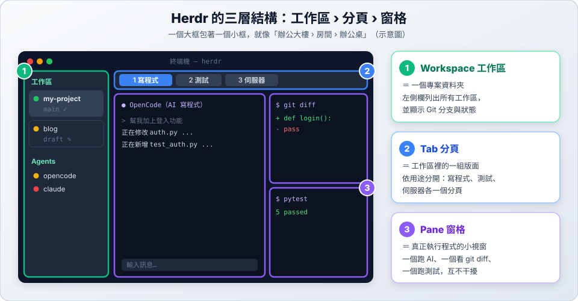
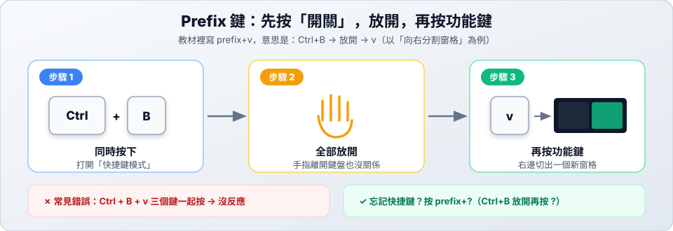
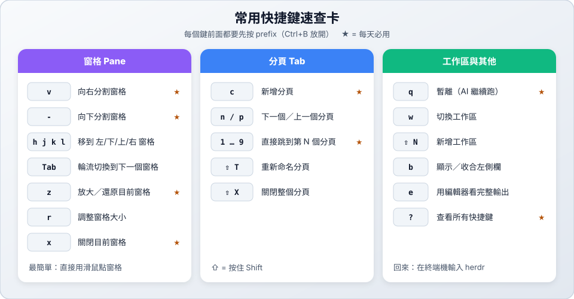

# 02　基本操作

> ★ 入門　｜　[← 01 安裝](01-install.md)　｜　[章節首頁](README.md)　｜　下一站：[03 AI 狀態燈號 →](03-agents.md)

**這一站你會學到**：Herdr 畫面的三層結構，以及最常用的快捷鍵。

---

## 1. 三層結構：工作區 › 分頁 › 窗格

記住一句話：**一個工作區有好幾個分頁，一個分頁有好幾個窗格**。

| 層級 | 比喻 | 實際用途 |
| :--- | :--- | :--- |
| **Workspace 工作區** | 辦公大樓 | 一個專案資料夾 |
| **Tab 分頁** | 大樓裡的房間 | 依用途分開：寫程式、測試、伺服器 |
| **Pane 窗格** | 房間裡的辦公桌 | 真正跑程式的地方：AI、git、測試 |

> [!TIP]
> **滑鼠完全可用**：點窗格可以切換、點分頁可以換頁、拖曳分隔線可以調整大小。

---

## 2. Prefix 鍵：所有快捷鍵的開關

Herdr 的快捷鍵都要**先按 `Ctrl+B`，放開，再按功能鍵**。本教材把它寫成 `prefix+某鍵`，例如 `prefix+v`。

---

## 3. 常用快捷鍵

剛開始只要記住 ★ 的幾個：

| 想做的事 | 快捷鍵 |
| :--- | :--- |
| 向右切一個窗格 | `prefix+v` |
| 向下切一個窗格 | `prefix+-` |
| 放大／還原目前窗格 | `prefix+z` |
| 關閉目前窗格 | `prefix+x` |
| 新增分頁 | `prefix+c` |
| 跳到第 N 個分頁 | `prefix+1` ～ `prefix+9` |
| 暫離（程式繼續跑） | `prefix+q` |
| 忘記快捷鍵時 | `prefix+?` |

> 快捷鍵可以自訂。執行 `herdr --default-config` 可以看到所有預設鍵位；想恢復預設，執行 `herdr config reset-keys`。

---

## ✅ 動手練習

在 Herdr 裡依序做一次：

1. `prefix+v` 向右切一個窗格。
2. `prefix+-` 在右邊再往下切一個。
3. 用滑鼠點左邊的窗格，再用 `prefix+l` 移到右邊。
4. `prefix+z` 放大右上的窗格，再按一次還原。
5. `prefix+c` 新增一個分頁，再用 `prefix+1` 回到第一個分頁。
6. `prefix+x` 把多出來的窗格都關掉。

> 下一站：[03 AI 狀態燈號 →](03-agents.md)
