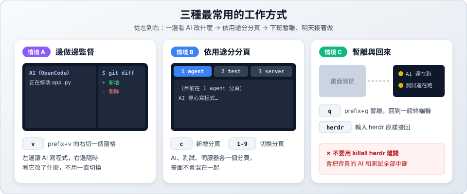

# 04　實戰情境

> ★★ 進階　｜　[← 03 AI 狀態燈號](03-agents.md)　｜　[章節首頁](README.md)　｜　下一站：[05 底層原理 →](05-architecture.md)

**這一站你會學到**：三種最常用的版面配置，以及重開機後怎麼找回工作。

---

## 情境 A：邊做邊監督

**問題**：AI 在背景改了很多檔案，不知道它有沒有改錯。

**做法**：

1. 在窗格啟動 AI（例如 `opencode`）。
2. `prefix+v` 向右切一個窗格。
3. 在右邊執行 `git diff` 或 `git status --short`，隨時查看 AI 改了什麼。

---

## 情境 B：依用途分分頁

**問題**：AI、測試結果、伺服器訊息全混在一起，看不清楚。

**做法**：每種用途一個分頁。

| 分頁 | 用途 | 建立方式 |
| :--- | :--- | :--- |
| 1 agent | AI 寫程式 | 預設的第一個分頁 |
| 2 test | 持續跑測試 | `prefix+c` 新增，`prefix+⇧T` 改名 |
| 3 server | 跑網站或 API 伺服器 | `prefix+c` 新增，`prefix+⇧T` 改名 |

用 `prefix+1`、`prefix+2`、`prefix+3` 瞬間切換。

---

## 情境 C：暫離與回來

**問題**：要下班或關掉終端機，但 AI 還在跑長任務。

**做法**：按 `prefix+q` 暫離。畫面回到一般終端機，但 AI 和測試**繼續在背景跑**。想回來時輸入 `herdr`，畫面原樣接回。

| 想做的事 | 正確做法 |
| :--- | :--- |
| 暫時離開，任務繼續跑 | `prefix+q` |
| 關掉一個窗格 | `prefix+x`，或在窗格輸入 `exit` |
| 完全結束 Herdr，釋放資源 | `herdr server stop` |

> [!WARNING]
> **不要用 `killall herdr` 離開！** 它會強制中斷背景的 Herdr，所有 AI 和測試都會被迫停止。

---

## 情境 D：電腦重開機後找回進度

Herdr 會保存工作區、分頁、窗格的配置。重開機後進入專案執行 `herdr`，會依保存的狀態重建版面。

要注意的是：**窗格裡原本跑的程式不會自動恢復執行**（例如測試、伺服器要重新啟動）。有安裝官方整合的 AI，可以恢復到原本的對話；沒有的話，在 AI 裡用它自己的指令找回對話（例如 OpenCode 的 `/sessions`）。

---

## ✅ 自我檢查

- [ ] 能做出情境 A 的左右雙窗格版面
- [ ] 能建立三個分頁並改名
- [ ] 知道「暫離」和「完全結束」的差別

> 下一站：[05 底層原理 →](05-architecture.md)
