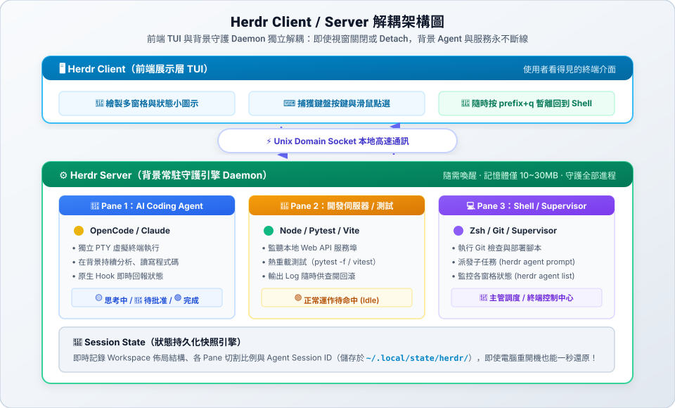

# Herdr 終端多工操作指南

## 導覽目錄

1. [安裝與確認版本](#1-安裝與確認版本)
2. [核心架構與概念（Client-Server、Workspace、Tab 與 Pane）](#2-核心架構與概念client-serverworkspace-tab-與-pane)
3. [啟動與日常鍵盤操作速查](#3-啟動與日常鍵盤操作速查)
4. [整合 AI Coding Agent（狀態辨識與連動）](#4-整合-ai-coding-agent狀態辨識與連動)
5. [Supervisor 與 SubAgent 終端協同架構](#5-supervisor-與-subagent-終端協同架構)
6. [實戰情境與解決方案（新手常見盲點）](#6-實戰情境與解決方案新手常見盲點)
7. [非互動 CLI 與背景工作階段管理](#7-非互動-cli-與背景工作階段管理)
8. [常用維護指令與疑難排解](#8-常用維護指令與疑難排解)

---


## 1. 安裝與確認版本

請依作業系統選擇對應方式安裝：

### macOS (Homebrew 推薦)
```bash
brew install herdr
```

### macOS / Linux 官方安裝腳本
```bash
curl -fsSL https://herdr.dev/install.sh | sh
```

### Windows (PowerShell)
```powershell
powershell -ExecutionPolicy Bypass -c "irm https://herdr.dev/install.ps1 | iex"
```

安裝完成後，在 shell 檢查版本確認成功：
```bash
herdr --version
herdr --help
```

---

## 2. 核心架構與概念（Client-Server、Workspace、Tab 與 Pane）

### 為什麼被稱為「herdr server」？什麼叫「解耦架構」？

很多初學者第一次看到「Client / Server 解耦架構」會覺得像天書，其實它的概念非常生活化：

#### 1. 什麼是「解耦（Decoupling）」？
* **傳統終端機是「強耦合（綁死在一起）」**：  
  平時你直接在終端機開一個視窗跑 OpenCode 或測試腳本，**「視窗畫面」與「執行的程式」是死死綁在同一個處理序上的**。只要你不小心把視窗按叉叉關掉、網路斷線、或電腦蓋上螢幕，裡面的程式就會「跟著視窗一起陪葬中斷」，所有進度全部報銷！
* **Herdr 採用「解耦（徹底拆開、互不干擾）」**：  
  「解耦」就是**把兩者的依賴關係拆開**。Herdr 把終端機拆成兩個完全獨立的個體：
  1. **前端畫面（Client）**：只負責接收你的鍵盤滑鼠操作，並把畫面秀給你看。
  2. **背景主機（Server）**：在背後默默守護所有窗格、真正負責執行 Agent 與程式。

#### 2. 一秒搞懂的生活對比
| 類型 | 生活比喻 | 當你不小心關掉視窗時 |
| :--- | :--- | :--- |
| **傳統終端機（未解耦）** | **一體成型的掌上型遊戲機**（螢幕與主機黏在同一個殼子裡） | 關掉螢幕電源，主機立刻斷電，遊戲進度直接消失！ |
| **Herdr（解耦架構）** | **客廳的電視螢幕（Client）＋獨立遊戲主機（Server）** | 關掉電視螢幕（按 `prefix+q` 離開），遊戲主機依然在背景下載與運算；隨時再打開電視（打 `herdr`），畫面秒接原進度！ |



* **Herdr Client（前端展示層）**：就像「外接螢幕與鍵盤」，負責把文字畫在終端機畫面上、接收你的按鍵輸入。
* **Herdr Server（背景守護引擎）**：就像「電腦主機」，真正在背後管理各個虛擬終端（PTY 窗格），讓 Agent 思考、伺服器監聽與測試程式持續運行。
* **Unix Domain Socket（本地通訊通道）**：就像「超高速內部對講機」，在同台電腦內以極低延遲雙向傳遞按鍵與輸出資料流。
* **總結最大好處**：當你按 `prefix+q` 暫離（Detach），或是終端視窗意外關閉、SSH 斷線，**被關閉的只有前端螢幕（Client）**，底層主機（Server）與所有正在推導寫代碼的 Agent **依然活著並持續工作**。隨時再打 `herdr`，就能一秒「把螢幕重新接回主機」！

### 什麼是「Daemon（背景守護行程）」？

架構圖中出現的「Daemon」（英文讀音類似 *Day-mon*）常讓初學者感到困惑，它的英文原意是希臘神話中「默默在背後幫忙的精靈」：

* **一般程式 vs. Daemon 程式**：
  * **一般程式（如瀏覽器、文字編輯器）**：一定會有一個「你看得見的視窗」。只要你把視窗按叉叉關閉，這個程式就立刻結束終止。
  * **Daemon（背景守護行程）**：**沒有自己的操作視窗，專門在電腦幕後默默值班**。
* **一秒搞懂的生活比喻**：
  * 就像智慧手機裡的**「鬧鐘服務」**或**「通訊軟體訊息接收」**：你平時根本不需要把鬧鐘 App 一直開在螢幕上，就算手機螢幕鎖定變黑，時間一到鬧鐘依然會準時響起、有新訊息依然會跳出通知——因為背後一直有一個 **Daemon 守護精靈在默默待命**。
* **在 Herdr 裡的角色**：
  * **`herdr server` 就是這個背景守護精靈**：它的工作就是「幫你顧好各個窗格裡的 Agent 和終端機程序」。
  * 即使你關閉終端機視窗，Daemon 依然在後台持續幫你把持著 Agent 的思考進度。
  * 而所謂的 **「隨需喚醒（On-demand Daemon）」**，就是指它平時完全不佔開機資源，只有在你第一次敲下 `herdr` 指令時，它才會在瞬間醒來為你服務。

### 什麼是「PTY（虛擬終端，Pseudo-Terminal）」？

在架構圖與窗格說明中常常出現「PTY」，它是 **Pseudo-Terminal** 的縮寫（*Pseudo* 就是「假裝、虛擬」的意思，中文稱**偽終端**或**虛擬終端**）：

#### 1. 為什麼需要 PTY？（從實體打字機到軟體模擬）
* **半世紀前的實體設備（TTY）**：在早期的電腦時代，工程師坐在名為 **TTY（Teletypewriter，電傳打字機）** 的巨大實體機器前，敲著真實機械鍵盤、透過一條電線把字送給遠端主機，主機再把結果打在紙卷或螢幕上。
* **現代的虛擬設備（PTY）**：現代電腦早就沒有實體打字機了，但像 Bash、Python、OpenCode 或 Claude 這些命令列程式，其底層設計依然**預設面前坐著一個活生生的人類、連接在實體終端機前**（需要知道螢幕寬度幾行幾列、是否支援彩色字元、能否按 `Ctrl+C` 中斷）。
* **PTY 就是作業系統用軟體模擬出來的「假打字機（虛擬終端）」**。

#### 2. 一秒搞懂的生活比喻：給 Agent 戴上的「VR 虛擬眼鏡與替身手套」
* **對 Agent / Shell 而言（以假亂真）**：
  Agent 戴上了這副「VR 眼鏡」，誤以為自己真正獨佔了一整個真實螢幕與鍵盤，因此它能正常渲染彩色字元、進度條、即時接收 `Ctrl+C` 或 `Esc` 單鍵訊號，開出精美的 TUI 對話框。
* **對 Herdr 而言（幕後操偶師）**：
  Herdr 握著 PTY 控制端的把手。這意味著 Herdr 可以**像真人打字一樣**把指令精準注入給 Agent（`herdr pane input`），也可以隨時無聲無息地讀取畫面上的所有文字輸出。
* **每個窗格都是獨立的 PTY**：
  Herdr 裡的每個 Pane（窗格）都是一間隔音良好的「獨立 PTY 虛擬小房間」，左邊跑 OpenCode、右邊跑 Git，兩者互不干擾、互不打架。

> 想要深入了解 PTY 雙向管道（Master / Slave）的底層通訊原理，請參閱專題：[PTY 深度科普指南](supervisor-subagent.md#3-深度科普pty虛擬終端到底是什麼)。

### 為什麼進入 Herdr，狀態都會被完整保留？

Herdr 具備**雙層狀態保留機制**：
1. **記憶體進程常駐（Process Keepalive）**：只要 `herdr server` 仍在運行，各窗格的底層行程就一直活在記憶體中。當你再次輸入 `herdr` 時，實際上是發起一次 **Attach（螢幕重連）**，直接把畫面重新投影到這些依然在運行的程序上。
2. **磁碟工作區快照（Workspace Layout Restore）**：Herdr 會自動將各專案的窗格切割比例、工作目錄、分頁名稱與開啟過的 Agent Session 保存於狀態資料庫（`~/.local/state/herdr/`）。即使伺服器重啟或重開機，進入專案執行 `herdr` 也能自動讀取快照重建原有的視窗排版。

### 每次開機都會自動執行嗎？會影響效能嗎？

* **開機不會自動啟動**：Herdr 預設**沒有**註冊任何開機常駐服務。它是 **「隨需喚醒（On-demand Daemon）」**，開機後若你不曾使用它，它處於完全靜止狀態，背景零程序。只有當你在終端機第一次輸入 `herdr` 時，它才會在毫秒間自動喚起 `herdr server`。
* **本體極其輕量，幾乎不耗資源**：Herdr 採用 Rust 高效能系統語言編寫，在待命狀態下 CPU 使用率為 **0%**，記憶體佔用極低（通常僅 **10 ~ 30 MB**，遠小於瀏覽器的一個分頁）。
* **真正影響效能的是「窗格裡面跑的任務」**：真正吃系統資源的是你在窗格內啟動的程式（如大型 Node.js dev server、Python 訓練任務或大量運算的 Agent）。若已完成工作，建議在窗格輸入 `exit` 或執行 `herdr server stop` 釋放資源。

---

### Workspace、Tab 與 Pane 三層結構

Herdr 採用清晰的三層結構管理你的開發環境：

| 層級名稱 | 概念定義 | AI 開發中的實際用途 |
| :--- | :--- | :--- |
| **Workspace（工作區）** | 一個獨立的專案或任務背景 | 一個專案目錄（如 `vibe_coding_harness`），或一個 Git Worktree |
| **Tab（分頁）** | 工作區內的一組終端版面 | 分頁 1 進行主功能開發、分頁 2 跑測試伺服器、分頁 3 執行檔案管理 |
| **Pane（窗格）** | 真正執行 shell、Agent 或程式的子視窗 | 左邊執行 OpenCode 撰寫代碼，右邊監控 `git diff` 變更 |
| **Agent 狀態** | 窗格內 AI Agent 的即時運作情況 | 標籤列即時提示 Agent 是否正在「工作中」或「等待人類批准」 |

> [!TIP]
> **滑鼠完全可用**：初學者可以直接用滑鼠點選窗格切換焦點、點擊上方分頁切換、拖曳分隔線調整大小，或按滑鼠右鍵開啟分割選單。

### 為什麼專案內有 .git 很重要？（Herdr 的原生感知優勢）

Herdr 與傳統終端工具（如 tmux）不同，它具備**原生深度感知 Git** 的能力。當你的專案資料夾內含有 `.git` 時，會啟動以下強大優勢：

1. **自動識別並命名工作區 (Auto Workspace)**：
   Herdr 啟動時會自動向上追溯 `.git` 定位專案根目錄，並自動以 Git Repo 名稱命名工作區，完全不需手動配置。
2. **自動群組聚合 Git Worktree（血緣關聯）**：
   當你搭配 `git worktree` 平行開設多個獨立工作目錄時（例如 `.worktrees/feature-login`），Herdr 能透過 `.git` 指標辨識血緣，自動把這些 worktree 歸類在母專案的同一個樹狀分組下。
3. **即時顯示分支與異動狀態**：
   標籤頁與工作區導覽（`prefix+w`）會主動顯示各窗格的**專案名稱（$repo）**、**當前分支（Branch）** 以及**未提交狀態（Git Status）**，不用手動打指令就能掌握進度。
4. **為 AI Agent 提供安全復原網**：
   有 `.git` 的專案才能搭配 `git diff` 監控 Agent 修改、透過 `git commit --amend` 補救漏改，並在 Agent 改錯方向時隨時安全復原。


---

## 3. 啟動與日常鍵盤操作速查

### 啟動進入 Herdr

進入專案目錄後啟動 Herdr：

```bash
cd /path/to/your-project
herdr
```
`herdr` 會自動建立或連回預設的背景工作階段。

### Prefix Key 說明
Herdr 預設採用 **`Ctrl+B`** 作為 **Prefix** 鍵（先按下 `Ctrl+B` 放開，再按下後續指令鍵）。

#### 1. 常用操作（每天必用）

| 功能 | 操作方式 | 說明 |
| :--- | :--- | :--- |
| **向右分割窗格** | `prefix+v` | 垂直分割出右側終端窗格（適合左邊跑 Agent，右邊看 Git） |
| **向下分割窗格** | `prefix+-` | 水平分割出下方終端窗格（適合下方跑測試或 Server） |
| **切換窗格焦點** | `prefix+h/j/k/l` 或方向鍵 | 在左／下／上／右窗格之間移動游標（亦可直接滑鼠點擊） |
| **新增分頁** | `prefix+c` | 在當前工作區建立全新分頁（Tab） |
| **切換分頁** | `prefix+n` / `prefix+p` | 切換至「下一個 (Next)」或「上一個 (Previous)」分頁 |
| **直達指定分頁** | `prefix+1` ～ `prefix+9` | 直接切換至第 1 到第 9 個分頁 |
| **暫離介面 (Detach)** | `prefix+q` | 離開 Herdr 回到外層 Shell，**所有背景程式與 Agent 保持持續運行** |

#### 2. 一般用途（版面微調與導覽）

| 功能 | 操作方式 | 說明 |
| :--- | :--- | :--- |
| **放大／還原窗格 (Zoom)** | `prefix+z` | 將當前窗格放大至全螢幕，再按一次即可復原原有多窗格排列 |
| **關閉當前窗格** | `prefix+x` | 關閉游標所在的窗格（或在 shell 中直接輸入 `exit`） |
| **工作區樹狀導覽** | `prefix+w` | 開啟工作區與分頁清單，視覺化切換不同的 Session |
| **查閱快捷鍵清單** | `prefix+?` | 開啟即時快捷鍵說明彈窗，確認目前生效的鍵位 |

#### 3. 進階使用（滾動與環境自訂）

| 功能 | 操作方式 | 說明 |
| :--- | :--- | :--- |
| **滾動／查看歷史輸出** | `prefix+[` | 進入檢視模式，可用 `PgUp`/`PgDn` 或方向鍵向上翻閱長篇日誌 |
| **重新命名分頁** | `prefix+,` | 為當前分頁自訂名稱（例如 `server`、`agent-auth`） |
| **重新命名工作區** | `prefix+$` | 為當前工作區命名，方便在多專案間辨識 |

---

## 4. 整合 AI Coding Agent（狀態辨識與連動）

Herdr 最強大的功能之一是能主動感知窗格內的 Agent 執行狀態。分頁與窗格標籤會即時顯示**彩色狀態小圖示**，並在背景任務需要注意或完成時自動播放**聲音提示**：

| 狀態小圖示與標籤 | 視覺外觀與顏色 | 聲音提示 | 開發者應對方式 |
| :--- | :--- | :--- | :--- |
| 🟡 `working` | 黃色實心 / 旋轉中 | *無聲音* | Agent 正在讀取檔案、推導思考或執行終端指令，正常等待或切換其他分頁 |
| 🔴 `blocked` | 紅色實心圓 / 驚嘆號 | 🔔 **警示音** (`request`) | **重要**！Agent 遇到權限確認或需回答問題，請切換回該窗格確認並批准 |
| 🟢 `done` | **綠色實心圓**（剛完成） | 🎵 **叮咚完成音** (`done`) | 任務剛完成回到待命狀態，但你**尚未檢視**該窗格，切回該窗格驗收成果 |
| 🟢 ○ `idle` | **綠色空心圓**（空閒就緒） | *無聲音* | 任務已驗收或已看過，Agent 處於常駐待命狀態，可以交付下一個新任務 |
| 🟣 `unknown` | 紫色實心 / 問號 | *無聲音* | 尚未安裝整合或無法識別狀態，檢查是否已安裝對應外掛 |

> [!NOTE]
> **綠色實心 vs 綠色空心圓的差別**：
> - 🟢 **實心綠圓 (`done`)**：代表任務剛跑完，Herdr 在視覺上提醒你「這裡有剛出爐的成果等你看」。
> - 🟢 **空心綠圓 (`idle`)**：當你切換回該窗格看過之後，實心綠圓就會轉為**空心綠圓**，代表「一切就緒（Ready），安靜待命交付下一個 Prompt」。

### 聲音提示機制與焦點抑制（Focus Suppression）

當你在其他窗格專心編程時，無需頻繁切換窗格查看進度：
1. **背景提醒**：只有當 Agent 處於**非當前活躍（背景）窗格**時，狀態轉為 🔴 `blocked` 或 🟢 `done` 才會觸發系統音效。
2. **智慧焦點抑制**：如果你當前正停留在該 Agent 窗格，Herdr 會自動將聲音靜音，避免重複打擾你的思考。
3. **音效設定檔**：可於 `~/.config/herdr/config.toml` 中調整或開關聲音：
   ```toml
   [ui.sound]
   enabled = true             # 是否啟用音效通知
   focus_suppression = true   # 處於當前活躍窗格時自動靜音
   # request_path = "/path/to/custom_bell.wav"  # 自訂 blocked 警示音
   # done_path = "/path/to/custom_chime.wav"    # 自訂 done 完成音
   ```
4. **測試音效與重新載入**：
   ```bash
   # 測試播放完成音效
   herdr notification show "測試通知" --sound done

   # 修改設定檔後熱重載
   herdr server reload-config
   ```

### 安裝主流 Agent 官方整合（OpenCode、Claude、Codex、AGY）

Herdr 支援多款主流 AI Coding Agent 的原生狀態感知外掛。安裝整合後，Agent 的生命週期（推導運算、等待授權、任務完成）會自動透過 Hook/Plugin 機制回報給 Herdr，分頁與窗格標籤便能即時呈現 🟡 `working`、🔴 `blocked`、🟢 `done` 等狀態。

#### 1. 整合管理基本指令
```bash
# 查看所有支援與已安裝的整合清單
herdr integration list

# 安裝指定 Agent 整合
herdr integration install <agent-name>

# 移除整合
herdr integration uninstall <agent-name>
```

#### 2. 主流 Agent 整合安裝速查

| Agent 工具 | 安裝指令 | 原生回報與特點說明 | 相關指引 |
| :--- | :--- | :--- | :--- |
| **OpenCode** | `herdr integration install opencode` | 自動寫入 OpenCode 全域外掛，完整支援 TUI 狀態即時感知與 Session 復原 | [OpenCode 整合教學](opencode-integration.md) |
| **Claude Code** | `herdr integration install claude` | 攔截 Claude CLI 的 Tool Use 批准與等候輸入提示，精準觸發 🔴 `blocked` 警示音 | [Claude Code 官網](https://claude.ai/code) |
| **Codex CLI** | `herdr integration install codex` | 辨識 OpenAI Codex CLI 執行階段，支援命令執行授權通知與自動完成提醒 | [OpenAI Codex](https://openai.com) |
| **AGY (Antigravity)** | `herdr integration install agy` | 深度整合 Google Antigravity CLI，支援子代理（SubAgent）分身調度與任務生命週期回報 | [Antigravity Guide](../README.md) |

> [!TIP]
> **安裝後生效步驟**：
> 1. 安裝整合外掛後，請關閉並重新啟動該 Agent 終端介面（TUI 或 CLI）。
> 2. 若窗格狀態仍顯示 🟣 `unknown`，可執行 `herdr server reload-config` 或重新啟動該窗格，Herdr 便會自動開始監聽並顯示顏色圖示。

---

## 5. Supervisor 與 SubAgent 終端協同架構

在多 Agent 開發中，由一個 **Supervisor（主管代理）** 負責拆解任務與把關，並在子窗格調度多個 **SubAgent（子代理）** 進行平行編程與測試，是避免單一模型注意力失控的最佳架構。

Herdr 的底層以 Unix Domain Socket 與 PTY 終端虛擬層為基礎，讓 Supervisor 能以非侵入式方式直接向 SubAgent 窗格注入任務（`herdr pane input`）並監控完成狀態（`herdr agent inspect`），無縫串起雙向溝通迴圈。

> 完整底層架構原理、SVG 數據流向圖與端到端實戰演練，請參閱專題指南：  
> 👉 **[Supervisor 與 SubAgent 終端協同指南](supervisor-subagent.md)**

---

## 6. 實戰情境與解決方案（新手常見盲點）

日常使用查閱表格即可，但在多工開發時，以下幾種「典型情境」是掌握 Herdr 的關鍵技巧：

#### 情境一：下班或切換環境，如何讓 Agent 繼續跑而不中斷？
* **痛點**：平時關閉終端機或 SSH 斷線，正在執行的長任務就會被迫中斷；不知道如何安全退出回到外層 Shell。
* **解決方案**：
  使用 **`prefix+q`（Detach 暫離）**！
  按完後介面會立即退出回到一般 Shell 終端機，但 Herdr 的背景伺服器、正在寫 code 的 Agent 與跑中的 Server **完全不會中斷**。隨時在終端輸入 `herdr`，就能原封不動重連回先前的畫面。

  > [!WARNING]
  > **請勿使用 `killall herdr` 離開！**  
  > `killall herdr` 會強制中斷背景的 `herdr server`，導致所有窗格內正在運行的 Agent 與任務被迫腰斬。
  > - **只想回到外層終端機（任務繼續跑）**：按 `prefix+q`。
  > - **單純關閉該窗格**：在窗格內輸入 `exit` 或按 `prefix+x`。
  > - **徹底結束並釋放資源**：輸入 `herdr server stop`。

#### 情境二：一邊讓 Agent 寫 code，一邊即時查看改動（標準雙窗格流）
* **痛點**：Agent 在背景默默改了好多檔案，不知道它有沒有改歪，一直切換視窗很繁瑣。
* **解決方案**：
  1. 啟動 Herdr 後，在預設窗格執行 `opencode`。
  2. 按 **`prefix+v`** 水平向右切出第二個窗格。
  3. 在右側窗格輸入 `git diff` 或 `git status --short`，一邊監督 Agent 操作，一邊隨時檢查改動。

#### 情境三：同時跑 Agent、開發伺服器與單元測試（分頁專注流）
* **痛點**：終端機視窗散落在桌面各處，測試輸出、Server 日誌與 Agent 提示混在一起難以管理。
* **解決方案**：
  善用分頁（Tab）分類職責：
  - **Tab 1（命名為 agent）**：按 `prefix+c` 建立，專門啟動 OpenCode 處理程式碼。
  - **Tab 2（命名為 test）**：專門執行 `uv run pytest -f` 持續測試。
  - **Tab 3（命名為 server）**：專門啟動本地 Web/API Server。
  利用 **`prefix+1`、`prefix+2`、`prefix+3`** 在不同任務間瞬間切換，桌面維持乾淨俐落。

#### 情境四：電腦重開機或意外關閉，如何找回工作區？
* **痛點**：電腦重啟後視窗全空，不確定之前的 Agent 進度還在不在。
* **解決方案**：
  Herdr 會持續保存工作區佈局結構。重開機後進入專案執行 `herdr`，會自動重建先前的分頁與窗格配置；接著在 Agent 窗格中輸入 `/sessions`（以 OpenCode 為例），即可一秒找回並續接上次的任務進度。

---

## 7. 非互動 CLI 與背景工作階段管理

除了透過 TUI 介面操作，Herdr 也提供了強大的 Shell 指令供自動化或快速管理：

```bash
# 列出目前背景所有的 Active Workspaces 與狀態
herdr list

# 重新連接到指定名稱的工作區
herdr attach vibe_coding_harness

# 建立新工作區而不立即進入
herdr workspace create --name feature-login

# 終止指定工作區及其底下的所有程序
herdr kill vibe_coding_harness
```

更多指令參數請參閱 [CLI 操作指南](cli.md)。

---

## 8. 常用維護指令與疑難排解

### 常用維護指令速查

| 指令 | 說明 |
| :--- | :--- |
| `herdr --version` | 檢查目前安裝的 Herdr 版本 |
| `herdr server status` | 檢查 Herdr 背景管理服務的運作狀態 |
| `herdr server restart` | 重啟 Herdr 背景服務（升級後套用新版本時使用） |
| `herdr server stop` | 正常停止 Herdr 背景服務並關閉所有工作區，釋放系統資源 |
| `herdr upgrade` | 自動檢查並升級 Herdr CLI 至最新版 |

### 常見問題排解 (Troubleshooting)

1. **找不到 `herdr` 指令**：
   - 重新載入 shell 設定檔（例如 `source ~/.zshrc`），並確認安裝路徑（如 `/opt/homebrew/bin` 或 `~/.local/bin`）在系統環境變數 `$PATH` 中。
2. **快捷鍵按了沒反應**：
   - 請注意 **Prefix 鍵不是連按**：按下 `Ctrl+B` 後必須先放開，然後再按後續的英文字母鍵（例如 `c` 或 `v`）。亦可隨時按 `prefix+?` 檢查當前生效的鍵位。
3. **Agent 狀態一直顯示 `unknown`**：
   - 請確認已在該環境中執行對應外掛安裝（例如 `herdr integration install opencode`）。若版本曾更新，請依說明執行 `herdr server restart`。
4. **如何回到外層終端機？千萬不要用 `killall herdr`！**：
   - **想暫時回到終端機，任務繼續跑（推薦）**：按 **`prefix+q`（Detach 暫離）**，即可回到外層 Shell，所有背景 Agent 依然穩健執行；隨時打 `herdr` 即可原樣接回。
   - **完成工作，關閉單一窗格**：在窗格輸入 `exit` 或按 `prefix+x`。
   - **誤用 `killall herdr` 的下場**：會無預警強制腰斬背景的 `herdr server`，使所有窗格內正在推導的 Agent 或跑中的測試強制中斷，甚至損壞未存檔的狀態。若要完全關閉請使用正規指令 `herdr server stop`。
