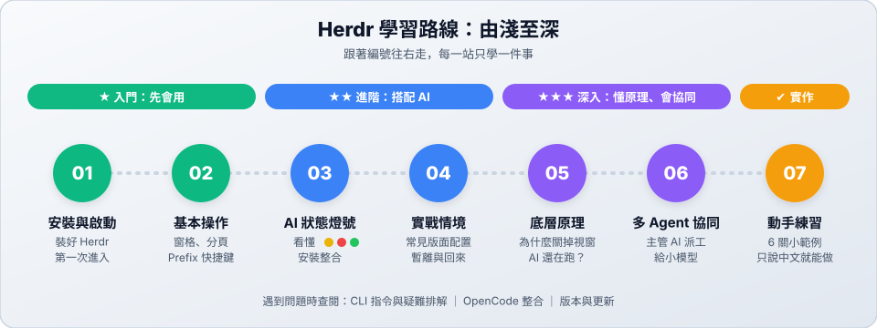

# Herdr：讓多個 AI 在同一個終端機裡一起工作

**Herdr** 是專為 AI coding agent 設計的終端多工台。它把一個終端機視窗切成好幾個小視窗，讓你可以：

- 一邊讓 AI 寫程式，一邊看它改了什麼。
- 同時跑好幾個 AI，並用**狀態燈號**一眼看出誰在工作、誰在等你。
- 關掉視窗後，AI **繼續在背景工作**；明天打開還能接著做。

---

## 學習路線

| 站 | 主題 | 難度 | 你會學到 |
| :---: | :--- | :---: | :--- |
| 01 | [安裝與第一次啟動](01-install.md) | ★ | 裝好 Herdr、第一次進入與離開 |
| 02 | [基本操作](02-basics.md) | ★ | 工作區／分頁／窗格、Prefix 快捷鍵 |
| 03 | [AI 狀態燈號](03-agents.md) | ★★ | 看懂 🟡🔴🟢、安裝 AI 整合、聲音提醒 |
| 04 | [實戰情境](04-scenarios.md) | ★★ | 三種常用版面、暫離與回來、重開機後找回進度 |
| 05 | [底層原理](05-architecture.md) | ★★★ | 為什麼關掉視窗 AI 還在跑？ |
| 06 | [多 Agent 協同](06-supervisor-subagent.md) | ★★★ | 讓主管 AI 派工給小模型、驗收、退回修改 |
| 07 | [動手練習](practice/README.md) | 🎯 | 6 關小範例，只說中文就能完成 |

> [!TIP]
> **時間不多？** 先讀 01、02，就能開始用 Herdr；03、04 讓你用得順手；05、06 是想深入了解時再讀。

---

## 📚 參考資料（遇到問題時查閱）

| 文件 | 用途 |
| :--- | :--- |
| [CLI 指令與疑難排解](cli.md) | 用指令操作窗格與 AI、常用維護指令、常見問題 |
| [在 Herdr 中使用 OpenCode](opencode-integration.md) | OpenCode 整合的安裝與限制 |
| [版本與更新紀錄](updates.md) | 如何更新 Herdr、官方文件來源 |
| [官方文件](https://herdr.dev/docs/) | Herdr 官方網站 |
