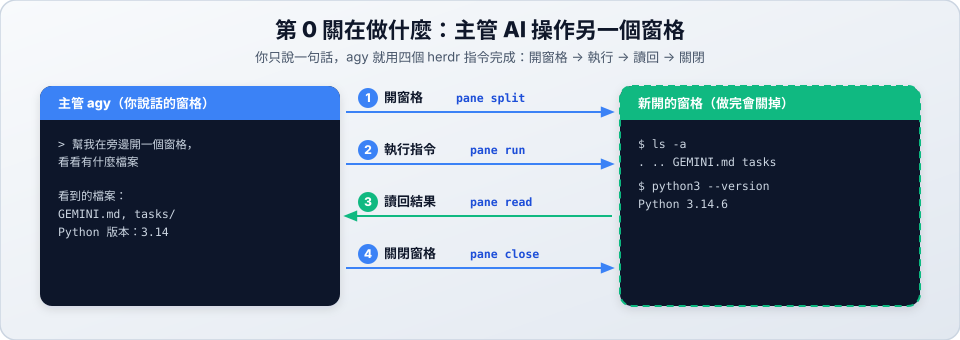

# 第 0 關：認識窗格

> 🎯 第 0 關／共 6 關　｜　[← 準備篇](../prepare.md)　｜　[關卡地圖](../README.md)　｜　[第 1 關 →](../01-first-subagent/README.md)　｜　⏱ 約 2 分鐘

## 學習目標

- 第一次用中文請主管 AI（agy）做事。
- 看懂 AI 怎麼**開一個新窗格、在裡面執行指令、再把結果讀回來**。
- 熟悉「說需求 → 看任務卡 → 確認 → 觀察 → 收到回報」的節奏，之後每一關都一樣。

## 開始前

在 `~/herdr-lab` 進入 Herdr，啟動 `agy --mode accept-edits`（見 [準備篇第三部分](../prepare.md#第三部分和主管-aiagy相處的方式)）。



---

## 對 agy 說

```text
幫我在旁邊開一個窗格，看看這個資料夾有什麼檔案，還有 Python 是什麼版本。
```

## 你會看到什麼

### 1. 任務卡（大約 30 秒～1 分鐘）

agy 先整理出一張任務卡給你確認，內容類似：

```text
任務卡：查看環境資訊
## 我的理解：要做什麼
  • 在右側開一個新窗格
  • 在新窗格執行指令，列出資料夾檔案、查詢 Python 版本
  • 讀取輸出後，整理並回報給您
## 分工
  • 執行者：Supervisor（這個任務很簡單，不需要派給小模型）
## 驗收標準
  • 成功開出新窗格、正確印出檔案清單與 Python 版本
這樣可以開始嗎？想修改的地方直接告訴我。
```

讀完後回覆：

```text
好，開始
```

### 2. 確認畫面（🔴）

agy 要執行 `herdr pane split ...` 時會問你，選 **2**（本次對話都允許 herdr 開頭的指令）。

### 3. 畫面變化

- 右邊**多出一個窗格**，裡面出現了 `ls` 和 `python3 --version` 的結果。
- 你的游標**沒有被搶走**，還留在 agy 這邊。

### 4. 回報

agy 會告訴你看到了哪些檔案、Python 是什麼版本，還會列出它用了哪些 herdr 指令，每個指令附一句說明。

### 5. 收尾

```text
看完了，幫我把那個窗格關掉
```

---

## 想一想

1. agy 怎麼「看到」另一個窗格的內容？回報裡哪一個指令負責這件事？
2. 這一關的任務卡寫著「不需要派給小模型」。你覺得什麼樣的工作才值得交給小模型？
3. 到 `~/herdr-lab/tasks/` 打開剛才的任務卡，它和你說的那句話差在哪裡？

## 變化題（換句話再做 2～3 次）

- 「幫我在下面開一個窗格，看看今天的日期和我的使用者名稱，看完幫我關掉。」
- 「幫我開兩個窗格，一個顯示目前在哪個資料夾，一個算 1+1 等於多少。」
- 「幫我開一個窗格，執行一個要等 5 秒才會印出『完成』的指令，等它真的印出來再告訴我。」想一想：agy 怎麼知道要「等」？

完成後 → [第 1 關：第一次派工](../01-first-subagent/README.md)

---

## 🔧 進階：自己下指令（選修）

想知道 agy 背後做了什麼？在 Herdr 另開一個 shell 窗格，親手做一次。需要 `jq`（`brew install jq`）。

```bash
# 1. 開右側窗格，從回傳的 JSON 取出新窗格的 ID
WORKER=$(herdr pane split --current --direction right --no-focus | jq -r '.result.pane.pane_id')
echo $WORKER                     # 例如 w1:p3

# 2. 在那個窗格執行指令
herdr pane run $WORKER "ls -a; python3 --version"

# 3. 把輸出讀回來
herdr pane read $WORKER --source recent-unwrapped --lines 10

# 4. 等某段文字出現（--timeout 單位是毫秒）
herdr pane run $WORKER "sleep 3; echo 全部完成"
herdr pane wait-output $WORKER --match "全部完成" --timeout 10000

# 5. 收尾
herdr pane close $WORKER
```

| 參數 | 意思 |
| :--- | :--- |
| `--current` | 以「你現在所在的窗格」為基準分割 |
| `--no-focus` | 不要把游標移到新窗格 |
| `--source recent-unwrapped` | 讀最近的輸出，並把被自動換行切斷的長行接回來 |

| 錯誤訊息 | 原因 |
| :--- | :--- |
| `pane_not_found` | ID 打錯或窗格已關閉，用 `herdr pane list` 查看 |
| `wait-output` 一直等不到 | `--match` 的文字和實際輸出不一樣 |
