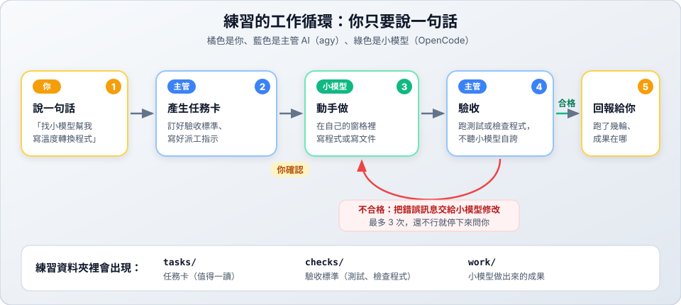

# 第 1 關：第一次派工

> 🎯 第 1 關／共 6 關　｜　[← 第 0 關](../00-panes/README.md)　｜　[關卡地圖](../README.md)　｜　[第 2 關 →](../02-retry/README.md)　｜　⏱ 約 3 分鐘

## 學習目標

- 第一次請主管 AI **把工作交給小模型**，而不是自己做。
- 看懂任務卡的四個部分：**要做什麼、分工、驗收標準、派工指示**。
- 看到主管**親自驗收**，而不是只相信小模型說「完成」。



---

## 對 agy 說

```text
找一個小模型幫我寫溫度轉換的程式，攝氏轉華氏，寫完你檢查。
```

## 你會看到什麼

### 1. 任務卡（大約 1 分鐘）

這次任務卡多了兩個重點：

```text
## 分工
  • SubAgent：coder（OpenCode，模型 opencode/muse-spark-1.3-contributor-free）
  • 工作目錄：work/temperature/
## 驗收標準
  • 函式正確：0°C → 32°F、100°C → 212°F、-40°C → -40°F
  • 檢查指令：uvx pytest -q checks/temperature/test_converter.py
## 派工指示（我會傳給 SubAgent 的原文）
  你是 SubAgent，只負責完成下面的任務，不要執行任何 herdr 指令……
  請在當前目錄下建立 converter.py，實作 celsius_to_fahrenheit……
```

- agy **還沒派工就先寫好了測試**，放在 `checks/temperature/`。
- 「派工指示」是 agy 替你寫的 prompt。你只說了一句話，它展開成一份清楚的工作說明。

確認沒問題後回覆「好，開始」。

### 2. 畫面變化（大約 1～2 分鐘）

| 看哪裡 | 你會看到 |
| :--- | :--- |
| 右邊新窗格 | OpenCode 啟動，小模型開始寫程式（窗格太窄就點一下再按 `prefix+z` 放大） |
| 窗格燈號 | 小模型工作時亮 🟡，做完變 🟢 |
| agy 窗格 | 小模型做完後，agy 執行 `uvx pytest`（確認畫面選 2），然後關閉小模型的窗格 |

### 3. 回報

```text
• 驗收結果：7 passed
• 成果檔案：work/temperature/converter.py
• 驗收測試：checks/temperature/test_converter.py
• 任務卡：tasks/temperature.md
```

---

## 想一想

1. 打開 `checks/temperature/` 裡的測試檔，agy 訂了哪些檢查？你同意這些標準嗎？
2. 為什麼不讓聰明的 agy 自己寫，而要交給小模型？（提示：費用，以及「由另一個人檢查」的好處）
3. 派工指示的第一句寫著「不要執行任何 herdr 指令」。你猜為什麼要特別交代這句？

## 變化題（換句話再做 2～3 次）

- 「找小模型幫我寫一個計算 BMI 的程式，輸入體重和身高，寫完你檢查。」
- 「找小模型寫一個把分數轉成等第的程式：90 分以上 A、80 分以上 B、其他 C。」
- 看到任務卡後**先不要說好**，試著修改它：「驗收標準再加一條：輸入小數也要算對」，看看 agy 怎麼更新任務卡。

完成後 → [第 2 關：不合格就退回](../02-retry/README.md)

---

## 🔧 進階：自己下指令（選修）

在 Herdr 另開一個 shell 窗格，親手當一次主管：

```bash
mkdir -p ~/herdr-lab/manual && cd ~/herdr-lab/manual

# 1. 開工作窗格（--cwd 讓新窗格和你在同一個資料夾）
WORKER=$(herdr pane split --current --direction right --cwd "$PWD" --no-focus | jq -r '.result.pane.pane_id')

# 2. 啟動小模型，取名 coder；-- 後面的參數交給 OpenCode，-m 指定模型
herdr agent start coder --kind opencode --pane $WORKER -- -m opencode/muse-spark-1.3-contributor-free

# 3. 派工並等它做完（--timeout 單位是毫秒，300000 = 5 分鐘）
herdr agent prompt coder "你是 SubAgent，只負責完成下面的任務，不要執行任何 herdr 指令。請在 temperature.py 寫一個函式 celsius_to_fahrenheit(c)，回傳華氏溫度。完成後回覆「完成」。" --wait --timeout 300000

# 4. 看狀態、讀回覆
herdr agent get coder | jq -r '.result.agent.agent_status'
herdr agent read coder --source recent-unwrapped --lines 40

# 5. 親自驗收
python3 -c "from temperature import celsius_to_fahrenheit as f; print(f(0), f(100), f(-40))"

# 6. 收尾（裡面的 OpenCode 會一起結束）
herdr pane close $WORKER
```

| 錯誤訊息 | 原因與解法 |
| :--- | :--- |
| `agent_name_taken` | 已經有叫 `coder` 的 Agent，換名字或先關掉舊窗格 |
| `agent_blocked` | Agent 在等人回應，用 `herdr agent read coder --source visible` 看它在問什麼 |
| `Endpoint is unavailable` | 免費模型忙碌，關掉窗格換模型重來 |
