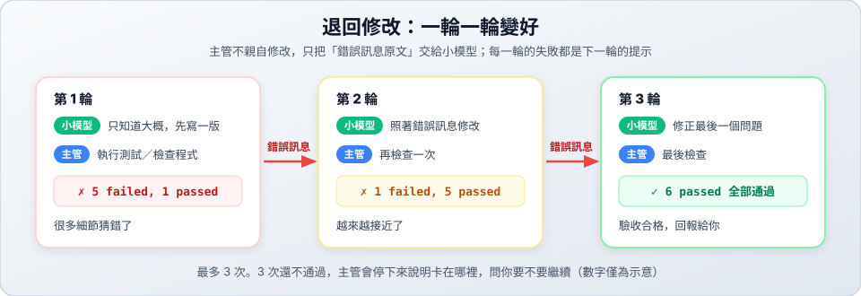

# 第 3 關：測試當裁判

> 🎯 第 3 關／共 6 關　｜　[← 第 2 關](../02-retry/README.md)　｜　[關卡地圖](../README.md)　｜　[第 4 關 →](../04-worktree-review/README.md)　｜　⏱ 約 10 分鐘

## 學習目標

- 理解**「先寫測試，再寫程式」**：聰明的主管負責訂規格（測試），小模型負責實作。
- 看小模型**依照測試失敗的訊息**一步步修正，直到全部通過。
- 學會看懂 pytest 的結果：`passed`、`failed`。



---

## 對 agy 說

```text
幫我做一個簡單的檢查密碼強度的功能。你先寫好測試，第一次派工只告訴小模型大概要做什麼，讓它照著測試失敗的訊息一直改到全部通過。
```

> 💡 記得說「簡單的」。沒有限制時，AI 有時會把功能設計得太複雜，小模型就要改很多輪。

## 你會看到什麼

### 1. 任務卡

agy 會先寫好測試檔 `checks/password-strength/test_xxx.py`，任務卡裡列出規則，例如：

```text
## 驗收標準
  • 長度至少 8 個字元
  • 至少一個大寫、一個小寫、一個數字
  • 檢查指令：uvx pytest -q checks/password-strength/
```

確認後回覆「好，開始」。

### 2. 測試循環（大約 2～8 分鐘）

agy 每一輪都會執行 `uvx pytest`（確認畫面選 2）。你會看到結果從失敗慢慢變成通過，例如（每次的數字都不一樣）：

```text
第 1 輪：5 failed, 1 passed   ← 小模型只知道「大概要做什麼」，很多細節猜錯
第 2 輪：2 failed, 4 passed   ← 照著失敗訊息修正
第 3 輪：6 passed             ← 全部通過 🎉
```

如果 3 輪還沒通過，agy 會停下來說明卡在哪裡，並問你要不要繼續。

### 3. 回報

agy 會整理每一輪失敗的是哪些測試、原因是什麼，以及成果檔案的位置。

---

## 想一想

1. 打開 `checks/password-strength/` 裡的測試檔，每個 `def test_...` 在檢查什麼？
2. 小模型一開始不知道詳細規則，為什麼最後還是能寫對？
3. 如果測試本身寫錯了（例如把正確的密碼判定為不合格），會發生什麼事？由誰負責發現？

## 變化題（換句話再做 2～3 次）

- 「幫我做一個簡單的判斷閏年的功能。你先寫測試，第一次只說大概，讓小模型照測試改到通過。」
- 「幫我做一個簡單的函式，檢查 email 格式是否正確。你先寫測試，再交給小模型。」
- 任務卡出現時，請 agy「多加一個測試：密碼不能有空白」，看看小模型能不能被新的測試抓到錯誤。

完成後 → [第 4 關：隔離與審查](../04-worktree-review/README.md)

---

## 🔧 進階：自己下指令（選修）

自己跑一次測試，看看結果長什麼樣子：

```bash
cd ~/herdr-lab
uvx pytest -q checks/password-strength/          # 簡短結果
uvx pytest -v checks/password-strength/          # 列出每個測試的名稱與結果
```

`uvx` 會自動準備好 pytest，不需要另外安裝。試著改壞 `work/password-strength/` 裡的程式，再跑一次測試，看看哪些測試會失敗。
