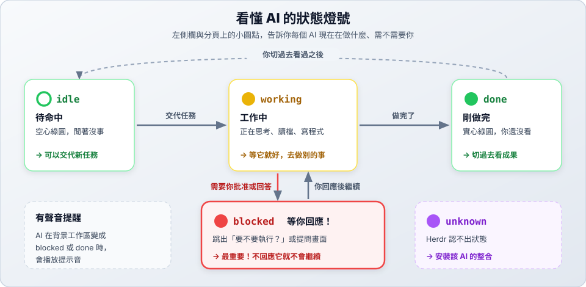

# 準備篇：開始練習前要先會的事

> 🎯 開始練習前　｜　[關卡地圖](README.md)　｜　[第 0 關 →](00-panes/README.md)　｜　⏱ 約 20 分鐘（只需做一次）

這組練習裡，你只需要用中文說出需求，其他事都由 AI 處理。但要讓 AI 順利工作，你得先做好兩件事：

1. **系統設定**：把工具裝好、帳號登入好、練習資料夾準備好（只需做一次）。
2. **Herdr 基本操作**：AI 會在畫面上開好幾個窗格。你要看得懂畫面、會切換窗格，也知道 AI 卡住時該怎麼處理。

每一節最後都有 ✅ 自我檢查，全部打勾再進入第 0 關。

---

## 第一部分：系統設定（只需做一次）

### 1. 安裝工具

| 工具 | 用途 | 確認指令 |
| :--- | :--- | :--- |
| **Herdr** | 終端多工台，讓多個 AI 同時在不同窗格工作 | `herdr --version` |
| **agy**（Antigravity CLI） | 主管 AI（Supervisor），負責理解你的需求、派工、驗收 | `agy --version` |
| **OpenCode** | 小模型 AI（SubAgent），負責實際寫程式、寫文件 | `opencode --version` |
| **uv** | 執行 Python 測試（`uvx pytest`），不用另外安裝 pytest | `uv --version` |
| **Git** | 第 4、5 關管理分支與合併 | `git --version` |
| **Python 3** | 執行程式與檢查程式 | `python3 --version` |

安裝方式：

- Herdr：見 [01 安裝與啟動](../01-install.md)。
- OpenCode：見 [OpenCode 操作指南](../../opencode/README.md)。
- uv：`curl -LsSf https://astral.sh/uv/install.sh | sh`
- Git、Python：macOS 可用 `brew install git python`。

每個確認指令都有顯示版本號，就代表安裝成功。

### 2. 登入 agy

在終端機輸入 `agy`，第一次使用時依照畫面指示登入 Google 帳號。看到輸入框，畫面上方也顯示你的帳號和模型名稱（例如 `Gemini 3.8 Flash`），就代表登入成功。確認後直接關閉這個終端機視窗即可。

### 3. 確認 OpenCode 的免費模型能用

```bash
opencode run -m opencode/muse-spark-1.3-contributor-free "只回覆 OK 兩個字"
```

看到 `OK` 就可以了。

> [!NOTE]
> 免費模型偶爾會因為伺服器忙碌出現 `Endpoint is unavailable`。這不是你的問題，主管 AI 會自動換成備用模型。
>
> 本練習使用的模型：
>
> | 用途 | 模型 | 說明 |
> | :--- | :--- | :--- |
> | 預設 | `opencode/muse-spark-1.3-contributor-free` | Muse Spark 免費版，速度快 |
> | 備用 | `opencode/nemotron-3.5-lightning-free` | NVIDIA Nemotron 免費版，速度較慢 |
>
> 備用模型也可以先測試一次：`opencode run -m opencode/nemotron-3.5-lightning-free "只回覆 OK 兩個字"`

### 4. 準備練習資料夾與主管規則檔

```bash
mkdir -p ~/herdr-lab
cd ~/herdr-lab
curl -fsSLO https://raw.githubusercontent.com/roberthsu2003/vibe_coding_harness/main/herdr/practice/GEMINI.md
```

[`GEMINI.md`](GEMINI.md) 是主管 AI 的「工作手冊」。agy 啟動時會**自動讀取**它，所以你只要說出需求，agy 就知道要怎麼做：

- 把你的一句話整理成**任務卡**（`tasks/` 資料夾），交給你確認。
- 自己訂出**驗收標準**，寫成檢查程式或測試（`checks/` 資料夾）。
- 把工作交給小模型，成果放在 `work/` 資料夾；不合格就退回修改，最多 3 輪。

> [!IMPORTANT]
> - 檔名一定要是 `GEMINI.md`。agy 會自動讀它，小模型 OpenCode 不會讀，兩邊才不會搞混身分。
> - 練習資料夾裡**不要放 `AGENTS.md`**。OpenCode 會自動讀這個檔名；如果裡面寫著主管規則，小模型會誤以為自己是主管而卡住。

### 5. 終端機視窗開大一點

AI 會在畫面上切出好幾個窗格。視窗太小時，窗格會窄到幾乎看不見字，小模型甚至可能收不到任務。請把終端機視窗**最大化**，寬度最好超過 120 個字元。

### ✅ 系統設定自我檢查

- [ ] 六個確認指令都有顯示版本號
- [ ] `agy` 可以登入並看到輸入框
- [ ] 免費模型回覆了 `OK`
- [ ] `~/herdr-lab/GEMINI.md` 存在
- [ ] 終端機視窗已最大化

---

## 第二部分：Herdr 基本操作

> 這部分是 [01 安裝與啟動](../01-install.md)、[02 基本操作](../02-basics.md)、[03 AI 狀態燈號](../03-agents.md) 的重點整理。第一次接觸 Herdr 的同學，建議先讀完這三站。

### 1. 三層結構


練習時，**主管 AI 和每個小模型各佔一個窗格**，通常只用一個分頁就夠了。

### 2. Prefix 鍵


練習中最常用的操作：

| 操作 | 功能 | 什麼時候用 |
| :--- | :--- | :--- |
| **滑鼠點一下窗格** | 切換到那個窗格 | 想看小模型在做什麼、或回到主管窗格 |
| `prefix+h` / `j` / `k` / `l` | 移到左／下／上／右的窗格 | 同上，用鍵盤操作 |
| `prefix+z` | 放大目前窗格，再按一次還原 | 窗格太窄看不清楚時 |
| `prefix+e` | 用編輯器打開完整的輸出內容 | 想看較早的訊息 |
| `prefix+x` | 關閉目前窗格 | 練習結束要收拾時 |
| `prefix+q` | 暫離（AI 繼續跑），輸入 `herdr` 回來 | 要離開一下 |

忘記快捷鍵時按 `prefix+?`。完整清單見 [02 基本操作](../02-basics.md#3-常用快捷鍵)。

### 3. 狀態燈號



> 🔴 是最重要的燈號：AI 停下來等你時，**沒有回應它，它就不會繼續**。

### ✅ Herdr 操作自我檢查

在 `~/herdr-lab` 進入 Herdr，練習以下動作：

- [ ] 用 `prefix+v` 切出右側窗格，再用滑鼠點擊在左右窗格之間切換
- [ ] 用 `prefix+z` 放大一個窗格，再還原
- [ ] 用 `prefix+x` 關掉多出來的窗格
- [ ] 用 `prefix+q` 離開，再輸入 `herdr` 回來

---

## 第三部分：和主管 AI（agy）相處的方式

### 1. 啟動 agy

在 Herdr 的窗格裡（位置要在 `~/herdr-lab`）輸入：

```bash
agy --mode accept-edits
```

`--mode accept-edits` 表示「建立或修改檔案時不用每次問我」。執行指令時仍然會先問你，比較安全。

第一次在這個資料夾啟動時會出現：

```text
Do you trust the contents of this project?
> Yes, I trust this folder
```

直接按 **Enter**。如果出現其他說明訊息，按 **Esc** 關掉。

### 2. 處理「要不要執行這個指令」

agy 要執行指令時，會停下來問你（燈號變 🔴）：

```text
Requesting permission for:
   herdr pane split ...
Run this command?
> 1. Yes, run command
  2. Yes, and always allow in this conversation for commands that start with 'herdr'
  3. Yes, and always allow ... (Persist to settings.json)
  4. No, cancel
```

| 指令開頭 | 建議選擇 | 原因 |
| :--- | :--- | :--- |
| `herdr`、`git`、`uvx`、`python3`、`mkdir`、`ls` | **2**（本次對話都允許） | 練習中會反覆用到，都是安全的指令 |
| 看不懂、或含有 `rm`、`sudo` | 先選 **4** 拒絕，再問 agy「這個指令是做什麼的？」 | 刪除檔案或需要管理員權限的指令要小心 |

用 **↓** 移動，**Enter** 確認。

### 3. 任務卡：AI 會先跟你確認

你說出需求後，agy **不會馬上動手**，而是先給你看一張任務卡：

```text
# 任務卡：溫度轉換程式
## 我的理解：要做什麼        ← AI 怎麼理解你的需求
## 分工                      ← 交給哪個小模型
## 驗收標準                  ← 怎樣才算合格
## 派工指示                  ← AI 幫你寫好、要傳給小模型的 prompt
這樣可以開始嗎？想修改的地方直接告訴我。
```

讀完後用一般的話回覆就好：

- 沒問題：「好，開始」
- 想調整：「驗收標準再加一條：負數也要測試」
- 理解錯了：「不是，我要的是華氏轉攝氏」

> 💡 任務卡裡的「派工指示」就是一份寫得很好的 prompt。多看幾次，你也會知道一份好的 prompt 長什麼樣子。

### 4. 卡住時怎麼辦

| 狀況 | 怎麼辦 |
| :--- | :--- |
| agy 窗格亮 🔴 | 它在等你按確認，看清楚後選擇 |
| 小模型窗格亮 🔴 | 跟 agy 說：「小模型好像卡住了，幫我看一下」 |
| 很久都沒有動靜 | 跟 agy 說：「現在進度如何？」 |
| 小模型窗格窄到看不到字 | 點一下那個窗格，按 `prefix+z` 放大 |
| 想全部重來 | 在 agy 窗格按 `prefix+x` 關掉，再開一個新窗格輸入 `agy --mode accept-edits` |

### ✅ agy 操作自我檢查

- [ ] 能用 `agy --mode accept-edits` 啟動 agy，並通過信任資料夾的確認
- [ ] 知道執行 `herdr` 指令的確認畫面要選 2
- [ ] 知道任務卡出現時，要先讀過再回覆「好，開始」

全部打勾 → 前往 [第 0 關：認識窗格](00-panes/README.md)
