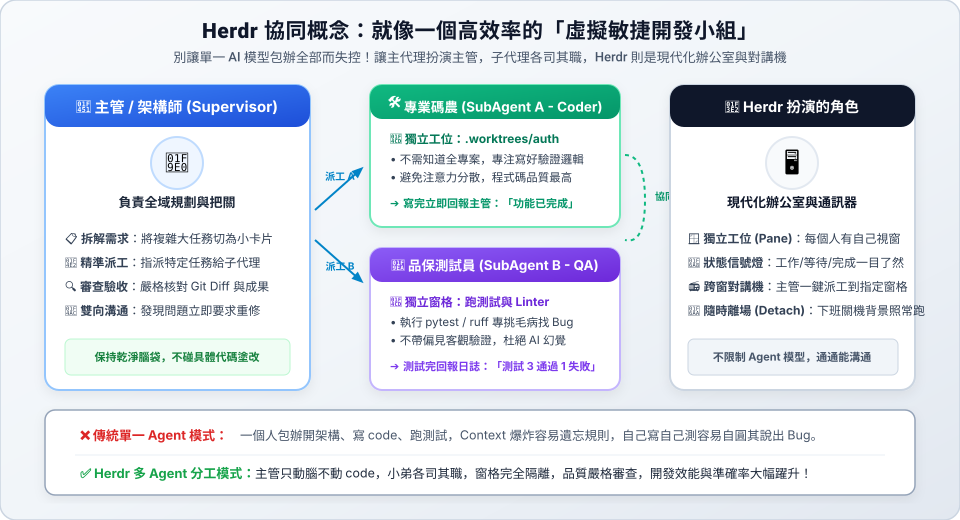
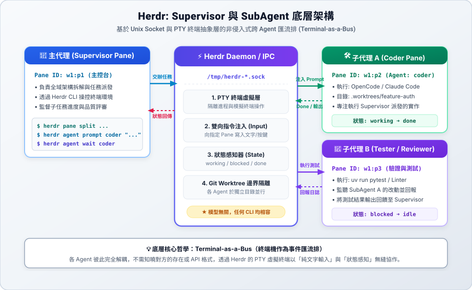

# Supervisor 與 SubAgent 終端協同工作流

在複雜的軟體開發中，讓單一 AI Agent 包辦「架構設計、代碼編寫、測試執行、代碼審查」往往會導致 Context 爆滿、注意力分散與自圓其說的錯誤。

透過 **Herdr**，你可以將終端機化身為多 Agent 協同的調度匯流排（Terminal-as-a-Bus），建立一個 **Supervisor（主代理 / 架構主管）** 負責拆解任務與把關，並在獨立窗格中生成多個 **SubAgent（子代理 / 執行者）** 分工協作。

---

## 導覽目錄

1. [概念比喻：虛擬敏捷開發小組（一般人一看就懂）](#1-概念比喻虛擬敏捷開發小組一般人一看就懂)
2. [底層核心原理：為什麼能跨 Agent 協同？](#2-底層核心原理為什麼能跨-agent-協同)
3. [深度科普：PTY（虛擬終端）到底是什麼？](#3-深度科普pty虛擬終端到底是什麼)
4. [技術架構數據流向圖](#4-技術架構數據流向圖)
5. [實戰演練：Supervisor 調度 SubAgent 完整範例](#5-實戰演練supervisor-調度-subagent-完整範例)
6. [Supervisor 角色提示詞 (Prompt Template)](#6-supervisor-角色提示詞-prompt-template)
7. [多 Agent 協同的最佳實踐](#7-多-agent-協同的最佳實踐)

---

## 1. 概念比喻：虛擬敏捷開發小組（一般人一看就懂）

如果把整個開發流程比喻為一家軟體公司，Herdr 的多 Agent 協同就像一個現代化的小型敏捷團隊：



### 📖 白話文看懂這張圖：為什麼我們需要「團隊分工」？

如果你曾經直接叫一個 AI Agent（例如叫它「幫我寫一個完整的電商網站」），你一定遇過這種慘況：
> ❌ **單一 Agent 的慘痛經歷**：  
> 一開始講得頭頭是道，改了 20 個檔案後開始語無倫次；修好前台購物車卻把後台結帳改壞；甚至寫出有 Bug 的程式碼還自信滿滿地告訴你「全部測試通過」。最後因為對話紀錄太長（Context 爆滿），整個人變遲鈍。

**這就是為什麼我們需要 Herdr 把終端機變成一個「敏捷開發小組」：**

#### 💡 一個真實的生活比喻：蓋房子
- **主管（Supervisor）就像「建築設計師 / 監工」**：  
  他手上有整棟房子的藍圖與規格。但他**絕不會親自挽起袖子去拌水泥或砌磚塊**。他的工作只有三件事：
  1. 看藍圖，把大工程切成具體小工單（「今天只砌這面牆」）。
  2. 派工給泥作師傅，交待「砌好通知我」。
  3. 師傅回報做好了，監工拿水平尺去驗收；發現砌歪了，要求師傅敲掉重做。
- **子代理 A（Coder）就像「泥作師傅」**：  
  他不需要去背整棟大樓的力學結構算式，他只要專心把眼前這面牆砌得平整漂亮。因為任務明確單純，所以失誤率極低。
- **子代理 B（QA Tester）就像「品質驗收員」**：  
  他拿著儀器專挑毛病。他跟泥作師傅是平級的獨立角色，因此不會互相袒護，有問題就老實跟監工回報。
- **Herdr 就像「現代化工地管理系統」**：  
  給每個人一個獨立施工區（窗格），互不干擾；門口掛著「施工中 / 待檢驗 / 已完工」的指示牌；還有無線對講機讓監工隨時隨地派工。

#### 🌰 實戰情境小範例：開發「使用者登入系統」
當你對主管下指令：「請幫我完成登入驗證功能」，這個小組是這樣分工的：
1. **主管動腦**：主管思考後，把任務拆成兩張工單：
   - 工單 1：「在 `src/auth.py` 寫密碼雜湊與驗證邏輯」。
   - 工單 2：「在 `tests/test_auth.py` 寫自動化測試」。
2. **主管派工**：主管用 Herdr 指令把「工單 1」丟給窗格內的子代理 A。
3. **子代理 A 施工**：子代理 A 在自己的獨立目錄快速寫完程式碼，回到待命狀態。
4. **主管找測試員驗證**：主管叫子代理 B 跑測試。測試員回報：「空密碼會直接當機！」
5. **主管命令修正**：主管再次命令子代理 A：「修正空密碼的錯誤處理」。
6. **驗收通過**：全體測試通過，主管審查代碼無誤，將成果合併回主專案。全程人類只需要在旁邊泡咖啡監督！

| 角色 | 現實中的對應 | 在終端機中的具體職責 |
| :--- | :--- | :--- |
| **👑 主代理 (Supervisor)** | **技術主管 / 架構師 (Tech Lead)** | 負責全域架構思考與任務拆解。不親自修改大量代碼，保持腦袋（Context Window）乾淨，專注驗收與代碼審查（Code Review）。 |
| **🛠️ 子代理 A (SubAgent)** | **核心工程師 (Coder)** | 坐在獨立的工位（`.worktrees/auth` 分支目錄），只接收具體的單一任務指令（如「實作 JWT 驗證」），專心寫代碼。 |
| **🧪 子代理 B (SubAgent)** | **品保測試員 (QA Tester)** | 坐在獨立窗格中，客觀執行 `uv run pytest` 與 Linter，專挑毛病並將失敗日誌反饋給主管。 |
| **🏢 Herdr 終端多工台** | **現代化辦公室與對講機系統** | 為每位工程師分配獨立互不干擾的窗格（工位），門口設有狀態燈（工作中/等待確認/完成），並提供對講機讓主管一鍵派工。 |


---

## 2. 底層核心原理：為什麼能跨 Agent 協同？

為什麼 Herdr 能夠在**不需要修改任何 AI 模型的內部代碼**的情況下，讓彼此陌生的 Agent 互相對話與派發任務？其底層依賴三大技術基石：

```text
+-----------------------------------------------------------------------+
|  Supervisor Pane (#pane-0)                                            |
|  發出指令: herdr pane input #pane-1 "請為 @auth.py 撰寫單元測試"      |
+-----------------------------------------------------------------------+
                                   │ (CLI / Unix Socket 通訊)
                                   ▼
+-----------------------------------------------------------------------+
|  Herdr Daemon (中央服務 / IPC 匯流排)                                 |
|  1. 解析目標 Pane ID (#pane-1)                                        |
|  2. 透過 PTY 驅動向終端注入文字與按鍵模擬                            |
|  3. 監控終端輸出緩衝區與進程狀態 (working / blocked / done)           |
+-----------------------------------------------------------------------+
                                   │ (PTY 虛擬終端寫入)
                                   ▼
+-----------------------------------------------------------------------+
|  SubAgent Pane (#pane-1)                                              |
|  OpenCode / Claude Code 收到輸入，開始執行任務...                     |
+-----------------------------------------------------------------------+
```

### 1. Unix Domain Socket 與常駐服務 (Daemon)
Herdr 在背景執行一個輕量服務進程，透過本機 Unix Domain Socket（`/tmp/herdr-*.sock`）監聽指令。不管是由人類工程師下指令，還是由某個窗格內的 Supervisor Agent 下指令，都能透過標準的 CLI（`herdr pane ...`）向伺服器發送控制訊息。

### 2. 非侵入式跨進程控制（模型完全解耦）
Supervisor 不需要知道 SubAgent 背後是哪一家模型（可以是 Claude 3.7、GPT-4.5 或本地 Ollama），甚至不需要 SubAgent 提供特定的 API 接口。Supervisor 只要像人類一樣向子窗格「鍵入文字」，SubAgent 就會開始工作。

### 3. 狀態感知探針 (State Awareness)
Herdr 內建智慧探針，能主動回報子窗格內的狀態標籤：
- `working`：子 Agent 正在思考或執行。
- `blocked`：子 Agent 卡住等待人類批准指令。
- `done`：子 Agent 已經完成這輪任務，返回等待輸入狀態。
Supervisor 只要透過 `herdr agent inspect` 即可隨時得知子代理是否完成，不用自己寫正則表達式解析終端文字。

---

## 3. 深度科普：PTY（虛擬終端）到底是什麼？

在理解 Herdr 的運作時，經常會看到 **PTY（Pseudo-Terminal）** 這個詞。為什麼它這麼重要？

### 什麼是 PTY？
* **歷史由來**：在 Unix 早期，電腦使用者是透過實體的**硬體電傳打字機（Teletypewriter，簡稱 TTY）** 連接到大型主機。
* **現代演進**：現代電腦已經沒有實體打字機，但作業系統仍然保留了這套終端通訊介面。透過軟體模擬出來的「假終端 / 虛擬終端」，就叫做 **PTY（Pseudo-Terminal）**。

### PTY 的雙向結構：Master 與 Slave
每個 PTY 都是成對出現的通道：
1. **Master 端（掌控者）**：由 **Herdr Daemon** 持有。負責攔截輸出、讀寫資料與注入模擬鍵盤按鍵。
2. **Slave 端（被控者）**：提供標準終端設備給 **Shell 或 Agent**（例如 OpenCode、Claude Code、Python）。

```text
[ Herdr Daemon ] <---> (Master 端) === [ PTY 通道 ] === (Slave 端) <---> [ Agent 應用程式 ]
```

### 為什麼普通管線 (Pipe) 不夠？為什麼 AI Agent 非要 PTY 不可？

很多人會問：「為什麼不能直接用 `echo "指令" | opencode` 這種普通的管道（Pipe）？」

1. **支援互動式 TUI 與 ANSI 顏色**：
   現代 AI Coding Agent（如 OpenCode 的 TUI 介面、豐富色彩、游標跳轉）在啟動時會檢查底層是否為「真實終端（TTY）」。如果只是普通 Pipe，程式會退化成純文字甚至直接崩潰報錯 `stdout is not a tty`。
2. **單鍵即時響應（Raw 模式）**：
   一般管道必須按 Enter 才能把整行送出；但 PTY 支援 Raw 模式，能夠即時傳遞 `Ctrl+C`、`Ctrl+X`、`Esc` 等單鍵訊號。
3. **讓 Agent「以為眼前坐著真人」**：
   PTY 創造了一個完美的擬真環境，讓所有命令列工具與 Agent 都以為自己正在直接與人類鍵盤螢幕互動。Herdr 藉由掌控 PTY Master 端，就能神不知鬼不覺地代表 Supervisor 注入提示詞並讀取終端畫面。

---

## 4. 技術架構數據流向圖

以下是 Supervisor、Herdr IPC 匯流排與各 SubAgent 的底層數據流架構：



---

## 5. 實戰演練：Supervisor 調度 SubAgent 完整範例

本例示範：**Supervisor 代理**（位於 `#pane-0`）如何透過 Herdr 指令，在右側建立一個獨立工作目錄的 **SubAgent 代理**（`#pane-1`），交辦編寫單元測試的任務，並確認完成。

### 步驟 1：Supervisor 建立子窗格並取得 Pane ID

Supervisor 決定將工作交辦出去時，在自己的終端執行：

```bash
# 水平向右分割出一個新的窗格，並以 JSON 格式獲取新窗格 ID
SPLIT_JSON=$(herdr pane split --direction right --format json)
SUB_PANE_ID=$(echo $SPLIT_JSON | jq -r '.result.pane.pane_id')

echo "已建立子代理窗格: $SUB_PANE_ID"
```

### 步驟 2：讓子窗格進入專屬目錄並啟動 SubAgent

為了避免子代理與主專案衝突，Supervisor 可搭配 `git worktree`，讓子代理在獨立分支上作業：

```bash
# 讓子窗格進入指定目錄並啟動 OpenCode
herdr pane input "$SUB_PANE_ID" "cd .worktrees/feature-auth && opencode"
```

### 步驟 3：Supervisor 向 SubAgent 交辦任務

等待 OpenCode 啟動完成後，Supervisor 將具體需求注入子窗格：

```bash
TASK_PROMPT="請閱讀 @src/auth.py，為密碼雜湊與 JWT 驗證撰寫單元測試放在 tests/test_auth.py。完成後請執行 uv run pytest 確認通過。"

# 注入任務提示詞並模擬按下 Enter
herdr pane input "$SUB_PANE_ID" "$TASK_PROMPT"
```

### 步驟 4：Supervisor 監控子代理進度（等待完成）

Supervisor 不需要一直盯著終端，可以寫一個簡單的輪詢檢查（或由 Herdr 狀態觸發）：

```bash
# 檢查子代理狀態，直到狀態變為 done
while true; do
  STATUS=$(herdr agent inspect "$SUB_PANE_ID" --format json | jq -r '.result.status')
  if [ "$STATUS" = "done" ]; then
    echo "🎉 SubAgent 已完成任務！"
    break
  elif [ "$STATUS" = "blocked" ]; then
    echo "⚠️ SubAgent 需要人類或主管授權！"
    break
  fi
  sleep 3
done
```

### 步驟 5：Supervisor 評審成果（Code Review & 對話）

SubAgent 完成後，Supervisor 在自己的主控台中審查改動：

```bash
# Supervisor 檢查子代理在 worktree 中產生的 Git 差異
git -C .worktrees/feature-auth diff
```

- **若成果滿意**：Supervisor 可直接將該 worktree 的分支 merge 回 main，並執行 `herdr pane close "$SUB_PANE_ID"` 關閉子窗格。
- **若需要補充修改（雙向對話）**：Supervisor 再次注入反饋指令：
  ```bash
  herdr pane input "$SUB_PANE_ID" "測試覆蓋率未達 80%，請補充邊界條件測試（例如空密碼與過期 Token）。"
  ```

---

## 6. Supervisor 角色提示詞 (Prompt Template)

當你在啟動主 Agent（Supervisor）時，可以把以下指示加入 Prompt 或專案的 `AGENTS.md`，賦予它調度子代理的能力：

```text
你現在是本專案的「主管架構師 (Supervisor Agent)」。
你負責總體任務規劃、架構決策與品質審查，嚴禁直接在大專案中進行大量代碼塗改。

【協同工具與職責】
1. 本環境運行於 Herdr 終端多工台，你具備執行 herdr CLI 的權限。
2. 當任務規模較大時，你必須：
   - 透過 git worktree 在 .worktrees/ 下建立獨立任務目錄。
   - 執行 `herdr pane split --direction right` 開啟 SubAgent 窗格。
   - 使用 `herdr pane input <pane_id> "指令"` 派發明確任務給 SubAgent。
3. 派發原則：明確給予「目標、範圍、驗收標準」。
4. 當 SubAgent 狀態為 done 時，使用 `git diff` 進行嚴格審查；驗收合格方可 merge。
```

---

## 7. 多 Agent 協同的最佳實踐

1. **一任務一 Worktree**：
   強烈建議每個 SubAgent 都在獨立的 `git worktree` 目錄下工作，這樣多個子代理可以同時修改代碼，完全不會發生檔案寫入衝突。
2. **小步派發，避免模糊長任務**：
   Supervisor 派發給 SubAgent 的任務粒度越小（例如「專門補測試」、「專門重構單一函式」），成功率越高。
3. **Supervisor 專注驗收與驗證**：
   Supervisor 最大的價值在於「不帶偏見的第三方審查」。子 Agent 寫完代碼後，由 Supervisor 檢查 diff 並由測試窗格確認通過，杜絕 AI 幻覺與自誇。
4. **善用 Herdr 視覺化佈局**：
   人類開發者隨時可按 `prefix+w` 或使用滑鼠點擊各個窗格，隨時接管任何一個 SubAgent 的操作，人機協同最為順暢。
