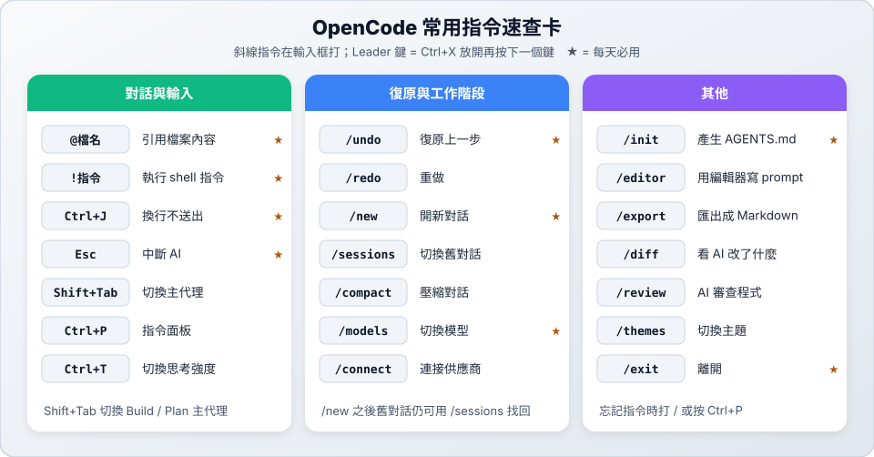

# 02　基本操作

> ★ 入門　｜　[← 01 安裝與連線](01-install.md)　｜　[章節首頁](README.md)　｜　下一站：[03 斜線指令 →](03-slash-commands.md)

**這一站你會學到**：和 AI 對話、讓它看指定的檔案、切換主代理，以及最常用的快捷鍵。

---

## 1. 啟動與離開

```bash
cd ~/my-project
opencode
```

也可以直接帶路徑：`opencode ~/my-project`。想接著上次的對話：`opencode -c`。

離開時輸入 `/exit`，或按 `Ctrl+C`。

## 2. 四種輸入方式

| 輸入 | 效果 | 範例 |
| :--- | :--- | :--- |
| 一般文字 | 交代 AI 做事 | `幫我在 README 加上安裝說明` |
| **`@名稱`** | 跳出選單，可以選檔案、Skill 或子代理 | `請看 @src/app.py，說明它在做什麼` |
| **`!指令`** | 在空白的輸入框打 `!`，進入 shell 模式執行指令，按 `Esc` 取消 | `!git status` |
| **`/指令`** | 斜線指令，操作 OpenCode 本身 | `/undo` |

> 想打多行再送出：按 `Ctrl+J`（或 `Shift+Enter`）換行，最後按 `Enter` 送出。

> [!TIP]
> `@` 選單右邊會標示種類：**skill**、**agent**，沒有標示的是檔案。只想看檔案的一部分時，可以加上行號，例如 `@src/app.py#20-45`。

## 3. 第一次對話

```text
請閱讀這個專案的目錄結構和 README，用三句話說明這個專案在做什麼。先不要修改任何檔案。
```

## 4. 兩個主代理：Build 和 Plan

按 **`Shift+Tab`** 切換，輸入框下方會顯示目前是哪一個：

| 主代理 | 做什麼 | 什麼時候用 |
| :--- | :--- | :--- |
| **Build**（預設） | 可以改檔案、執行指令 | 要它動手做的時候 |
| **Plan** | 只分析和規劃，不會修改專案檔案 | 想先看看它打算怎麼做的時候 |

> [!NOTE]
> 舊版是按 `Tab`，OpenCode 2 改成 `Shift+Tab`。畫面底部的 `shift+tab agents` 就是在提示這件事。

---

## 5. 快捷鍵



很多功能有快捷鍵。OpenCode 的快捷鍵常以 **`Ctrl+X`** 開頭（稱為 Leader 鍵）：先按 `Ctrl+X`，放開，再按下一個鍵。

| 功能 | 快捷鍵 | 對應的斜線指令 |
| :--- | :--- | :--- |
| 中斷 AI | `Esc` | — |
| 切換主代理 | `Shift+Tab` | `/agents` |
| 切換思考強度 | `Ctrl+T` | `/variants` |
| 指令面板 | `Ctrl+P` | — |
| 切換模型 | `Ctrl+X` → `M` | `/models` |
| 開新對話 | `Ctrl+X` → `N` | `/new` |
| 切換舊對話 | `Ctrl+X` → `L` | `/sessions` |
| 復原上一步 | `Ctrl+X` → `U` | `/undo` |
| 重做 | `Ctrl+X` → `R` | `/redo` |
| 壓縮對話 | `Ctrl+X` → `C` | `/compact` |
| 用編輯器寫訊息 | `Ctrl+X` → `E` | `/editor` |
| 匯出對話 | `Ctrl+X` → `X` | `/export` |
| 顯示／隱藏側邊欄 | `Ctrl+X` → `B` | — |

> 所有斜線指令和小範例，下一站會一個一個介紹。

---

## ✅ 動手練習

1. 啟動 OpenCode，問它專案在做什麼。
2. 用 `@` 引用一個檔案，請它解釋。
3. 輸入 `!ls` 看看結果。
4. 請它新增一個小檔案，再用 `/undo` 復原。
5. 按 `Shift+Tab` 切換到 Plan，觀察輸入框下方的變化，再切回 Build。

> 下一站：[03 斜線指令 →](03-slash-commands.md)
