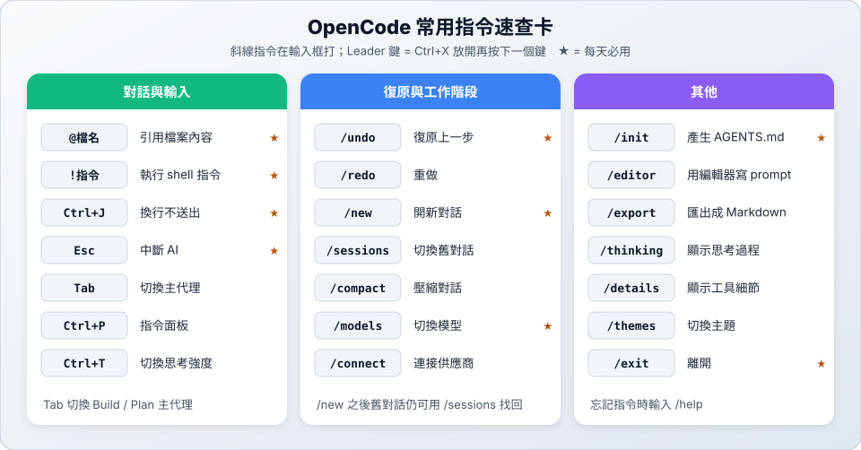

# 02　基本操作

> ★ 入門　｜　[← 01 安裝與連線](01-install.md)　｜　[章節首頁](README.md)　｜　下一站：[03 AGENTS.md 專案規則 →](03-agents-md.md)

**這一站你會學到**：和 AI 對話、讓它看指定的檔案、使用斜線指令與快捷鍵。

---

## 1. 啟動

```bash
cd ~/my-project
opencode
```

也可以直接帶路徑：`opencode ~/my-project`。

## 2. 三種輸入方式

| 輸入 | 效果 | 範例 |
| :--- | :--- | :--- |
| 一般文字 | 交代 AI 做事 | `幫我在 README 加上安裝說明` |
| **`@檔名`** | 把檔案內容交給 AI（會跳出選單讓你挑） | `請看 @src/app.py，說明它在做什麼` |
| **`!指令`** | 直接執行 shell 指令，結果也會給 AI 看 | `!git status` |
| **`/指令`** | 斜線指令，操作 OpenCode 本身 | `/undo` |

> 想打多行再送出：按 `Ctrl+J`（或 `Shift+Enter`）換行，最後按 `Enter` 送出。

## 3. 第一次對話

```text
請閱讀這個專案的目錄結構和 README，用三句話說明這個專案在做什麼。先不要修改任何檔案。
```

---

## 4. 斜線指令與快捷鍵



很多斜線指令也有快捷鍵。OpenCode 的快捷鍵以 **`Ctrl+X`** 開頭（稱為 Leader 鍵）：先按 `Ctrl+X`，放開，再按下一個鍵。

| 功能 | 斜線指令 | 快捷鍵 |
| :--- | :--- | :--- |
| 切換模型 | `/models` | `Ctrl+X` → `M` |
| 開新對話 | `/new` | `Ctrl+X` → `N` |
| 切換舊對話 | `/sessions` | `Ctrl+X` → `L` |
| 復原上一步 | `/undo` | `Ctrl+X` → `U` |
| 重做 | `/redo` | `Ctrl+X` → `R` |
| 壓縮對話 | `/compact` | `Ctrl+X` → `C` |
| 用編輯器寫 prompt | `/editor` | `Ctrl+X` → `E` |
| 匯出對話 | `/export` | `Ctrl+X` → `X` |
| 離開 | `/exit` | `Ctrl+X` → `Q`，或 `Ctrl+C` |
| 中斷 AI | — | `Esc` |
| 切換主代理（Build / Plan） | — | `Tab` |
| 切換思考強度 | — | `Ctrl+T` |
| 指令面板 | — | `Ctrl+P` |

> 忘記指令時輸入 `/help`。

---

## ✅ 動手練習

1. 啟動 OpenCode，問它專案在做什麼。
2. 用 `@` 引用一個檔案，請它解釋。
3. 輸入 `!ls` 看看結果。
4. 請它新增一個小檔案，再用 `/undo` 復原。
5. 按 `Tab` 切換到 Plan，觀察介面的變化，再切回 Build。

> 下一站：[03 AGENTS.md 專案規則 →](03-agents-md.md)
