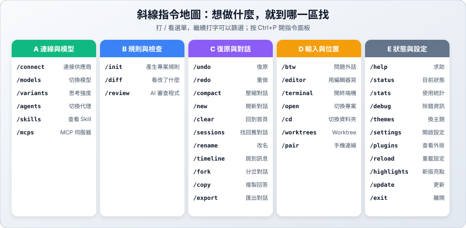

# 03　斜線指令

> ★ 入門　｜　[← 02 基本操作](02-basics.md)　｜　[章節首頁](README.md)　｜　下一站：[04 環境配置 →](04-config.md)

**這一站你會學到**：什麼是斜線指令、新手必學的 8 個指令，並透過分區連結進入各區介紹、做自己的專屬指令與動手練習（全程只建立 Markdown 筆記檔，**完全不用寫程式**！）。



---

## 1. 怎麼使用斜線指令？

斜線指令（Slash Command）是 OpenCode 輸入框裡的快捷功能，以 `/` 開頭。

1. 在輸入框打 `/`，會跳出指令選單。
2. 繼續打字可以篩選，例如打 `/un` 會看到 `/undo`。
3. 按 `Enter` 執行。

有些指令後面可以直接接一句中文，例如：

```text
/btw Markdown 的標題怎麼分層級？
```

> [!TIP]
> **按了 `Enter`，指令還留在輸入框？** 這是在等你補上後面的說明文字。補完或直接再按一次 `Enter` 就會送出。

> [!NOTE]
> 選單會隨情況變化。`/undo`、`/compact`、`/copy`、`/export`、`/fork`、`/rename`、`/timeline`、`/terminal` 要**對話開始後**才會出現，`/redo` 則要先 `/undo` 過。剛啟動時找不到它們是正常的。

---

## 2. 新手必學 8 個指令

剛開始使用時，先認識這 8 個最常用的指令就夠了：

| 指令 | 一句話說明 | 什麼時候用 | 所屬分區 |
| :--- | :--- | :--- | :---: |
| [`/connect`](03-slash-commands/a-models.md#connect連接模型供應商) | 連接模型供應商 | 第一次使用、登入失效時 | [A 區](03-slash-commands/a-models.md) |
| [`/models`](03-slash-commands/a-models.md#models切換模型可搜尋免費模型) | 切換模型（可找 `free` 免費模型） | 模型太慢或想換免費模型時 | [A 區](03-slash-commands/a-models.md) |
| [`/init`](03-slash-commands/b-review.md#init產生專案規則agentsmd) | 產生專案規則（`AGENTS.md`） | 進到新資料夾或新專案時 | [B 區](03-slash-commands/b-review.md) |
| [`/diff`](03-slash-commands/b-review.md#diff看-ai-改了什麼) | 看 AI 改了什麼 | AI 修改完 `.md` 檔案後 | [B 區](03-slash-commands/b-review.md) |
| [`/undo`](03-slash-commands/c-session.md#undo復原上一步) | 復原上一步 | AI 把檔案改壞或寫錯方向時 | [C 區](03-slash-commands/c-session.md) |
| [`/compact`](03-slash-commands/c-session.md#compact壓縮對話) | 壓縮對話 | 對話太長、AI 開始忘東忘西時 | [C 區](03-slash-commands/c-session.md) |
| [`/new`](03-slash-commands/c-session.md#new-與-clear開始新對話) | 開新對話 | 換一個新主題時 | [C 區](03-slash-commands/c-session.md) |
| [`/exit`](03-slash-commands/e-status-settings.md#exit離開-opencode) | 離開 OpenCode | 下課或結束練習時 | [E 區](03-slash-commands/e-status-settings.md) |

> [!TIP]
> 不用背！忘記指令時打 `/` 看選單，或按 `Ctrl+P` 開指令面板。

---

## 3. 六大分區教學與練習（點擊進入）

為了讓你好找、好練，我們把所有斜線指令與自訂指令分成 **A～F 六大區**。每一區點進去都有詳細說明，以及**只用 Markdown 檔案、不寫程式的動手練習**：

| 分區連結 | 解決什麼問題？ | 這一區包含的內容 | 動手練習主題 |
| :--- | :--- | :--- | :--- |
| 🟢 **[A 區：連線與模型 →](03-slash-commands/a-models.md)** | 怎麼連供應商、找免費模型、切換代理？ | `/connect`、`/models`、`/variants`、`/agents`、`/skills`、`/mcps` | 挑一個 `free` 免費模型並建立 `hello.md` |
| 🔵 **[B 區：規則與檢查 →](03-slash-commands/b-review.md)** | 怎麼產生資料夾規矩、看 AI 改了哪幾行？ | `/init`、`/diff`、`/review` | 建立筆記規則、修改 `reading-notes.md` 並用 `/diff` 檢查 |
| 🟣 **[C 區：復原與對話 →](03-slash-commands/c-session.md)** | AI 改錯怎麼馬上復原？對話太長怎麼辦？ | `/undo`、`/redo`、`/compact`、`/new`、`/clear`、`/sessions`、`/rename`、`/timeline`、`/fork`、`/copy`、`/export` | 用 `travel.md` 旅遊筆記體驗 `/undo` 後悔藥與找回舊對話 |
| 🟠 **[D 區：輸入與位置 →](03-slash-commands/d-input-nav.md)** | 想隨口問問題、用編輯器打字或換資料夾？ | `/btw`、`/editor`、`/terminal`、`/cd`、`/open`、`/worktrees`、`/pair` | 用 `/btw` 查語法、建立 `notes/faq.md` 並用 `/cd` 切換目錄 |
| ⚪ **[E 區：狀態與設定 →](03-slash-commands/e-status-settings.md)** | 怎麼換配色主題、看用量統計或離開？ | `/help`、`/status`、`/stats`、`/debug`、`/themes`、`/settings`、`/reload`、`/plugins`、`/highlights`、`/update`、`/exit` | 用 `/themes` 換喜歡的主題配色並查看 `/stats` 統計 |
| ✨ **[F 區：自訂斜線指令 →](03-slash-commands/f-custom-commands.md)** | 常打的句子怎麼變成自己的 `/指令`？ | 用 `.opencode/commands/*.md` 建立專屬斜線指令 | 親手做出 `/hello` 打招呼與 `/diary` 自動寫日記指令 |

---

## 4. ✅ 5 分鐘初體驗（不寫程式，只建 Markdown 檔！）

還沒點進各分區前，你可以先在任何空資料夾啟動 `opencode`，跟著下面 5 步體驗最核心的流程：

| 步驟 | 在對話框輸入 | 觀察重點 |
| :---: | :--- | :--- |
| **1** | `/models` | 輸入 `free` 篩選出免費模型，選一個按 `Enter` |
| **2** | `請幫我建立 todo.md，列出準備期末報告的 5 個待辦步驟` | 讓 AI 幫你建立第一份 Markdown 筆記檔 `todo.md` |
| **3** | `請在 todo.md 最下面加上一段「週末預計進度」` | 讓 AI 修改剛剛建立的 `todo.md` |
| **4** | `/diff` | 打開差異檢視器，看看綠色 `+` 標示出 AI 剛才新增的哪幾行（按 `Esc` 關閉） |
| **5** | `/undo` → 看完再輸入 `/redo` | 體驗一鍵撤銷剛剛的修改，再一鍵恢復回來！ |

體驗完上面 5 步後，就可以從 **[🟢 A 區：連線與模型](03-slash-commands/a-models.md)** 開始依序逛進去了！

---

[← 02 基本操作](02-basics.md)　｜　[章節首頁](README.md)　｜　下一站：[04 環境配置 →](04-config.md)
