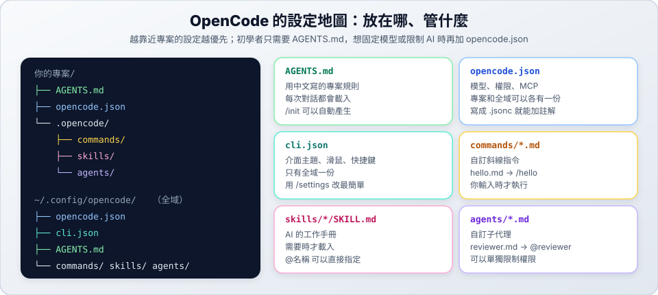

# 04　環境配置

> ★★ 進階　｜　[← 03 斜線指令](03-slash-commands.md)　｜　[章節首頁](README.md)　｜　下一站：[05 Skill 配置 →](05-skills.md)

**這一站你會學到**：OpenCode 的設定檔放在哪裡、怎麼固定預設模型、怎麼調整介面，以及環境變數和 MCP 的用法。



---

## 開始前：建立本節練習資料夾

先完成[課堂練習準備](../practice/README.md)的工具確認與教材下載，再在**一般終端機**逐行執行：

```bash
python3 ~/terminal-ai-course/practice/prepare.py ~/terminal-ai-labs/opencode/04
cd ~/terminal-ai-labs/opencode/04
opencode
```

看到目的資料夾已存在時，直接 `cd` 進去接續；要重做則把路徑最後一段改成 `04-retry`。本節的程式、筆記與初始 Git commit 都已準備好。

---

## 1. 最簡單的方式：一句話請 AI 改

不用記設定格式，直接說：

```text
請幫我修改這個專案的 opencode.json，把預設模型設成 opencode/nemotron-3.5-lightning-free，改完後說明你改了什麼。
```

接下來的內容是讓你**看得懂 AI 改了什麼**，不需要背。

---

## 2. 設定檔放在哪裡？

OpenCode 有兩個主要的設定檔，管的事情不一樣：

| 檔案 | 位置 | 管什麼 |
| :--- | :--- | :--- |
| **`opencode.json`**（全域） | `~/.config/opencode/opencode.json` | 你所有專案的 AI 行為：模型、權限、MCP |
| **`opencode.json`**（專案） | 專案根目錄 | 這個專案專用的設定，可以用 Git 分享 |
| **`cli.json`** | `~/.config/opencode/cli.json` | 介面外觀：主題、滑鼠、快捷鍵。只有全域一份 |

> [!TIP]
> 把副檔名改成 `.jsonc` 就能在設定檔裡寫 `//` 註解，比較好讀。

**兩份都有時聽誰的？** 設定會合併，衝突時**越靠近專案的越優先**：

```text
全域設定  →  專案根目錄  →  子資料夾  →  .opencode/ 裡的設定
（優先權低）                              （優先權高）
```

想確認實際讀到哪些檔案，在一般終端機輸入：

```bash
opencode debug config
```

> [!WARNING]
> 這個指令的輸出可能包含你的 **API Key**，不要整段貼給別人。

---

## 3. 常用設定

### 固定預設模型

沒有設定時，OpenCode 會自己挑模型，不一定是你想用的。建議在全域設定檔固定下來：

```jsonc
{
  "$schema": "https://opencode.ai/config.json",
  "model": "opencode/nemotron-3.5-lightning-free"
}
```

> `$schema` 這行讓編輯器能檢查拼字，建議保留。

### 其他常用欄位

| 欄位 | 用途 | 範例 |
| :--- | :--- | :--- |
| `model` | 預設模型 | `"opencode/nemotron-3.5-lightning-free"` |
| `default_agent` | 預設的主代理 | `"plan"` |
| `shell` | `!` 和 AI 執行指令時用的 shell | `"zsh"` |
| `permissions` | 權限規則 | 見 [08 權限設定](08-permissions.md) |
| `instructions` | 額外的規則檔 | `["docs/規範.md"]` |
| `skills` | 額外的 Skill 來源 | `["~/my-skills"]` |
| `commands` | 用 JSON 定義斜線指令 | 見下方 |
| `mcp` | MCP 伺服器 | 見[第 5 節](#5-mcp讓-ai-使用外部工具) |
| `compaction` | 自動壓縮對話 | `{ "auto": true }` |

**範例：用 JSON 定義斜線指令**（效果和 [03-F 自訂斜線指令](03-slash-commands/f-custom-commands.md)的 `.md` 檔一樣）

```jsonc
{
  "$schema": "https://opencode.ai/config.json",
  "commands": {
    "hello": {
      "description": "打招呼",
      "template": "請用一句繁體中文跟 $ARGUMENTS 打招呼。"
    }
  }
}
```

### 調整介面（`cli.json`）

最簡單的方式是輸入 `/settings` 或 `/themes`，用選的就好，OpenCode 會幫你存檔。想手動編輯時長這樣：

```json
{
  "$schema": "https://opencode.ai/v2/cli.json",
  "theme": { "name": "tokyonight", "mode": "dark" },
  "mouse": false,
  "keybinds": {
    "leader": "ctrl+x"
  }
}
```

| 欄位 | 用途 |
| :--- | :--- |
| `theme.name`、`theme.mode` | 主題名稱；模式可選 `system`、`dark`、`light` |
| `mouse` | 要不要啟用滑鼠 |
| `tabs.mode` | 分頁功能：`auto`、`on`、`off` |
| `attention.sound` | 工作完成時要不要發出聲音 |
| `keybinds` | 自訂快捷鍵，設成 `"none"` 表示停用 |

---

## 4. 環境變數

環境變數是在**啟動 OpenCode 之前**，由終端機提供的設定。

### 新手只需要這一個：`EDITOR`

讓 `/editor` 知道要開哪個編輯器：

```bash
# 寫進 ~/.zshrc，以後每次開終端機都會生效
echo 'export EDITOR="code --wait"' >> ~/.zshrc
source ~/.zshrc
```

> 圖形介面的編輯器（例如 VS Code）一定要加 `--wait`，OpenCode 才會等你存檔關閉。用 Vim 的話寫 `export EDITOR="vim"`。

### 完整範例：用環境變數指定模型

先用 `/models` 記下可用模型 ID，離開 OpenCode 後在一般終端機設定（若下列模型不可用，換成自己記下的 ID）：

```bash
export CLASSROOM_MODEL="opencode/nemotron-3.5-lightning-free"
```

把專案 `opencode.json` 的 model 欄位改為環境變數引用，保留其他欄位：

```json
{
  "$schema": "https://opencode.ai/config.json",
  "model": "{env:CLASSROOM_MODEL}"
}
```

執行 `opencode --standalone`，送出 `請只回覆 OK`。**驗收**：輸入框的模型與 CLASSROOM_MODEL 一致，並取得回答。完成後先把 model 改回原本的固定 ID，再退出並在終端機執行 `unset CLASSROOM_MODEL`；重啟後模型仍可使用。

設定檔支援兩種引用方式：

| 寫法 | 意思 |
| :--- | :--- |
| `{env:變數名稱}` | 換成環境變數的值，上面已可實際操作 |
| `{file:路徑}` | 換成檔案的內容，例如金鑰檔內容 |

API 金鑰也可透過環境變數引用，但需先有真實供應商與金鑰；初學者直接依第 01 站 `/connect` 登入即可，不需要建立虛構供應商。不要把金鑰寫在要 commit 的檔案裡。

### 其他環境變數（進階）

| 變數 | 用途 |
| :--- | :--- |
| `EDITOR`、`VISUAL` | `/editor` 使用的編輯器 |
| `OPENCODE_CONFIG` | 指定另一份設定檔的路徑 |
| `OPENCODE_CONFIG_DIR` | 指定另一個放代理、指令、外掛的資料夾 |
| `OPENCODE_CONFIG_CONTENT` | 直接用一段 JSON 當設定 |
| `OPENCODE_CLI_CONFIG_CONTENT` | 直接用一段 JSON 當介面設定 |
| `OPENCODE_DISABLE_PROJECT_CONFIG` | 設成 `1` 時不讀專案的設定和 `AGENTS.md` |
| `OPENCODE_LOG_LEVEL` | 記錄的詳細程度 |

> [!IMPORTANT]
> **設了環境變數卻沒反應？** OpenCode 平常在背景跑一個服務，這個服務不會讀到你**後來**才設的環境變數。可以這樣解決：
>
> ```bash
> # 方法一：重新啟動背景服務，讓它讀到新的環境變數
> opencode service restart
>
> # 方法二：這次啟動不使用背景服務
> opencode --standalone
> ```
>
> 只是改了設定檔的話，輸入 `/reload` 就好。

---

## 5. MCP：讓 AI 使用外部工具

MCP 伺服器可以幫 AI 加上新能力。這裡使用能實際連線的本機檔案伺服器。先在一般終端機執行 `node --version`、`npx --version`，確認已安裝 Node.js；首次下載需要網路。

1. 在本章練習資料夾執行 `pwd`，記下完整路徑。
2. 在 OpenCode 輸入以下提示詞，最後一行貼上剛才的路徑：

```text
請在這個專案的 opencode.json 合併一個 lab-files 本機 MCP 伺服器，保留其他設定。
啟動指令為 npx -y @modelcontextprotocol/server-filesystem，最後加上我下一行提供的完整練習專案路徑，請把它放在 command 陣列最後一項。
完整練習專案路徑：請在這裡貼上 pwd 顯示的路徑
```

設定檔裡會長這樣：

```jsonc
{
  "$schema": "https://opencode.ai/config.json",
  "mcp": {
    "servers": {
      "lab-files": {
        "type": "local",
        "command": ["npx", "-y", "@modelcontextprotocol/server-filesystem", "/請換成本章練習專案的完整路徑"]
      }
    }
  }
}
```

3. 輸入 `/reload`，再用 `/mcps` 查看 `lab-files` 連線狀態；失敗時選中後按 `Space` 重試，檢查完整路徑、Node 與網路。
4. 送出以下任務：

```text
請使用 lab-files MCP 的讀檔工具讀取 README.md，回報測試指令，並指出使用了哪個 MCP 工具。不要改用普通讀檔或終端機。
```

**驗收**：紀錄顯示 `lab-files` 工具被呼叫，回答包含 `python3 -m unittest discover -s tests -v`。只有普通讀檔紀錄時，請要求重做。

**收尾**：請 AI 只刪除 `opencode.json` 的 `mcp.servers.lab-files` 項目，保留模型與其他設定。輸入 `/reload`，再確認 `/mcps` 不再列出它。設定格式見 [官方 MCP 文件](https://opencode.ai/docs/mcp-servers)，工具來源見 [官方 Filesystem Server](https://github.com/modelcontextprotocol/servers/tree/main/src/filesystem)。

> [!WARNING]
> MCP 伺服器能讓 AI 做很多事，只安裝你信任的來源。

---

## 完整小練習：模型、JSON 指令、介面與環境變數

### A. 固定模型並測試 JSON 指令

1. 用 `/models` 找出本帳號可用的模型 ID，依第 1 節提示詞寫入專案 `opencode.json`（範例免費模型若下架，就換成選單中的非中國大陸模型）。
2. 把第 3 節的 `commands.hello` **合併**進同一份 `opencode.json`，不要用範例整份蓋掉模型設定。
3. 輸入 `/reload`，再送出 `/hello 小明`。

**驗收**：回覆提到「小明」，輸入框下方模型符合設定；離開再啟動仍使用該模型。練完可只刪除本次新增的 `commands.hello`，重載後它應從選單消失。

### B. 調整介面後還原

在 `/themes` 記下原主題，選 `tokyonight`（若清單無此項目就選另一個已列出的主題）並確認畫面改色。離開再啟動應保留新配色；最後選回原主題。要試手動修改 `cli.json`，先備份既有檔案，只合併 `mouse: false`，重啟後確認滑鼠選取行為改變，再還原原值。

### C. 用外部編輯器送出一則訊息

先在終端機確認 `nano --version` 可執行。離開 OpenCode 後，使用一次性的環境變數，不必改 `~/.zshrc`：

```bash
EDITOR=nano opencode --standalone
```

送出一則 `你好` 後執行 `/editor`，在 nano 輸入：

```text
請閱讀 README.md，列出用途、執行方式、測試方式三點，不修改檔案。
```

按 `Ctrl+O`、`Enter` 儲存，再 `Ctrl+X` 離開 nano。回到 OpenCode 後按 `Enter` 送出。

**驗收**：訊息帶回輸入框，AI 能正確列出本專案指令。離開後正常執行 `opencode`，本次 `EDITOR=nano` 不會改掉原本 shell 的設定。若使用原本的背景服務，依第 4 節先重啟服務，或像這裡加上 `--standalone`。

### D. 環境變數引用：先用無機密的值驗證

除了前面的 CLASSROOM_MODEL，也可實際操作 `OPENCODE_CONFIG_CONTENT`：在一般終端機執行：

```bash
OPENCODE_CONFIG_CONTENT='{"default_agent":"plan"}' opencode --standalone
```

**驗收**：新對話的主代理為 Plan；送出 `請規劃在 README.md 加一句摘要，先不要改檔案。`，應只給計畫。離開後正常啟動應回到原設定。需要真實 API 金鑰時用 `/connect` 的完整流程，無需建立不存在的 `acme` 供應商。

## ✅ 自我檢查

- [ ] 說得出 `opencode.json` 和 `cli.json` 各管什麼
- [ ] 把預設模型固定成免費模型，重新啟動後輸入框下方顯示正確的模型
- [ ] 用 `/themes` 換過主題
- [ ] 設定 `EDITOR`，並用 `/editor` 寫過一則訊息
- [ ] 知道環境變數沒生效時可以用 `opencode service restart`

> 下一站：[05 Skill 配置 →](05-skills.md)
