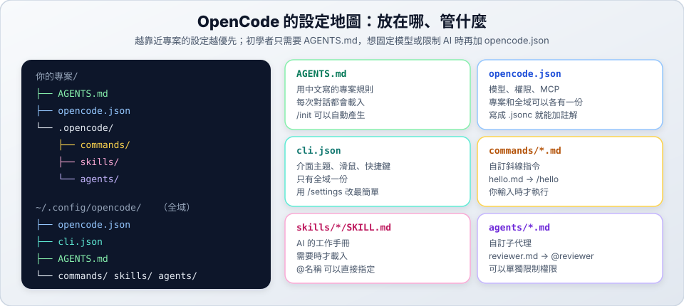

# 04　環境配置

> ★★ 進階　｜　[← 03 斜線指令](03-slash-commands.md)　｜　[章節首頁](README.md)　｜　下一站：[05 Skill 配置 →](05-skills.md)

**這一站你會學到**：OpenCode 的設定檔放在哪裡、怎麼固定預設模型、怎麼調整介面，以及環境變數和 MCP 的用法。



---

## 1. 最簡單的方式：一句話請 AI 改

不用記設定格式，直接說：

```text
請幫我修改這個專案的 opencode.json，把預設模型設成 opencode/nemotron-3.5-lightning-free，改完後說明你改了什麼。
```

接下來的內容是讓你**看得懂 AI 改了什麼**，不需要背。

---

## 2. 設定檔放在哪裡？

OpenCode 有兩個主要的設定檔，管的事情不一樣：

| 檔案 | 位置 | 管什麼 |
| :--- | :--- | :--- |
| **`opencode.json`**（全域） | `~/.config/opencode/opencode.json` | 你所有專案的 AI 行為：模型、權限、MCP |
| **`opencode.json`**（專案） | 專案根目錄 | 這個專案專用的設定，可以用 Git 分享 |
| **`cli.json`** | `~/.config/opencode/cli.json` | 介面外觀：主題、滑鼠、快捷鍵。只有全域一份 |

> [!TIP]
> 把副檔名改成 `.jsonc` 就能在設定檔裡寫 `//` 註解，比較好讀。

**兩份都有時聽誰的？** 設定會合併，衝突時**越靠近專案的越優先**：

```text
全域設定  →  專案根目錄  →  子資料夾  →  .opencode/ 裡的設定
（優先權低）                              （優先權高）
```

想確認實際讀到哪些檔案，在一般終端機輸入：

```bash
opencode debug config
```

> [!WARNING]
> 這個指令的輸出可能包含你的 **API Key**，不要整段貼給別人。

---

## 3. 常用設定

### 固定預設模型

沒有設定時，OpenCode 會自己挑模型，不一定是你想用的。建議在全域設定檔固定下來：

```jsonc
{
  "$schema": "https://opencode.ai/config.json",
  "model": "opencode/nemotron-3.5-lightning-free"
}
```

> `$schema` 這行讓編輯器能檢查拼字，建議保留。

### 其他常用欄位

| 欄位 | 用途 | 範例 |
| :--- | :--- | :--- |
| `model` | 預設模型 | `"opencode/nemotron-3.5-lightning-free"` |
| `default_agent` | 預設的主代理 | `"plan"` |
| `shell` | `!` 和 AI 執行指令時用的 shell | `"zsh"` |
| `permissions` | 權限規則 | 見 [08 權限設定](08-permissions.md) |
| `instructions` | 額外的規則檔 | `["docs/規範.md"]` |
| `skills` | 額外的 Skill 來源 | `["~/my-skills"]` |
| `commands` | 用 JSON 定義斜線指令 | 見下方 |
| `mcp` | MCP 伺服器 | 見[第 5 節](#5-mcp讓-ai-使用外部工具) |
| `compaction` | 自動壓縮對話 | `{ "auto": true }` |

**範例：用 JSON 定義斜線指令**（效果和 [03-F 自訂斜線指令](03-slash-commands/f-custom-commands.md)的 `.md` 檔一樣）

```jsonc
{
  "$schema": "https://opencode.ai/config.json",
  "commands": {
    "hello": {
      "description": "打招呼",
      "template": "請用一句繁體中文跟 $ARGUMENTS 打招呼。"
    }
  }
}
```

### 調整介面（`cli.json`）

最簡單的方式是輸入 `/settings` 或 `/themes`，用選的就好，OpenCode 會幫你存檔。想手動編輯時長這樣：

```json
{
  "$schema": "https://opencode.ai/v2/cli.json",
  "theme": { "name": "tokyonight", "mode": "dark" },
  "mouse": false,
  "keybinds": {
    "leader": "ctrl+x"
  }
}
```

| 欄位 | 用途 |
| :--- | :--- |
| `theme.name`、`theme.mode` | 主題名稱；模式可選 `system`、`dark`、`light` |
| `mouse` | 要不要啟用滑鼠 |
| `tabs.mode` | 分頁功能：`auto`、`on`、`off` |
| `attention.sound` | 工作完成時要不要發出聲音 |
| `keybinds` | 自訂快捷鍵，設成 `"none"` 表示停用 |

---

## 4. 環境變數

環境變數是在**啟動 OpenCode 之前**，由終端機提供的設定。

### 新手只需要這一個：`EDITOR`

讓 `/editor` 知道要開哪個編輯器：

```bash
# 寫進 ~/.zshrc，以後每次開終端機都會生效
echo 'export EDITOR="code --wait"' >> ~/.zshrc
source ~/.zshrc
```

> 圖形介面的編輯器（例如 VS Code）一定要加 `--wait`，OpenCode 才會等你存檔關閉。用 Vim 的話寫 `export EDITOR="vim"`。

### 把 API Key 放在環境變數

**不要把 API Key 直接寫在要 commit 的設定檔裡**，改成引用環境變數：

```jsonc
{
  "providers": {
    "acme": {
      "settings": { "apiKey": "{env:ACME_API_KEY}" }
    }
  }
}
```

設定檔支援兩種引用方式：

| 寫法 | 意思 |
| :--- | :--- |
| `{env:變數名稱}` | 換成環境變數的值 |
| `{file:路徑}` | 換成檔案的內容，例如 `{file:~/.secrets/key}` |

> 如果用 `/connect` 登入，就不需要自己處理 API Key。

### 其他環境變數（進階）

| 變數 | 用途 |
| :--- | :--- |
| `EDITOR`、`VISUAL` | `/editor` 使用的編輯器 |
| `OPENCODE_CONFIG` | 指定另一份設定檔的路徑 |
| `OPENCODE_CONFIG_DIR` | 指定另一個放代理、指令、外掛的資料夾 |
| `OPENCODE_CONFIG_CONTENT` | 直接用一段 JSON 當設定 |
| `OPENCODE_CLI_CONFIG_CONTENT` | 直接用一段 JSON 當介面設定 |
| `OPENCODE_DISABLE_PROJECT_CONFIG` | 設成 `1` 時不讀專案的設定和 `AGENTS.md` |
| `OPENCODE_LOG_LEVEL` | 記錄的詳細程度 |

> [!IMPORTANT]
> **設了環境變數卻沒反應？** OpenCode 平常在背景跑一個服務，這個服務不會讀到你**後來**才設的環境變數。可以這樣解決：
>
> ```bash
> # 方法一：重新啟動背景服務，讓它讀到新的環境變數
> opencode service restart
>
> # 方法二：這次啟動不使用背景服務
> opencode --standalone
> ```
>
> 只是改了設定檔的話，輸入 `/reload` 就好。

---

## 5. MCP：讓 AI 使用外部工具

MCP 伺服器可以幫 AI 加上新能力，例如操作資料庫或瀏覽器。用一句話請 AI 設定就好：

```text
請幫我在這個專案的 opencode.json 加入一個叫 docs 的遠端 MCP 伺服器，網址是 https://example.com/mcp。
```

設定檔裡會長這樣：

```jsonc
{
  "$schema": "https://opencode.ai/config.json",
  "mcp": {
    "servers": {
      // 遠端的 MCP 伺服器
      "docs": {
        "type": "remote",
        "url": "https://example.com/mcp"
      },
      // 在你電腦上執行的 MCP 伺服器
      "my-tool": {
        "type": "local",
        "command": ["npx", "-y", "my-mcp-tool"]
      }
    }
  }
}
```

設定後輸入 `/mcps` 查看連線狀態。

> [!WARNING]
> MCP 伺服器能讓 AI 做很多事，只安裝你信任的來源。

---

## ✅ 自我檢查

- [ ] 說得出 `opencode.json` 和 `cli.json` 各管什麼
- [ ] 把預設模型固定成免費模型，重新啟動後輸入框下方顯示正確的模型
- [ ] 用 `/themes` 換過主題
- [ ] 設定 `EDITOR`，並用 `/editor` 寫過一則訊息
- [ ] 知道環境變數沒生效時可以用 `opencode service restart`

> 下一站：[05 Skill 配置 →](05-skills.md)
