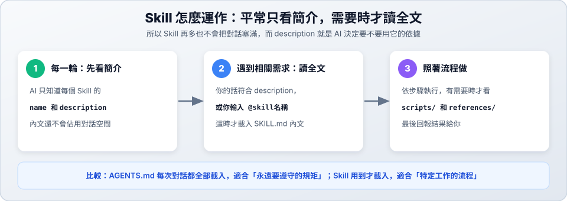

# 05　Skill 配置

> ★★ 進階　｜　[← 04 環境配置](04-config.md)　｜　[章節首頁](README.md)　｜　下一站：[06 AGENTS.md 專案規則 →](06-agents-md.md)

**這一站你會學到**：Skill 的「區域 vs 全域」差異、如何取得並使用**外部 Skill**、如何從零建立**自訂 Skill**，以及怎麼測試、停用與刪除 Skill。



---

## 1. Skill 是什麼？

**Skill 就像交給 AI 的一份工作手冊。** 你把某件事的做法寫下來，之後 AI 遇到這件事就會翻開手冊照做，你不用每次重新交代。

它和另外兩個功能很像，差別在這裡：

| | `AGENTS.md`（規則） | 斜線指令 | Skill（工作手冊） |
| :--- | :--- | :--- | :--- |
| **何時作用** | 每次對話都載入 | 你輸入 `/指令` 時 | AI 判斷需要時，或你用 `@` 指定時 |
| **適合內容** | 永遠要遵守的規矩 | 常打的一段話 | 特定工作的步驟 |
| **例子** | 一律用繁體中文回覆 | `/hello 小明` | 幫我出複習測驗、用白話文解說程式 |

> [!TIP]
> 同一件事交代 AI 超過兩次，就值得做成 Skill。

---

## 2. 區域（專案） vs 全域（個人）

每個 Skill 都是一個資料夾，裡面一定要有 `SKILL.md`。依照存放位置不同，分為**區域（專案）**與**全域（個人）**：

| 範圍 | 存放路徑 | 誰能用 | 適合放什麼 | 優先順序 |
| :--- | :--- | :--- | :--- | :---: |
| **區域（專案）** | `.opencode/skills/<名稱>/SKILL.md` | **只有這個專案**（可 commit 進 Git 分享給組員） | 專案專用的解說格式、檢查流程、團隊規範 | 1（最高，會覆蓋同名全域 Skill） |
| **全域（個人）** | `~/.config/opencode/skills/<名稱>/SKILL.md` | **你電腦上的所有專案** | 個人習慣用的工具（出題複習、筆記整理、寫 commit） | 2 |

> [!NOTE]
> - `.opencode` 前面有一個點，Finder 預設看不到（按 `Cmd+Shift+.` 可以顯示）。
> - 如果區域和全域有**同名的 Skill**，OpenCode 會優先使用**區域（專案）**的版本。

---

## 3. 使用「外部 Skill」的兩種方式

別人寫好的 Skill 不用自己重寫，在 OpenCode 中有兩種常見取得方式：

### 方式 A：直接共用其他 AI 工具的外部 Skill

OpenCode 會自動讀取其他工具的 Skill 資料夾，所以你在其他工具裝過的外部 Skill，在這裡也能直接用：

| 來源 | 區域（專案） | 全域（個人） |
| :--- | :--- | :--- |
| **通用格式（如 `agy`）** | `.agents/skills/<名稱>/` | `~/.agents/skills/<名稱>/` |
| **Claude Code** | `.claude/skills/<名稱>/` | `~/.claude/skills/<名稱>/` |

### 方式 B：從 GitHub 或同學分享取得單一 Skill

如果網路上或同學分享了一個 Skill 資料夾（裡面有 `SKILL.md`），只要把整個資料夾放進對應目錄即可：

- **只給這個專案用（區域）**：放到 `<專案>/.opencode/skills/<skill-名稱>/`
- **所有專案都要用（全域）**：放到 `~/.config/opencode/skills/<skill-名稱>/`

#### 動手實作：從 GitHub 安裝非程式類 Skill（以製作簡報 `pptx` 為例）

[anthropics/skills](https://github.com/anthropics/skills) 是官方開源的 Skill 寶庫，裡面有很多**非寫程式**的實用 Skill（如製作簡報 `pptx`、Word 文件 `docx`、PDF 處理 `pdf`）。

1. **下載並放到專案（區域）目錄**：
   ```bash
   git clone --depth 1 https://github.com/anthropics/skills.git /tmp/ext-skills
   mkdir -p .opencode/skills
   cp -r /tmp/ext-skills/skills/pptx .opencode/skills/pptx
   rm -rf /tmp/ext-skills
   ```
   > 想改成**全域**（所有專案都能用），把 `.opencode/skills/pptx` 換成 `~/.config/opencode/skills/pptx` 即可。

2. **檢查並載入**：打開 `.opencode/skills/pptx/SKILL.md` 確認內容安全後，在 OpenCode 輸入 `/reload`（再用 `/skills` 確認看到 `pptx`）。

3. **實際試用（非程式任務）**：
   ```text
   @pptx 請幫我製作一份 5 頁的簡報（intro.pptx），主題是「AI 協作開發入門」，大綱如下：
   第 1 頁（封面）：標題「AI 協作開發入門」、副標題「用終端機與 AI 一起寫程式」
   第 2 頁：什麼是 AI Coding Agent？（一句話定義＋三個常見用途）
   第 3 頁：傳統寫程式 vs AI 協作的差別（對照表）
   第 4 頁：新手必學的三個好習慣（說清楚需求、分小步測試、自己看過程式碼）
   第 5 頁（總結）：今天就能開始的第一步與 Q&A
   ```

4. **不想用了怎麼刪**：
   ```bash
   rm -rf .opencode/skills/pptx
   ```
   回到 OpenCode 輸入 `/reload` 就移除了。

> [!CAUTION]
> Skill 資料夾裡可能包含腳本或操作指示。使用來路不明的外部 Skill 前，**請先打開 `SKILL.md`（與 `scripts/`）看過內容**，確認沒有危險指令再載入。

---

## 4. 自訂 Skill：兩個學生可直接動手做的範例

以下兩個範例不需要複雜專案環境，**任何程式碼或筆記資料夾都能立刻測試**。

### 範例 1（區域・專案 Skill）：用一句話請 AI 建立「程式碼白話解說員」

適合放在課堂專案的 `.opencode/skills/`，組員 pull 下來就能一起用。

在 OpenCode 對話框直接輸入：

```text
請幫我在這個專案建立一個 OpenCode skill，名稱叫 explain-code，
放在 .opencode/skills/ 底下，用途是用初學者聽得懂的繁體中文解說指定程式碼，必須包含：
1. 一句話總結這段程式在做什麼
2. 用一個生活比喻說明核心邏輯
3. 逐段拆解關鍵步驟
4. 提醒一個初學者常踩的坑
```

AI 會自動建立 `.opencode/skills/explain-code/SKILL.md`。接著輸入 `/reload`（若選單已有可略過），然後在輸入框打 `@explain`，從選單選右邊標示 **skill** 的項目：

```text
@explain-code 請解說這個專案裡的主要程式檔案
```

送出後畫面會顯示 `skill  explain-code`，代表 AI 已經讀了這份手冊。

---

### 範例 2（全域・個人 Skill）：自己動手寫「複習出題小老師」

這個 Skill 放在**全域目錄**，以後不管寫哪一科的作業都能叫它出題考你！

#### 步驟 1：在全域目錄建立資料夾與 `SKILL.md`

```bash
mkdir -p ~/.config/opencode/skills/study-quiz
```

用編輯器打開 `~/.config/opencode/skills/study-quiz/SKILL.md`，貼入以下內容：

````markdown
---
name: study-quiz
description: 根據指定的程式碼或筆記內容，出 3 題繁體中文選擇題幫助學生複習。當使用者想複習或自我測驗時使用。
---

# 複習出題小老師

## 步驟

1. 閱讀使用者指定的檔案或段落內容。
2. 設計 **3 題繁體中文單選題**（每題 A、B、C、D 四個選項），難度由淺入深。
3. **先不要直接公布答案**，請使用者回覆他的答案（例如 `1A 2C 3B`）。
4. 等使用者作答後，再逐題批改並用白話文解釋為什麼。

## 輸出格式

```text
### 第 1 題：...
A. ...
B. ...
C. ...
D. ...
```
````

#### 步驟 2：重新載入並測試

在 OpenCode 輸入 `/reload`，再用兩種方式試試看：

| 測試方式 | 輸入範例 | 預期結果 |
| :--- | :--- | :--- |
| **用 `@` 指定** | `@study-quiz 根據 README.md 出題考我` | 畫面顯示 `skill  study-quiz`，並出 3 題選擇題等你作答 |
| **自然語言觸發** | `幫我針對這份程式出幾題測驗複習一下` | AI 判斷符合 `description`，自動載入 `study-quiz` 出題 |

> [!NOTE]
> OpenCode 的 Skill 不是斜線指令，`/study-quiz` 不會觸發它（要用 `@study-quiz` 或自然語言）。

---

## 5. 看懂 `SKILL.md` 與資料夾結構

### 資料夾結構

Skill 資料夾裡還可以放參考資料或腳本，AI 只有在 `SKILL.md` 叫它看的時候才會讀：

```text
<skill-名稱>/
├── SKILL.md            ← 必要：設定欄位與操作步驟
├── references/         ← 選用：比較長的參考文件
│   └── 範例格式.md
└── scripts/            ← 選用：輔助腳本
    └── check.sh
```

### 開頭的設定欄位（Frontmatter）

`SKILL.md` 最上面兩條 `---` 之間的內容：

| 欄位 | 用途 | 寫法建議 |
| :--- | :--- | :--- |
| `name` | 顯示的名稱 | 小寫英文、數字與連字號，和資料夾名稱相同 |
| `description` | **最重要**。AI 靠它判斷要不要自動使用這個 Skill | 寫清楚「什麼時候用」和「會做什麼」 |
| `disable-model-invocation` | 設成 `true` 時，AI 不會自動使用，只有你用 `@` 才會觸發 | 用在有風險的工作，例如部署 |

> [!IMPORTANT]
> **沒有寫 `description`，AI 就不知道何時該自動使用這個 Skill**，只能由你自己用 `@` 呼叫。

### 取名規則與 `description` 寫法

- 名稱建議只用**小寫英文、數字與連字號**（如 `study-quiz`、`explain-code`），不要用大寫、底線或中文。
- `description` 避免只寫兩個字（如 `出題` ❌），要寫清楚時機與成果（如 `根據程式碼或筆記出 3 題繁體中文選擇題幫助複習。當使用者想自我測驗時使用。` ✅）。

---

## 6. 建立、停用與刪除總整理（區域 vs 全域）

| 操作 | 區域（專案 Skill） | 全域（個人 Skill） |
| :--- | :--- | :--- |
| **查看已載入** | 在對話框輸入 `/skills` | 在對話框輸入 `/skills` |
| **建立** | `mkdir -p .opencode/skills/<名稱>`<br>建立 `SKILL.md` | `mkdir -p ~/.config/opencode/skills/<名稱>`<br>建立 `SKILL.md` |
| **套用變更** | `/reload` | `/reload` |
| **暫時停用** | 把 `SKILL.md` 改名為 `SKILL.md.bak`<br>再輸入 `/reload` | 把 `SKILL.md` 改名為 `SKILL.md.bak`<br>再輸入 `/reload` |
| **徹底刪除** | `rm -rf .opencode/skills/<名稱>`<br>再輸入 `/reload` | `rm -rf ~/.config/opencode/skills/<名稱>`<br>再輸入 `/reload` |
| **分享給同學** | Commit `.opencode/skills/` 進 Git | 把該資料夾壓縮或複製給對方 |

> [!TIP]
> 也可以直接用中文請 AI 幫忙刪除，例如：「請幫我刪除這個專案的 `explain-code` skill」，刪除後記得輸入 `/reload` 與 `/skills` 確認。

### 限制 AI 使用哪些 Skill（進階）

如果不想刪除外部 Skill，只想在某個專案暫時禁止或要求先詢問，可以在 `opencode.json` 用權限規則控制（詳細寫法見 [08 權限設定](08-permissions.md)）：

```jsonc
{
  "$schema": "https://opencode.ai/config.json",
  "permissions": [
    // 所有 skill 都要先問我
    { "action": "skill", "resource": "*", "effect": "ask" },
    // 這個可以直接用
    { "action": "skill", "resource": "study-quiz", "effect": "allow" },
    // internal- 開頭的完全禁止
    { "action": "skill", "resource": "internal-*", "effect": "deny" }
  ]
}
```

---

## 7. Skill 沒有作用？

| 現象 | 先檢查 |
| :--- | :--- |
| `/skills` 看不到 | 檔名是不是全大寫的 `SKILL.md`？資料夾放對位置了嗎？再輸入 `/reload` 試試 |
| 看得到，但 AI 不會自動用 | `description` 寫得夠清楚嗎？有沒有設定 `disable-model-invocation`？ |
| 用 `@` 找不到 | 選單裡要選標示 **skill** 的項目，不要選到同名的檔案 |
| AI 拒絕使用 | `opencode.json` 的權限是不是設成 `deny` 了？ |
| 內容不是你剛寫的版本 | 其他位置有沒有同名的 Skill？區域（`.opencode/skills/`）會蓋過全域與 `.claude/skills/` |

---

## 8. 課堂動手練習（10 分鐘完成）

1. **建立一個區域 Skill**：用第 4 節的「範例 1」請 AI 建立 `explain-code`，輸入 `/reload` 後，用 `@explain-code` 解說專案裡的任一個檔案。
2. **建立一個全域 Skill**：用第 4 節的「範例 2」手動建立 `~/.config/opencode/skills/study-quiz/SKILL.md`，輸入 `/reload` 後，用 `@study-quiz` 考自己 3 題。
3. **測試自動觸發**：不用 `@`，改說「幫我針對這份程式出幾題測驗複習一下」，確認畫面出現 `skill  study-quiz`。
4. **體驗刪除流程**：將剛建立的 `explain-code` 刪除（`rm -rf .opencode/skills/explain-code`），再輸入 `/reload` 和 `/skills` 確認它已消失。

---

[← 04 環境配置](04-config.md)　｜　[章節首頁](README.md)　｜　下一站：[06 AGENTS.md 專案規則 →](06-agents-md.md)
