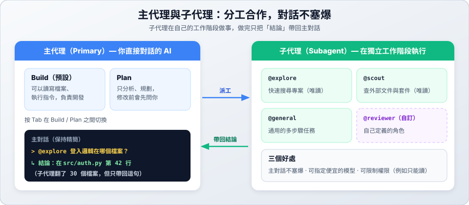

# 05　Subagent 子代理

> ★★★ 深入　｜　[← 04 實戰情境](04-scenarios.md)　｜　[章節首頁](README.md)　｜　下一站：[06 權限設定 →](06-permissions.md)

**這一站你會學到**：主代理和子代理的差別、怎麼呼叫子代理，以及自訂專屬的子代理。

---

## 1. 主代理與子代理



| 類型 | 是什麼 | 內建的代理 |
| :--- | :--- | :--- |
| **主代理（Primary）** | 你直接對話的 AI。按 `Tab` 切換 | **Build**（預設，可以改檔案、執行指令）<br>**Plan**（只分析規劃，修改前會先問你） |
| **子代理（Subagent）** | 被派去做特定工作的助手，在**獨立的工作階段**執行 | **Explore**（搜尋專案，唯讀）<br>**Scout**（查外部文件與套件，唯讀）<br>**General**（通用多步驟任務） |

**為什麼要用子代理？**

1. **主對話不塞爆**：子代理翻了幾十個檔案，只把結論帶回來。
2. **省錢**：子代理可以指定便宜或免費的模型。
3. **安全**：子代理可以單獨限制權限，例如只能讀、不能改。

## 2. 呼叫子代理

**方法一：用 `@` 指定**

```text
@explore 專案裡處理使用者登入的程式在哪個檔案？
```

**方法二：讓主代理自己決定**——主代理會依照每個子代理的說明（`description`），在需要時自動派工。

---

## 3. 自訂子代理

在專案建立 `.opencode/agents/` 資料夾，每個 `.md` 檔就是一個代理，**檔名就是代理的名字**。（全域的放在 `~/.config/opencode/agents/`。）

### 範例一：只讀的程式審查員（`.opencode/agents/reviewer.md`）

```markdown
---
description: 審查最近的改動或 git diff，找出錯誤、安全問題與邊界情況，只讀不修改
mode: subagent
model: opencode/muse-spark-1.3-contributor-free
temperature: 0.1
permission:
  edit: deny
  bash: deny
---

你是一位嚴格的程式審查員。請檢查改動，重點注意：
1. 沒有處理的錯誤或邊界情況。
2. 安全風險，例如沒有檢查使用者輸入。
3. 是否符合專案 AGENTS.md 的規範。

請依嚴重程度（嚴重 / 警告 / 建議）條列說明。不要修改任何檔案。
```

使用方式：`@reviewer 幫我檢查目前的 git diff`

### 範例二：測試助手（`.opencode/agents/tester.md`）

```markdown
---
description: 執行單元測試、分析失敗原因，並補上缺少的測試
mode: subagent
temperature: 0.2
---

你是測試工程師。請依照專案 AGENTS.md 的規範，用 uv run pytest 執行測試，
分析失敗的原因，並補上邊界情況的測試，直到全部通過。
```

> 也可以執行 `opencode agent create`，用問答的方式建立代理。

### 設定欄位

| 欄位 | 說明 |
| :--- | :--- |
| `description` | **必填**。說明這個代理做什麼；主代理靠它判斷何時派工 |
| `mode` | `subagent`（只當子代理）、`primary`（可用 `Tab` 切換）、`all`（兩者皆可，預設） |
| `model` | 指定模型，格式 `供應商/模型`；不寫就沿用主代理的模型 |
| `temperature` | 0.0～1.0，越低越穩定。審查、測試建議 0.1～0.2 |
| `permission` | 權限，例如 `edit: deny`、`bash: ask`（見 [06 權限設定](06-permissions.md)） |

---

## ✅ 自我檢查

- [ ] 用 `@explore` 問過一個關於專案的問題
- [ ] 建立了 `reviewer.md`，並用 `@reviewer` 呼叫它
- [ ] 執行 `opencode agent list` 看得到自訂的代理

> 下一站：[06 權限設定 →](06-permissions.md)
