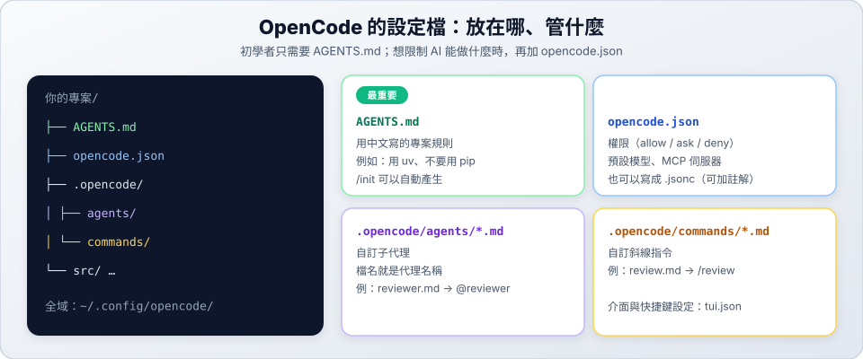

# 06　權限設定

> ★★★ 深入　｜　[← 05 Subagent 子代理](05-subagents.md)　｜　[章節首頁](README.md)　｜　下一站：[07 指令模式與 Herdr →](07-cli-run.md)

**這一站你會學到**：用 `opencode.json` 控制 AI 哪些事可以直接做、哪些要先問你、哪些完全禁止。

---

## 1. 設定檔放在哪裡



| 範圍 | 位置 |
| :--- | :--- |
| 這個專案 | 專案根目錄的 `opencode.json`（或 `opencode.jsonc`，可以加註解） |
| 所有專案 | `~/.config/opencode/opencode.json` |

兩份都有時會**合併**，衝突的設定以專案的為準。

## 2. 三種權限

| 值 | 意思 |
| :--- | :--- |
| `allow` | 直接執行，不問 |
| `ask` | 先問你，你同意才執行 |
| `deny` | 禁止 |

## 3. 範例

```jsonc
{
  "$schema": "https://opencode.ai/config.json",
  "permission": {
    // 修改檔案前先問我
    "edit": "ask",
    // 執行指令：預設先問，安全的指令直接允許，危險的禁止
    "bash": {
      "*": "ask",
      "git status *": "allow",
      "git diff *": "allow",
      "uv run pytest *": "allow",
      "rm *": "deny"
    }
  }
}
```

> [!IMPORTANT]
> 規則的順序很重要：**最後一條符合的規則生效**。所以要把通用的 `"*"` 放在最前面，特別的規則放在後面。

## 4. 確認設定有生效

```bash
opencode debug config
```

會列出 OpenCode 最後實際使用的設定。

---

## 設定檔一覽

| 檔案 | 放哪裡 | 用途 |
| :--- | :--- | :--- |
| `AGENTS.md` | 專案根目錄 | 用中文寫的專案規則（見 [03](03-agents-md.md)） |
| `opencode.json` | 專案根目錄 | 權限、預設模型（`"model": "供應商/模型"`）、MCP 伺服器 |
| `.opencode/agents/*.md` | 專案內 | 自訂代理（見 [05](05-subagents.md)） |
| `.opencode/commands/*.md` | 專案內 | 自訂斜線指令，檔名就是指令名稱 |
| `tui.json` | 和 `opencode.json` 放一起 | 介面主題、快捷鍵 |

---

## ✅ 自我檢查

- [ ] 在練習專案建立 `opencode.json`，讓 `edit` 變成 `ask`
- [ ] 請 AI 修改檔案時，看到它先問你
- [ ] 用 `opencode debug config` 確認設定

> 下一站：[07 指令模式與 Herdr →](07-cli-run.md)
