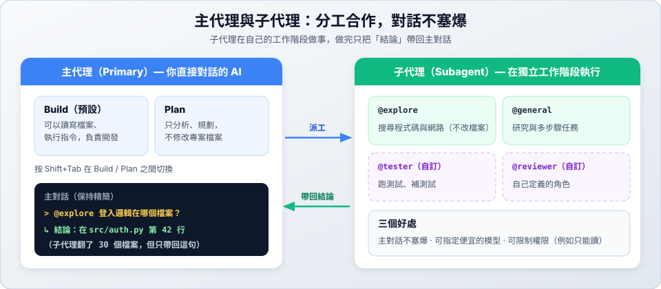

# 07　Subagent 子代理

> ★★★ 深入　｜　[← 06 AGENTS.md](06-agents-md.md)　｜　[章節首頁](README.md)　｜　下一站：[08 權限設定 →](08-permissions.md)

**這一站你會學到**：主代理和子代理的差別、怎麼呼叫子代理，以及自訂專屬的子代理。

---

## 開始前：建立本節練習資料夾

先完成[課堂練習準備](../practice/README.md)的工具確認與教材下載，再在**一般終端機**逐行執行：

```bash
python3 ~/terminal-ai-course/practice/prepare.py ~/terminal-ai-labs/opencode/07
cd ~/terminal-ai-labs/opencode/07
opencode
```

看到目的資料夾已存在時，直接 `cd` 進去接續；要重做則把路徑最後一段改成 `07-retry`。本節的程式、筆記與初始 Git commit 都已準備好。

---

## 1. 主代理與子代理



| 類型 | 是什麼 | 內建的代理 |
| :--- | :--- | :--- |
| **主代理（Primary）** | 你直接對話的 AI。按 `Shift+Tab` 切換 | **Build**（預設，可以改檔案、執行指令）<br>**Plan**（只分析規劃，不修改專案檔案） |
| **子代理（Subagent）** | 被派去做特定工作的助手，在**獨立的工作階段**執行 | **Explore**（搜尋程式碼和網路資料，不改檔案）<br>**General**（研究與多步驟任務） |

**為什麼要用子代理？**

1. **主對話不塞爆**：子代理翻了幾十個檔案，只把結論帶回來。
2. **省錢**：子代理可以指定便宜或免費的模型。
3. **安全**：子代理可以單獨限制權限，例如只能讀、不能改。

## 2. 呼叫子代理

**方法一：直接用中文說**

```text
請用 explore 子代理找出專案裡處理使用者登入的程式在哪個檔案。
```

**方法二：用 `@` 指定**——打 `@exp`，從選單選右邊標示 **agent** 的項目：

```text
@explore 專案裡處理使用者登入的程式在哪個檔案？
```

**方法三：讓主代理自己決定**——主代理會依照每個子代理的說明（`description`），在需要時自動派工。

---

## 3. 自訂子代理

最簡單的方式是用一句話請 AI 建立：

```text
請幫我建立一個 OpenCode 子代理 reviewer，放在 .opencode/agents/，用途是審查程式改動並列出問題，它只能讀，不能修改檔案。
```

每個代理都是一個 `.md` 檔，**檔名就是代理的名字**：

| 範圍 | 位置 |
| :--- | :--- |
| 這個專案 | `.opencode/agents/` |
| 所有專案 | `~/.config/opencode/agents/` |

### 範例一：只讀的程式審查員（`.opencode/agents/reviewer.md`）

```markdown
---
description: 審查最近的改動或 git diff，找出錯誤、安全問題與邊界情況，只讀不修改
mode: subagent
model: opencode/nemotron-3.5-lightning-free
permissions:
  - action: edit
    resource: "*"
    effect: deny
---

你是一位嚴格的程式審查員。請檢查改動，重點注意：
1. 沒有處理的錯誤或邊界情況。
2. 安全風險，例如沒有檢查使用者輸入。
3. 是否符合專案 AGENTS.md 的規範。

請依嚴重程度（嚴重 / 警告 / 建議）條列說明。不要修改任何檔案。
```

使用方式：`@reviewer 幫我檢查目前的 git diff`

### 範例二：測試助手（`.opencode/agents/tester.md`）

```markdown
---
description: 執行單元測試、分析失敗原因，並補上缺少的測試
mode: subagent
---

你是測試工程師。請依照專案 AGENTS.md 的規範，用 uv run pytest tests/ 執行測試，
分析失敗的原因，並補上邊界情況的測試，直到全部通過。
```

### 完整實作：探索、審查、測試與移除

**準備**：本章素材已含 `src/auth.py`、`calc.py`、`tests/` 與初始 commit；一般終端機先建立 `mkdir -p .opencode/agents`。

1. 依第 2 節分別用中文點名與 `@explore` 查詢登入程式。**驗收**：都找到 `src/auth.py` 的 `login`，不是只回覆「我來找找」。
2. 將範例一完整存成 `.opencode/agents/reviewer.md`，輸入 `/reload`，打 `@rev`，確認選單右邊標示 agent。範例模型若無法使用，刪除 `model` 欄位以沿用目前可用模型。
3. 先在 Build 送出 `請在 calc.py 的 divide 上方加上一句註解「除法練習」，不改邏輯。`，製造可供審查的差異。
4. 送出 `@reviewer 請審查目前 git diff 與 calc.py，檢查除以零的邊界問題，只回報不修改。`。**驗收**：報告指出零除數風險，`git diff -- calc.py` 仍只有剛才那句註解。
5. 將範例二存成 `.opencode/agents/tester.md`。先依[練習準備](../practice/README.md)安裝 uv，再於本章終端機執行 `uv sync`。輸入 `/reload`，送出：

```text
@tester 請只在 tests/test_auth.py 補上帳號與密碼為空字串時應登入失敗的測試，不改 src/，執行 uv run pytest tests/，全部通過後回報測試數。
```

**驗收**：終端機執行 `uv run pytest tests/` 應至少 5 題通過，`git diff -- src/` 無輸出；若不想安裝 uv，把 tester.md 的指令改為 `python3 -m unittest discover -s tests -v` 後重載，使用同一題亦可驗證。

**停用與恢復**：在終端機執行 `mv .opencode/agents/reviewer.md .opencode/agents/reviewer.md.bak`，`/reload` 後確認 `@reviewer` 不再出現；改回原檔名、重載後應恢復。

**收尾**：移除本次新建的 reviewer.md、tester.md，重載後確認兩個代理都不在選單（其他原有代理保留）。若任務仍在跑，先按 `Esc` 中斷目前任務並檢查子代理狀態，再移除設定檔。

### 設定欄位

| 欄位 | 說明 |
| :--- | :--- |
| `description` | 說明這個代理做什麼；主代理靠它判斷何時派工，子代理一定要寫 |
| `mode` | `subagent`（只當子代理）、`primary`（可用 `Shift+Tab` 切換，**不寫時的預設值**）、`all`（兩者皆可） |
| `model` | 指定模型，格式 `供應商/模型`；不寫就沿用目前的模型 |
| `permissions` | 權限規則（見 [08 權限設定](08-permissions.md)） |
| `steps` | 最多執行幾個步驟 |

> [!IMPORTANT]
> 要當子代理就一定要寫 `mode: subagent`，不然它會變成主代理。

> 網路上的舊教學可能用 `temperature`、`permission`、`tools` 這些欄位，它們是 OpenCode 1 的寫法，在這裡不要使用。

---

## ✅ 自我檢查

- [ ] 用 `@explore` 問過一個關於專案的問題
- [ ] 建立了 `reviewer.md`，並用 `@reviewer` 呼叫它
- [ ] 打 `@rev` 時，選單裡有標示 **agent** 的 `@reviewer`

> 下一站：[08 權限設定 →](08-permissions.md)
