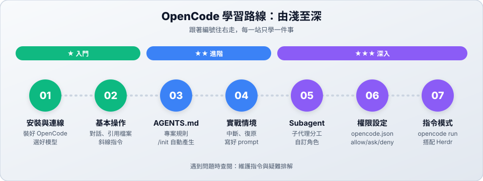

# OpenCode：在終端機裡和 AI 一起寫程式

**OpenCode** 是開源的 AI coding agent。它在終端機裡執行，能讀懂你的專案、修改檔案、執行指令，再根據結果繼續修正。

- 用中文說出需求，它會自己找檔案、寫程式、跑測試。
- 可以接很多家的 AI 模型，也有**免費模型**可以用。
- 能設定專案規則（`AGENTS.md`）、權限、子代理，讓 AI 照你的方式工作。

---

## 學習路線

| 站 | 主題 | 難度 | 你會學到 |
| :---: | :--- | :---: | :--- |
| 01 | [安裝與連線](01-install.md) | ★ | 裝好 OpenCode、連接模型、使用免費模型 |
| 02 | [基本操作](02-basics.md) | ★ | 對話、引用檔案、斜線指令與快捷鍵 |
| 03 | [AGENTS.md 專案規則](03-agents-md.md) | ★★ | 讓 AI 照專案的規矩做事 |
| 04 | [實戰情境](04-scenarios.md) | ★★ | 中斷、復原、對話太長、寫好 prompt |
| 05 | [Subagent 子代理](05-subagents.md) | ★★★ | 子代理分工、自訂專屬角色 |
| 06 | [權限設定](06-permissions.md) | ★★★ | 控制 AI 能做什麼、不能做什麼 |
| 07 | [指令模式與 Herdr](07-cli-run.md) | ★★★ | `opencode run`、搭配 Herdr 多工 |

> [!TIP]
> **時間不多？** 讀完 01、02 就能開始用；03、04 讓 AI 更聽話；05～07 是進階的分工與自動化。

---

## 📚 參考資料

| 文件 | 用途 |
| :--- | :--- |
| [維護指令與疑難排解](reference.md) | 常用管理指令、常見問題 |
| [官方文件](https://opencode.ai/docs) | OpenCode 官方網站 |
| [在 Herdr 中使用 OpenCode](../herdr/opencode-integration.md) | Herdr 整合 |

← [回到專案首頁](../README.md)
