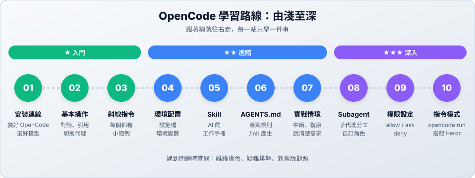

# OpenCode：在終端機裡和 AI 一起寫程式

**OpenCode** 是開源的 AI coding agent。它在終端機裡執行，能讀懂你的專案、修改檔案、執行指令，再根據結果繼續修正。

- **說中文就能用**：說出需求，它會自己找檔案、寫程式、跑測試。
- **斜線指令**：`/undo`、`/diff`、`/review` 等快捷功能，一個指令完成常見操作。
- **可以調成你的樣子**：用設定檔、規則和 Skill，讓 AI 照你的方式做事。
- **多種模型可選**：可以接很多家的 AI 模型，也有**免費模型**可以用。

> [!NOTE]
> 本教材以 **OpenCode 2** 為準（實測版本 2.0.32）。如果你看到的畫面或網路教學不一樣，可能是舊版，見[新舊版對照](reference.md#3-新舊版對照)。

---

## 學習路線

| 站 | 主題 | 難度 | 你會學到 |
| :---: | :--- | :---: | :--- |
| 01 | [安裝與連線](01-install.md) | ★ | 裝好 OpenCode、連接模型、使用免費模型 |
| 02 | [基本操作](02-basics.md) | ★ | 對話、引用檔案、切換代理、快捷鍵 |
| 03 | [斜線指令](03-slash-commands.md) | ★ | 所有內建指令的小範例、做自己的指令 |
| 04 | [環境配置](04-config.md) | ★★ | 設定檔位置、固定模型、環境變數、MCP |
| 05 | [Skill 配置](05-skills.md) | ★★ | 建立、使用和管理自己的 Skill |
| 06 | [AGENTS.md 專案規則](06-agents-md.md) | ★★ | 讓 AI 照專案的規矩做事 |
| 07 | [實戰情境](07-scenarios.md) | ★★ | 中斷、復原、對話太長、說清楚需求 |
| 08 | [Subagent 子代理](08-subagents.md) | ★★★ | 子代理分工、自訂專屬角色 |
| 09 | [權限設定](09-permissions.md) | ★★★ | 控制 AI 能做什麼、不能做什麼 |
| 10 | [指令模式與 Herdr](10-cli-run.md) | ★★★ | `opencode run`、搭配 Herdr 多工 |

> [!TIP]
> **時間不多？** 讀完 01～03 就能開始用；04～07 讓 AI 更符合你的需求；08～10 是進階的分工與自動化。

---

## 📚 參考資料

| 文件 | 用途 |
| :--- | :--- |
| [維護指令與疑難排解](reference.md) | 常用管理指令、常見問題、新舊版對照 |
| [官方文件（V2）](https://opencode.ai/v2/docs/) | OpenCode 2 官方文件 |
| [在 Herdr 中使用 OpenCode](../herdr/opencode-integration.md) | Herdr 整合 |

← [回到專案首頁](../README.md)
