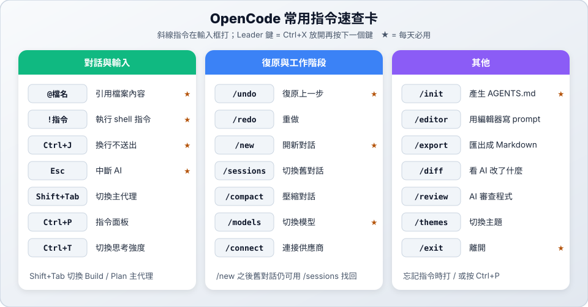

# 📚 參考：維護指令與疑難排解

> 📚 參考　｜　[章節首頁](README.md)

本頁以 OpenCode 2.0.32 的實際操作與[官方文件](https://opencode.ai/v2/docs/)為準。

> 斜線指令請看 [03 斜線指令](03-slash-commands.md)。

---

## 1. 常用管理指令

這些指令在一般終端機輸入，不是在 OpenCode 的輸入框：

| 指令 | 用途 |
| :--- | :--- |
| `opencode --version` | 查看版本 |
| `opencode upgrade` | 升級到最新版 |
| `opencode auth list` | 查看已連接的供應商 |
| `opencode auth login <供應商>` | 在終端機登入供應商 |
| `opencode models` | 列出所有可用模型 |
| `opencode session list` | 列出歷史對話 |
| `opencode mcp list` | 列出 MCP 伺服器 |
| `opencode stats` | 查看 token 用量與費用 |
| `opencode reload` | 重新載入設定 |
| `opencode service restart` | 重新啟動背景服務 |
| `opencode debug config` | 查看讀到哪些設定檔（輸出可能含 API Key，不要外流） |
| `opencode debug agents` | 列出所有代理和它們的權限 |
| `opencode debug paths` | 查看資料、設定、記錄檔的位置 |

想找免費模型：`opencode models | grep free`

---

## 2. 疑難排解

| 狀況 | 解法 |
| :--- | :--- |
| 找不到 `opencode` 指令 | 重新開終端機；用 `which opencode` 確認安裝路徑在 `$PATH` 裡 |
| `Reconnect OpenCode Console to continue.` | 登入失效。輸入 `/connect`，選 OpenCode Console 重新連接 |
| `This API key has expired.` | API Key 過期了，重新登入也不會更新它。到 OpenCode Console 建立新的 Key，再用 `/connect` 貼上 |
| 出現 401 錯誤 | 登入資訊失效。輸入 `/connect` 重新連接，或用 `opencode auth list` 檢查 |
| 出現 429 錯誤 | 請求太頻繁或額度用完，稍後再試或換模型 |
| 免費模型出現 `Endpoint is unavailable` | 伺服器忙碌，用 `/models` 換一個標示 `Free` 的模型 |
| 找不到教材提到的免費模型 | 免費名單會變動，用 `/models` 搜尋 `free` 看目前有哪些 |
| 模型不是你選的那個 | 在設定檔固定 `model`（見 [04](04-config.md#固定預設模型)） |
| AI 一直用 `pip install` | 確認專案根目錄有 `AGENTS.md`（見 [06](06-agents-md.md)），並在對話中用 `@AGENTS.md` 提醒它 |
| 選單裡沒有 `/init` 或 `/review` | 這些指令啟動後才載入，等幾秒再打一次 |
| 選單裡沒有 `/undo` 或 `/compact` | 這些指令要對話開始後才會出現 |
| 按 `Enter` 後指令還留在輸入框 | 再按一次 `Enter` 就會送出 |
| 打指令卻出現 `no such file or directory` | 你正在 `/terminal` 開的終端機裡，要先切回輸入框 |
| `Tab` 切換不了 Build / Plan | OpenCode 2 改成 `Shift+Tab` |
| 自訂指令沒出現 | 檔案要放在 `.opencode/commands/`，副檔名是 `.md` |
| Skill 沒出現 | 見 [05 Skill 沒有作用？](05-skills.md#8-skill-沒有作用) |
| 設定好像沒有生效 | 輸入 `/reload`；再用 `opencode debug config` 查看讀到哪些檔案 |
| 環境變數沒有生效 | 背景服務讀不到後來才設的變數，執行 `opencode service restart`（見 [04](04-config.md#4-環境變數)） |
| 升級後還是舊版 | 關掉所有 OpenCode 視窗後重新啟動；用 `opencode --version` 確認 |
| 想換介面主題或快捷鍵 | 輸入 `/themes` 或 `/settings`；快捷鍵寫在 `~/.config/opencode/cli.json` |

---

## 3. 新舊版對照

網路上很多教學還是 OpenCode 1 的寫法。舊的設定檔大多仍能讀取，但新寫的請用右邊的格式：

| 項目 | OpenCode 1 | OpenCode 2 |
| :--- | :--- | :--- |
| 切換主代理 | `Tab` | `Shift+Tab` |
| 權限 | `"permission": { "bash": { "rm *": "deny" } }` | `"permissions": [{ "action": "shell", "resource": "rm *", "effect": "deny" }]` |
| 執行指令的權限名稱 | `bash` | `shell` |
| 派工的權限名稱 | `task` | `subagent` |
| 自訂指令（JSON） | `command` | `commands` |
| 自訂指令在背景執行 | `subtask: true` | `subagent: true` |
| 代理欄位 | `permission`、`prompt`、`temperature` | `permissions`、`system`；`temperature` 不再放在代理上 |
| 供應商設定 | `provider`、`options` | `providers`、`settings` |
| MCP | `mcp` 底下直接放伺服器 | `mcp.servers` |
| 介面設定 | `tui.json` | `~/.config/opencode/cli.json` |
| 內建子代理 | Explore、Scout、General | Explore、General |
| 規則檔 | `AGENTS.md`，也會讀 `CLAUDE.md` | 只讀 `AGENTS.md` |
| 建立代理 | `opencode agent create` | 請 AI 建立，或自己新增 `.md` 檔 |
| 列出代理 | `opencode agent list` | `opencode debug agents` |
| 查看供應商 | `opencode providers list` | `opencode auth list` |
| 斜線指令 | `/details`、`/thinking`（切換顯示） | `/details` 已移除；`/thinking` 變成 `/variants` 的別名 |

完整說明見官方的 [Migrate from V1](https://opencode.ai/v2/docs/migrate-v1/)。
