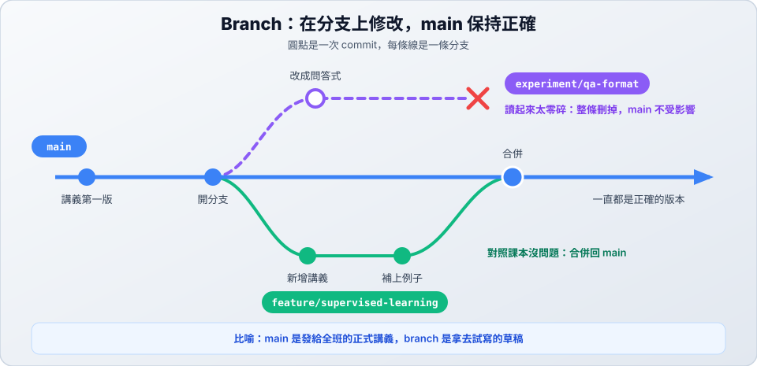

# 01　為什麼需要 Branch

> ★ 入門　｜　[章節首頁](README.md)　｜　下一站：[02 Branch 基本流程 →](02-branch-basics.md)

**這一站你會學到**：Branch（分支）是什麼、為什麼請 AI 修改內容前要先開分支，以及分支該怎麼命名。

---

## 1. 先看一個故事

> 你在[開始之前](README.md#開始之前準備-ml-notes-資料夾)寫好了第一版講義，裡面有「過擬合」和「準確率」。今天老師說：「下週要教監督式學習。」

你請 AI 新增監督式學習的講義。AI 寫完了，還順手「優化」了過擬合的講義，結果把原本正確的定義改錯了。

| | 直接改在 main | 先開一條分支 |
| :--- | :--- | :--- |
| **定義被改錯時** | 正式講義已經被改動，要先找出 AI 改了哪些地方 | main 完全沒變，講義還是對的 |
| **想重寫時** | 要小心復原，才不會連好的部分一起改掉 | 分支不要了就丟掉，重開一條 |
| **想確認內容時** | 新寫的和被改動的全混在一起 | 能清楚列出這條分支改了什麼 |

## 2. Branch 是什麼？

Branch 是**一條獨立的修改路線**。從 main 開出分支後，在分支上的 commit 不會影響 main；確定沒問題，再把成果合併回 main。

- **feature/supervised-learning**：講義寫好了，合併回 main。
- **experiment/qa-format**：把講義改成問答式，但讀起來太零碎，整條刪掉。main 完全不受影響。

> 💡 比喻：main 像發給全班的正式講義；branch 像拿去試寫的草稿。草稿寫壞了就丟掉，正式講義不會變。

建立分支時，Git 不會複製整個專案，所以幾乎是一瞬間完成。分支開多少條都不用擔心佔空間。

## 3. 為什麼用 AI 工作特別需要 Branch？

| AI 的特性 | 分支帶來的好處 |
| :--- | :--- |
| AI 一次可能改很多檔案 | 所有改動都留在分支上，壞了不會波及 main |
| AI 可能順手改到你沒要求的地方 | 合併前可以比較分支和 main，看清楚全部的改動 |
| AI 可能把專有名詞解釋錯 | 先留在分支上，對照課本確認後才放進正式講義 |
| 同一個名詞有好幾種寫法 | 每種寫法各開一條分支，比較後留下最好的 |

## 4. 什麼時候開分支？怎麼命名？

**原則：main 只放確定正確的版本。** 只要是請 AI 修改內容，就先開分支。

名稱用「類型/簡短說明」，看到名稱就知道它在做什麼：

| 類型 | 用在什麼時候 | 講義的例子 |
| :--- | :--- | :--- |
| `feature/` | 新增內容 | `feature/supervised-learning`：新增監督式學習講義 |
| `fix/` | 修正一般的錯誤 | `fix/supervised-example`：改寫監督式學習的例子 |
| `hotfix/` | 正式版本有錯，要緊急修正 | `hotfix/accuracy-formula`：考試前修正準確率公式 |
| `experiment/` | 試試看，不一定會留下 | `experiment/qa-format`：試做問答式講義 |

> 這些類型是常見的命名習慣，源自軟體開發，用在講義上一樣清楚。名稱也可以直接請 AI 取：「請依這個需求取一個合適的分支名稱。」

---

## ✅ 自我檢查

- [ ] 能用自己的話說明 branch 是什麼
- [ ] 能說出「先開分支」比「直接改 main」好在哪裡
- [ ] 能替「新增梯度下降講義」想一個分支名稱

> 下一站：[02 Branch 基本流程 →](02-branch-basics.md)
