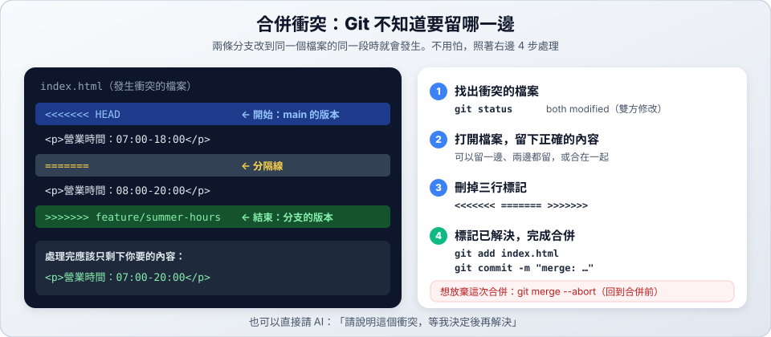

# 03　合併與衝突

> ★★ 進階　｜　[← 02 Branch 基本流程](02-branch-basics.md)　｜　[章節首頁](README.md)　｜　下一站：[04 為什麼需要 Worktree →](04-why-worktree.md)

**這一站你會學到**：怎麼安全地合併、遇到衝突怎麼處理，以及合併完才後悔怎麼辦。

> 接續 [02 站](02-branch-basics.md)的 `ml-notes`，目前只有 `main` 一條分支。

---

## 1. 開兩條分支，改同一行

> 講義裡過擬合的定義只寫了「模型學得太細」。老師說：「要講原因，也要講現象。」你各開一條分支來改：
>
> - `fix/overfit-cause`：改成「模型連雜訊也學了進去」
> - `fix/overfit-symptom`：改成「訓練資料表現好，新資料表現差」

先開第一條分支，補上原因：

**自己打指令**

```bash
git switch -c fix/overfit-cause
```

**請 AI 做**

```text
請從 main 開一條分支 fix/overfit-cause，並切換過去。
```

**請 AI 寫**

```text
請把 terms/overfitting.md 的定義那一行改成「- **定義**：模型連雜訊也學了進去。」只改這一行，其他內容不要動。先不要 commit。
```

**自己打指令**

```bash
git add .
git commit -m "fix: 補上過擬合的原因"
git switch main
```

**請 AI 做**

```text
請把這次的改動 commit，訊息是「fix: 補上過擬合的原因」，然後切回 main。
```

再從 main 開第二條分支，補上現象：

**自己打指令**

```bash
git switch -c fix/overfit-symptom
```

**請 AI 做**

```text
請從 main 開一條分支 fix/overfit-symptom，並切換過去。
```

**請 AI 寫**

```text
請重新讀一次 terms/overfitting.md，把定義那一行改成「- **定義**：訓練資料表現好，新資料表現差。」只改這一行，其他內容不要動。先不要 commit。
```

**自己打指令**

```bash
git add .
git commit -m "fix: 補上過擬合的現象"
git switch main
```

**請 AI 做**

```text
請把這次的改動 commit，訊息是「fix: 補上過擬合的現象」，然後切回 main。先不要合併。
```

---

## 2. 安全地合併

先合併第一條。合併前先確認位置和狀態，再預覽會多出哪些 commit。

**自己打指令**

```bash
git switch main                            # 1. 切到 main
git status                                 # 2. 應該沒有未提交的改動
git log main..fix/overfit-cause --oneline  # 3. 預覽分支比 main 多了哪些 commit
git merge fix/overfit-cause                # 4. 合併
```

> 之後專案連上 GitHub，合併前要先 `git pull` 更新 main，合併後再 `git push`。

**請 AI 做**

```text
請把 fix/overfit-cause 合併進 main。合併前先確認我在 main 上、沒有未提交的改動，並告訴我會多出哪些 commit，等我同意再合併。
```

合併有兩種結果。這一次應該會順利完成，顯示 `Fast-forward`：

| 結果 | 英文介面 | 中文介面 | 接下來 |
| :--- | :--- | :--- | :--- |
| ✅ 順利合併 | `Fast-forward`，或 `Merge made by the 'ort' strategy.` | 相同 | 完成，可以刪除分支 |
| ⚠️ 發生衝突 | `CONFLICT (content): Merge conflict in 檔名` | `衝突（內容）：合併衝突於 檔名` | 照第 4 節的步驟處理 |

> [!NOTE]
> **`git merge` 之後跳出編輯器？這不是當機。** main 和分支各有新 commit 時，Git 會請你確認合併訊息，直接存檔離開就好：
> - **nano**（畫面下方有 `^X Exit`）：按 `Ctrl+X`
> - **Vim**：輸入 `:wq`，按 `Enter`
>
> 不想看到編輯器：`git merge --no-edit <分支名稱>`。

---

## 3. 為什麼會衝突？

現在合併第二條。這裡會出現 `CONFLICT`，這是預期中的結果。

**自己打指令**

```bash
git merge fix/overfit-symptom
```

**請 AI 做**

```text
請把 fix/overfit-symptom 也合併進 main。如果有衝突先不要解決，把衝突內容給我看。
```

兩條分支都改了同一行定義。第一條已經合併，第二條合併時 Git 不知道要留哪個版本，就會停下來問你：

```text
<<<<<<< HEAD
- **定義**：模型連雜訊也學了進去。
=======
- **定義**：訓練資料表現好，新資料表現差。
>>>>>>> fix/overfit-symptom
```

| 標記 | 意思 |
| :--- | :--- |
| `<<<<<<< HEAD` | 開始：目前分支（main）的版本 |
| `=======` | 分隔線 |
| `>>>>>>> fix/overfit-symptom` | 結束：要合併進來的分支的版本 |

衝突不代表出錯了，只是有一個決定要由人來做。這很常見，不用怕。

---

## 4. 處理衝突



### 先看懂衝突

**自己打指令**

```bash
git status                  # both modified（雙方修改）的就是衝突的檔案
cat terms/overfitting.md    # 看衝突的內容
```

**請 AI 做**

```text
目前的合併發生衝突。請告訴我衝突在哪裡、兩邊各改了什麼，先不要修改檔案。
```

### 想放棄這次合併

如果現在不想處理，可以回到合併前的狀態。**這次要繼續練習，先知道就好，不用執行。**

**自己打指令**（這次不用執行）

```bash
git merge --abort   # 回到合併前的狀態
```

**請 AI 做**

```text
請放棄這次合併，回到合併前的狀態。
```

### 決定內容並完成合併

這句定義該怎麼寫，要由讀過課本的你決定。原因和現象其實都對，所以兩個都留下。內容一樣交給 AI 改。

**請 AI 寫**

```text
原因和現象都要留。請把定義那一行改成「- **定義**：模型連雜訊也學了進去，所以訓練資料表現好，新資料表現差。」並刪掉衝突標記，其他內容不要動。改完先讓我看結果，先不要完成合併。
```

> 如果兩邊改的內容互不相關，例如兩條分支都在索引最後加了一行不同的名詞，就請 AI「保留兩邊的內容，並刪掉衝突標記」。

確認內容正確、標記也刪乾淨了，再完成合併：

**自己打指令**

```bash
cat terms/overfitting.md
git add terms/overfitting.md                      # 標記為已解決
git commit -m "merge: 合併 fix/overfit-symptom"   # 完成合併
```

**請 AI 做**

```text
內容沒問題，請完成這次合併。
```

---

## 5. 合併完才發現不對

> 剛合併完過擬合的新定義，老師說：「等一下，雜訊那段說法還要再確認。」

| 情況 | 做法 | 結果 |
| :--- | :--- | :--- |
| **還沒 push** | 把 main 退回合併前 | 就像沒合併過，分支還在，修好後可以再合併 |
| **已經 push** | 用一個新的 commit 抵銷這次合併 | 歷史會多一筆「Revert」紀錄，別人不受影響 |

`ml-notes` 還沒有 push 過，所以把 main 退回合併前。

**自己打指令**

```bash
git reset --merge ORIG_HEAD   # 要在合併後馬上執行，中間不要做其他合併或 reset
cat terms/overfitting.md      # 定義回到只有「原因」的版本
```

**請 AI 做**

```text
我想復原剛才那次合併。請先告訴我這次合併有沒有 push 過，再用適合的方式復原，復原前讓我確認。
```

> 老師回覆：「確認過了，說法沒問題。」

分支還在，所以可以再合併一次。同樣的衝突會再出現，正好再練一次。

**自己打指令**

```bash
git merge fix/overfit-symptom
```

**請 AI 做**

```text
請再把 fix/overfit-symptom 合併進 main。如果有衝突先不要解決，把衝突內容給我看。
```

**請 AI 寫**

```text
請把定義那一行改成「- **定義**：模型連雜訊也學了進去，所以訓練資料表現好，新資料表現差。」並刪掉衝突標記，其他內容不要動。先不要完成合併。
```

**自己打指令**

```bash
git add terms/overfitting.md
git commit -m "merge: 合併 fix/overfit-symptom"
```

**請 AI 做**

```text
內容沒問題，請完成這次合併。
```

如果已經 push 過，就要改用抵銷的做法。**`ml-notes` 沒有 push，這次不用執行。**

**自己打指令**（這次不用執行）

```bash
git revert -m 1 HEAD   # 新增一個抵銷的 commit
git push
```

> `-m 1` 用在有產生合併 commit 的情況。如果當時是 `Fast-forward`，就沒有合併 commit，要先用 `git log` 找出要抵銷的 commit，再執行 `git revert <commit 編號>`。

> [!WARNING]
> **已經抵銷（revert）過的合併，不能直接再合併一次。** Git 會顯示 `Already up to date`（已經是最新的），改動不會回來。要先請 AI 處理：「我之前 revert 過這次合併，現在要重新把它合併回來。」

---

## 6. 刪除分支，看看歷史

**自己打指令**

```bash
git branch -d fix/overfit-cause fix/overfit-symptom
git log --oneline --graph --all
```

**請 AI 做**

```text
請刪除這兩條已經合併的分支，並用圖形顯示 commit 歷史。
```

---

## ✅ 自我檢查

- [ ] 能看懂 `<<<<<<<`、`=======`、`>>>>>>>` 各代表什麼
- [ ] 能看懂衝突、決定內容，再自己用指令完成合併
- [ ] 知道解決衝突時，為什麼要由自己決定正確內容
- [ ] 能分辨 `git merge --abort`（合併途中放棄）和 `git reset --merge`／`git revert`（已經合併完才復原）
- [ ] 能用自己的話說明過擬合的原因和現象

> 📍 **目前進度**：只有 `main` 一條分支，過擬合的定義已經同時包含原因和現象。

> 下一站：[04 為什麼需要 Worktree →](04-why-worktree.md)
