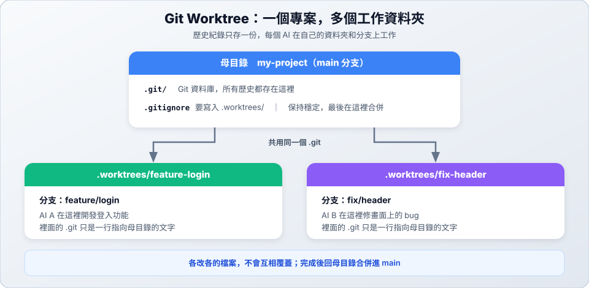

# 04　為什麼需要 Worktree

> ★ 入門　｜　[← 03 合併與衝突](03-merge-conflict.md)　｜　[章節首頁](README.md)　｜　下一站：[05 目錄與原理 →](05-worktree-structure.md)

**這一站你會學到**：只用分支時的限制、worktree 怎麼解決多個 AI 同時開發的問題，以及什麼時候該用哪一種。

---

## 1. 只用分支，會卡在哪裡？

> 小豆咖啡生意變好，老闆一次提了兩個需求：「客人要能**登入會員**，還有手機上的**頁首跑版**了。」會員登入要做很久，你想讓兩個 AI 同時做。

分支隔開了版本，但**一個資料夾同一時間只能在一條分支上**。如果兩個 AI 在同一個資料夾工作：

1. AI A 在 `feature/login` 上開發登入功能。
2. AI B 為了修頁首，切換到 `fix/header`。
3. 資料夾裡的檔案跟著換了，AI A 再讀檔案時，看到的已經是另一條分支的內容，改動也可能跟著跑到錯的分支。

問題不在分支，而在**兩個 AI 共用同一個資料夾**。

## 2. Worktree 的解法

Worktree 讓同一個專案有好幾個工作資料夾，每個資料夾各自停在一條分支上。

| 問題 | 只用分支 | 加上 Worktree |
| :--- | :--- | :--- |
| **多個 AI 同時改程式** | 同一個資料夾，檔案互相干擾 | 每個 AI 一個獨立資料夾，各做各的 |
| **想要多份程式碼** | 重複 `git clone`，又慢又佔空間 | 所有 worktree **共用同一個 `.git`**，建立快，歷史紀錄也不用多存一份 |
| **主程式要保持穩定** | 切換分支時，改到一半的檔案很難處理 | 主資料夾一直停在 main，隨時可以去各 worktree 驗收 |

> 💡 比喻：只用分支像「一張書桌，換作業就要把桌面清空」；worktree 像「同一本講義影印給每個人，各自在自己的桌子寫」，而且影印幾乎不用錢。

## 3. 該用 Branch 還是 Worktree？

Worktree 不是取代分支，而是**讓不同分支同時放在不同資料夾**。每個 worktree 都停在自己的分支上，前面學的開分支、commit、合併通通用得上。

| 你的情況 | 建議 | 小豆咖啡的例子 |
| :--- | :--- | :--- |
| 一次只有一個 AI，做完一件再做下一件 | **只用 Branch** | 先做菜單頁，做完再改營業時間 |
| 想快速試一個想法 | **只用 Branch** | 試做深色主題 |
| 多個 AI 要同時開發 | **Worktree** | 一個做會員登入，一個修頁首 |
| 功能做到一半，臨時要處理急事 | **Worktree** | 登入還沒做完，網站突然當機（[情境 D](07-scenarios.md#情境-d功能做到一半突然要緊急修-bug)） |

> 不確定時先用 Branch。需要「同時」做好幾件事，再加上 Worktree。

---

## ✅ 自我檢查

- [ ] 能說出「一個資料夾同時只能在一條分支」造成的問題
- [ ] 能說出 worktree 比重複 `git clone` 好在哪裡
- [ ] 能判斷自己現在的工作該用 Branch 還是 Worktree

> 下一站：[05 目錄與原理 →](05-worktree-structure.md)
