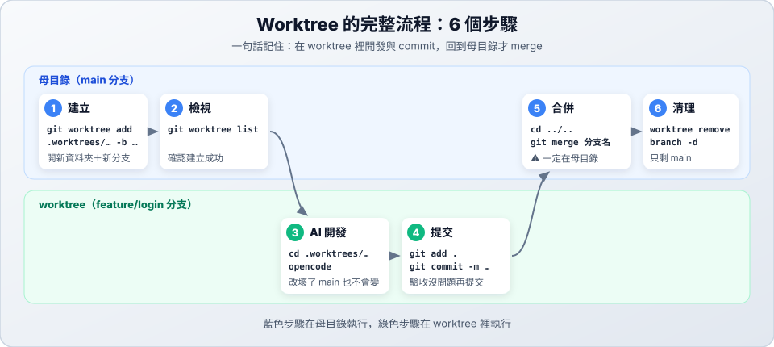

# 06　Worktree 完整流程

> ★★ 進階　｜　[← 05 目錄與原理](05-worktree-structure.md)　｜　[章節首頁](README.md)　｜　下一站：[07 實戰情境 →](07-scenarios.md)

**這一站你會學到**：worktree 從建立到清理的 6 個步驟、每一步在哪裡執行、怎麼讓兩個 AI 同時工作、為什麼要回母目錄合併，以及怎麼確認自己在哪個 worktree。

> 接續 [05 站](05-worktree-structure.md)的 `ml-notes`。這一站會完成 [04 站](04-why-worktree.md)老師交代的兩件事。

---

> 老師交代的**神經網路**講義和**監督式學習**的例子都要開工了。你讓兩個 AI 同時做：AI A 寫神經網路，AI B 改寫例子，自己的主資料夾保持乾淨。



請 AI 做的範例不限定工具，用你使用的 AI 工具就可以。

## 步驟 1：建立（在母目錄）

每個 AI 各有一個 worktree 和一條分支。神經網路要參考老師的投影片，所以把 `references` 複製過去。

**自己打指令**

```bash
git worktree add .worktrees/feature-neural-network -b feature/neural-network   # 建立資料夾和新分支
cp -R references .worktrees/feature-neural-network/                            # 複製老師的投影片
git worktree add .worktrees/fix-supervised-example -b fix/supervised-example
```

**請 AI 做**

對母目錄的 AI 說：

```text
請建立兩個 worktree：feature/neural-network 放在 .worktrees/feature-neural-network，並把 references 資料夾複製過去；fix/supervised-example 放在 .worktrees/fix-supervised-example。
```

> [!IMPORTANT]
> **`references` 這一步很重要。** 被忽略的檔案不會自動出現在新的 worktree，少了 `references/`，就讀不到老師的投影片。

## 步驟 2：檢視（在母目錄）

**自己打指令**

```bash
git worktree list
cat .worktrees/feature-neural-network/.git   # 會看到 gitdir 那一行
```

**請 AI 做**

```text
請列出目前所有的 worktree 和它們的分支，再顯示 .worktrees/feature-neural-network/.git 的內容，並說明它是檔案還是資料夾。
```

應該會看到三筆：母目錄（`main`）和兩個新的 worktree。worktree 裡的 `.git` 是一個檔案，指向母目錄，這就是 [05 站](05-worktree-structure.md#2-為什麼比較省空間)說的省空間的原因。

## 步驟 3：讓兩個 AI 同時撰寫（在各自的 worktree）

開第一個新的終端機視窗，先進入 `ml-notes` 資料夾，再輸入這一行，讓 AI A 在 worktree 裡工作：

```bash
cd .worktrees/feature-neural-network   # 進入 worktree，再啟動你使用的 AI 工具
```

先問 AI「你現在在哪個資料夾、哪個分支？」，確認是 `feature-neural-network` 和 `feature/neural-network`，再交代工作：

**請 AI 寫**

```text
請參考 references/slides.md，新增 terms/neural-network.md，說明「神經網路」，格式和現有的講義一樣，並把它加進 README.md 的索引。先不要 commit。
```

AI A 寫的同時，開第二個新的終端機視窗，先進入 `ml-notes` 資料夾，再讓 AI B 開工：

```bash
cd .worktrees/fix-supervised-example   # 進入 worktree，再啟動你使用的 AI 工具
```

**請 AI 寫**

```text
terms/supervised-learning.md 的例子不夠清楚，請把例子那一行改寫得更具體，其他內容和其他檔案都不要動。先不要 commit。
```

兩個 AI 改的檔案各自留在自己的分支上，不會互相干擾，main 的檔案也不會變動。

> 想同時開好幾個視窗，可以搭配 [Herdr](../herdr/README.md)。

## 💡 我現在在哪一個 worktree？

開了好幾個 worktree 後很容易搞混。趁現在實際確認一次：

**自己打指令**

```bash
git rev-parse --git-dir                    # 在母目錄執行，結果是 .git
cd .worktrees/feature-neural-network
git rev-parse --show-toplevel              # 目前所在資料夾的根目錄
git branch --show-current                  # 目前的分支
git rev-parse --git-dir                    # 路徑裡有 .git/worktrees/
cd ../..
```

| `git rev-parse --git-dir` 的結果 | 代表 |
| :--- | :--- |
| 路徑裡有 `.git/worktrees/`，例如 `.../.git/worktrees/feature-neural-network` | 🌿 worktree：`feature-neural-network` |
| `.git`，或以 `/.git` 結尾的路徑（在子資料夾執行時） | ✅ 母目錄 |

> `git worktree list` 會列出所有 worktree，但**不會標示你在哪一個**。

**請 AI 做**

對 AI A 說：

```text
我現在在哪個資料夾、哪個分支？這裡是母目錄還是 worktree？
```

其他快速確認的方法：

- **看 AI 工具的畫面**：有些工具會顯示目前的資料夾和分支。
- **看終端機提示字元**：很多設定（例如 Oh My Zsh、Starship）會顯示目前分支。

## 步驟 4：驗收並提交（在各自的 worktree）

兩個 AI 都寫完後，對照課本讀一遍，試著用自己的話說明輸入層、隱藏層和輸出層各做什麼。確認沒問題再提交。

**自己打指令**

```bash
cd .worktrees/feature-neural-network  # 指令視窗也要進入 worktree
git status
git add .
git diff --staged                     # 對照課本確認內容，按 q 離開
git commit -m "docs: 新增神經網路講義"
cd ../..

cd .worktrees/fix-supervised-example
git status
git add .
git diff --staged
git commit -m "fix: 改寫監督式學習的例子"
cd ../..
```

**請 AI 做**

先請兩個 AI 分別列出改動：

```text
請列出你改了哪些檔案，並說明每個改動。先不要 commit，等我看過內容。
```

確認沒問題，再對 AI A 說：

```text
內容沒問題，請 commit，訊息是「docs: 新增神經網路講義」。
```

對 AI B 說：

```text
內容沒問題，請 commit，訊息是「fix: 改寫監督式學習的例子」。
```

> 所有 worktree 共用同一個 `.git`，這裡的 commit 在母目錄**馬上看得到**，不需要 push / pull。

確認母目錄的檔案還沒有變動，應該還看不到 `neural-network.md`：

**自己打指令**

```bash
ls terms
```

**請 AI 做**

回到母目錄的 AI，說：

```text
請列出 terms 資料夾的檔案。
```

## 步驟 5：回到母目錄合併

先合併神經網路。

**自己打指令**

```bash
git branch --show-current                        # 應該顯示 main
git log main..feature/neural-network --oneline   # 預覽會多出哪些 commit
git merge feature/neural-network
```

**請 AI 做**

對母目錄的 AI 說：

```text
請把 feature/neural-network 合併進 main。合併前先告訴我會多出哪些 commit，等我同意再合併。
```

### 為什麼一定要回母目錄？

`main` 分支已經被母目錄使用中，Git **不允許同一條分支同時在兩個地方使用**。所以在 worktree 裡切換到 main 會失敗：

```text
fatal: 'main' is already used by worktree at '/path/to/ml-notes'
致命錯誤: 「main」已被位於「/path/to/ml-notes」的工作區使用
```

反過來就可以：在 worktree 裡把 main 的最新內容合併**進來**是允許的。

### 先把 main 同步進還在做的分支

main 剛多了神經網路，但 `fix/supervised-example` 還不知道。先在 worktree 裡把 main 合併進來，確定兩邊放在一起沒問題，再正式合併回 main。如果有衝突，也會在分支上處理完，main 全程保持乾淨。

**自己打指令**

```bash
cd .worktrees/fix-supervised-example
git merge --no-edit main                 # 把 main 合併進這條分支
ls terms                                 # 現在也看得到 neural-network.md
cd ../..
```

**請 AI 做**

對 AI B 說：

```text
請把最新的 main 合併進這條分支，如果有衝突先告訴我，再列出 terms 資料夾的檔案。
```

現在可以把例子的改寫合併回 main：

**自己打指令**

```bash
git log main..fix/supervised-example --oneline
git merge fix/supervised-example
```

**請 AI 做**

對母目錄的 AI 說：

```text
請把 fix/supervised-example 合併進 main。合併前先告訴我會多出哪些 commit，等我同意再合併。
```

合併結果的判讀和衝突處理，都和只用分支時一樣，見 [03 合併與衝突](03-merge-conflict.md)。

## 步驟 6：清理（在母目錄）

**自己打指令**

```bash
git -C .worktrees/feature-neural-network status --ignored   # 先看有哪些被忽略的檔案
git worktree remove .worktrees/feature-neural-network       # 移除 worktree
git branch -d feature/neural-network                        # 刪除分支
git worktree remove .worktrees/fix-supervised-example
git branch -d fix/supervised-example
git worktree list                                           # 確認只剩母目錄
```

> 順序不能反過來：worktree 還在時，`git branch -d` 會出現 `cannot delete branch … used by worktree`。

> `git -C <路徑>` 的意思是「到那個資料夾執行 git」，不用真的 `cd` 過去。

**請 AI 做**

先把兩個 worktree 裡的 AI 關掉，然後對母目錄的 AI 說：

```text
請移除 feature-neural-network 和 fix-supervised-example 這兩個 worktree 和它們的分支，並確認只剩母目錄。移除前先檢查裡面有沒有被忽略、但我還需要的檔案，例如只放在那邊的 references。
```

> [!WARNING]
> 移除 worktree 時，Git 只會擋下**修改過或未追蹤**的檔案。**被忽略的檔案（例如 `references/`）會直接刪除，不會警告。** 所以移除前要先檢查。這次母目錄還留著一份 `references/`，可以放心移除。

> [!WARNING]
> 看到分支「沒有完全合併」時，代表還有 commit 沒合併。先回到步驟 5，**不要強制刪除**，否則那些工作很難找回來。

> 如果是從空資料夾開始的專案，要先做第一次 commit 才建立 worktree。專案還沒有任何 commit 時，建立 worktree 不會報錯，但會產生一條沒有歷史的分支。

---

## ✅ 自我檢查

- [ ] 能不看教材打出 worktree 的 6 個步驟，並知道每一步在哪裡執行
- [ ] 知道為什麼在 worktree 裡不能切換到 main
- [ ] 知道移除 worktree 前要先檢查什麼
- [ ] 能用 `git rev-parse --git-dir` 判斷自己在母目錄還是 worktree
- [ ] 能用自己的話說明什麼是神經網路

> 📍 **目前進度**：只有 `main` 一條分支，也只剩母目錄。`terms` 裡有 4 份講義：`accuracy.md`、`neural-network.md`、`overfitting.md`、`supervised-learning.md`。

> 下一站：[07 實戰情境 →](07-scenarios.md)
