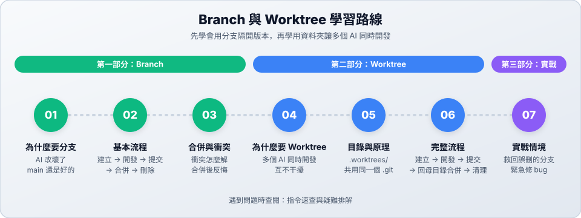

# Branch 與 Worktree：讓 AI 放心改，多個 AI 同時開發

請 AI 改程式最怕兩件事：改壞能用的版本，以及多個 AI 互相干擾。

- **Branch（分支）** 把開發中的版本隔開。AI 在分支上改壞了，main 還是好的。
- **Worktree** 把工作資料夾隔開。每個 AI 有自己的資料夾和分支，可以同時開發。

> [!NOTE]
> **這一章從 Branch 教到 Worktree，重點放在怎麼搭配 AI 使用。** 還不熟 commit 的話，請先看 [Git 學習筆記](https://github.com/roberthsu2003/git)的[環境設定](https://github.com/roberthsu2003/git/tree/main/環境安裝與設定)和[第 01 章](https://github.com/roberthsu2003/git/tree/main/開始使用Git)。想更深入了解分支，看[第 03 章 分支與合併](https://github.com/roberthsu2003/git/tree/main/分支)；想把改壞的檔案救回來，看[第 09 章 還原檔案](https://github.com/roberthsu2003/git/tree/main/回復被刪除的檔案或被編輯的內容)。

---

## 貫穿全章的故事：小豆咖啡

你接下社區咖啡店「小豆咖啡」（虛構）的網站案。網站已經上線，老闆不斷提出新需求，你也跟著從一個 AI 用到好幾個 AI：

| 老闆說 | 你遇到的問題 | 學到什麼 | 站 |
| :--- | :--- | :--- | :---: |
| 「週末想讓客人看到菜單。」 | AI 可能把首頁改壞 | Branch | [01](01-why-branch.md)、[02](02-branch-basics.md) |
| 「提早 7 點開店，夏天開到 8 點。」 | 兩條分支改到同一行 | 合併與衝突 | [03](03-merge-conflict.md) |
| 「要有會員登入，手機頁首也跑版了。」 | 想讓兩個 AI 同時做 | Worktree | [04](04-why-worktree.md)、[05](05-worktree-structure.md)、[06](06-worktree-lifecycle.md) |
| 「客人一登入，網站就當機！」 | 手上的工作還沒做完 | 實戰情境 | [07](07-scenarios.md) |

---

## 學習路線

| 部分 | 站 | 主題 | 難度 | 你會學到 |
| :--- | :---: | :--- | :---: | :--- |
| **Branch** | 01 | [為什麼需要 Branch](01-why-branch.md) | ★ | 分支是什麼、怎麼命名 |
| | 02 | [Branch 基本流程](02-branch-basics.md) | ★ | 建立 → 開發 → 提交 → 合併 → 刪除、丟掉失敗的實驗 |
| | 03 | [合併與衝突](03-merge-conflict.md) | ★★ | 安全地合併、解決衝突、合併後反悔 |
| **Worktree** | 04 | [為什麼需要 Worktree](04-why-worktree.md) | ★ | 多個 AI 同時開發的問題、Branch 和 Worktree 怎麼選 |
| | 05 | [目錄與原理](05-worktree-structure.md) | ★ | `.worktrees/` 放哪裡、什麼隔離了、什麼還是共用 |
| | 06 | [Worktree 完整流程](06-worktree-lifecycle.md) | ★★ | 建立 → 開發 → 提交 → 回母目錄合併 → 清理 |
| **實戰** | 07 | [實戰情境](07-scenarios.md) | ★★★ | AI 改在 main 上、救回分支、緊急修 bug、搭配 Herdr |

> [!TIP]
> **一句話記住**：不要直接在 main 上開發。一次一個 AI 用 Branch；多個 AI 同時做，每個 AI 再加一個 Worktree。

> **不用背指令。** 每一站都會告訴你怎麼用一句話請 AI 做。想自己打指令的話，看每站最後的「進階（選修）」。

---

## 📚 參考資料

| 文件 | 用途 |
| :--- | :--- |
| [指令速查與疑難排解](reference.md) | 所有 branch 與 worktree 指令、常見錯誤訊息（中英對照） |
| [Git 學習筆記](https://github.com/roberthsu2003/git) | 從第一筆 commit 開始的 Git 基礎教材 |
| [官方文件：git-branch](https://git-scm.com/docs/git-branch)、[git-switch](https://git-scm.com/docs/git-switch)、[git-worktree](https://git-scm.com/docs/git-worktree) | Git 官方說明 |

← [回到專案首頁](../README.md)
