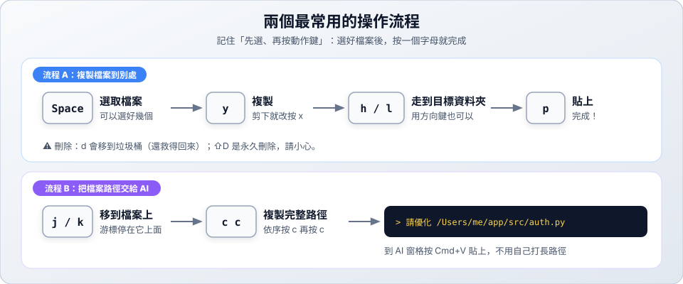

# 03　檔案管理

> ★★ 進階　｜　[← 02 瀏覽與預覽](02-browse.md)　｜　[章節首頁](README.md)　｜　下一站：[04 搜尋與跳轉 →](04-search.md)

**這一站你會學到**：選取、複製、搬移、新增、改名、刪除檔案，以及複製檔案路徑。

---

## 1. 記住一個原則：先選，再按動作鍵

---

## 2. 選取

| 想做的事 | 按鍵 |
| :--- | :--- |
| 選取／取消選取目前這個檔案 | `Space` |
| 連續選取（移動游標就會一路選下去） | `v` |
| 全選 | `Ctrl+A` |
| 取消所有選取 | `Esc` |

> 沒有選取任何檔案時，動作會套用在**游標所在的那一個**檔案上。

## 3. 複製、剪下、貼上、刪除

| 想做的事 | 按鍵 | 說明 |
| :--- | :--- | :--- |
| 複製 | `y` | 先複製，到目標資料夾再貼上 |
| 剪下（搬移） | `x` | 貼上後原本的檔案會消失 |
| 貼上 | `p` | 貼到目前的資料夾 |
| 刪除 | `d` | 移到垃圾桶，還救得回來 |
| 永久刪除 | `⇧D` | ⚠️ 不經過垃圾桶，**無法復原** |

## 4. 新增與改名

| 想做的事 | 按鍵 | 說明 |
| :--- | :--- | :--- |
| 新增檔案 | `a` | 輸入檔名後按 `Enter` |
| 新增資料夾 | `a` | 名稱結尾加上 `/`，例如 `docs/` |
| 重新命名 | `r` | 修改名稱後按 `Enter` |

## 5. 複製路徑與檔名

依序按兩個鍵（先按 `c`，放開，再按第二個鍵）：

| 按鍵 | 複製到剪貼簿的內容 | 範例 |
| :--- | :--- | :--- |
| `c` `c` | 完整路徑 | `/Users/me/app/src/auth.py` |
| `c` `d` | 所在資料夾的路徑 | `/Users/me/app/src` |
| `c` `f` | 檔名 | `auth.py` |
| `c` `n` | 不含副檔名的檔名 | `auth` |

---

## ✅ 動手練習

1. 用 `a` 建立一個 `practice/` 資料夾，進去後再建立 `hello.txt`。
2. 用 `r` 把 `hello.txt` 改名為 `hi.txt`。
3. 用 `y` 複製 `hi.txt`，回上一層用 `p` 貼上。
4. 停在 `hi.txt` 上按 `c` `c`，到別的地方貼上，看看複製到什麼。
5. 用 `d` 刪除練習用的檔案（會移到垃圾桶）。

> 下一站：[04 搜尋與跳轉 →](04-search.md)
