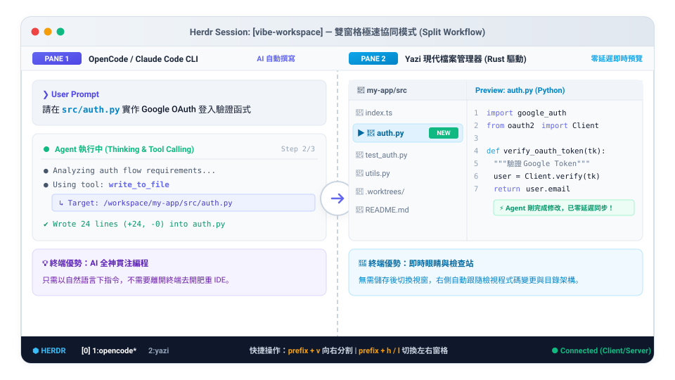

# Yazi 終端檔案管理指南

Yazi（鴨子）是一套以 Rust 編寫的高效能非同步終端檔案管理器（Terminal File Manager）。在以 AI 為核心的開發環境（Vibe Coding Harness）中，Yazi 是連結「AI 終端編程」與「檔案視覺化檢視」的重要橋樑。

---

## 導覽目錄

1. [為什麼 AI 輔助開發需要 Yazi？（在 Harness 中的定位）](#1-為什麼-ai-輔助開發需要-yazi在-harness-中的定位)
2. [安裝與確認版本（推薦配套工具）](#2-安裝與確認版本推薦配套工具)
3. [核心概念：三欄式現代佈局](#3-核心概念三欄式現代佈局)
4. [日常鍵盤操作速查（分級掌握）](#4-日常鍵盤操作速查分級掌握)
5. [實戰情境與解決方案（新手常見盲點）](#5-實戰情境與解決方案新手常見盲點)
6. [搭配 Herdr 終端多工工作流](#6-搭配-herdr-終端多工工作流)
7. [離開時自動切換目錄（Cwd on Exit）](#7-離開時自動切換目錄cwd-on-exit)
8. [常用維護指令與疑難排解](#8-常用維護指令與疑難排解)

---

## 1. 為什麼 AI 輔助開發需要 Yazi？（在 Harness 中的定位）

很多初學者常問：「我已經有 VS Code 和圖形介面的檔案總管（Finder / 檔案總管）了，為什麼還需要在終端機裡用 Yazi？」

當你開始大量使用 OpenCode、Claude Code 等 AI 工具時，痛點很快就會浮現：

| 開發痛點 | 傳統方式的缺點 | Yazi 終端解法 |
| :--- | :--- | :--- |
| **驗收 AI 改動** | 頻繁在終端機與 IDE / Finder 視窗間切換，打斷心流（Context Switching） | 終端視窗一秒就地開啟，即時三欄式語法高亮預覽，快速確認檔案變動 |
| **提供脈絡路徑** | 滑鼠手動尋找檔案、複製路徑極其繁瑣 | 按 **`c c`** 瞬間複製完整絕對路徑、按 **`c f`** 複製檔名，秒貼進 Prompt 給 Agent |
| **查看 Worktree 結構** | 隱藏資料夾（`.worktrees`、`.env`）在 GUI 往往被自動遮蔽 | 按 **`.`** 即時切換隱藏檔顯示，迅速穿梭各分支工作目錄 |
| **極致輕量與速度** | 圖形軟體啟動緩慢、佔用記憶體 | Rust 打造，非同步非阻塞架構，啟動僅需毫秒、滾動極度流暢 |

---

## 2. 安裝與確認版本（推薦配套工具）

請依作業系統選擇對應方式安裝。強烈建議一併安裝 `bat`，以獲得最完美的程式碼語法彩色高亮預覽：

### macOS (Homebrew 推薦)
```bash
# 同時安裝 yazi 與彩色語法預覽工具 bat
brew install yazi bat
```

### Linux (預編譯安裝或套件管理)
```bash
# Ubuntu / Debian 推薦由官方二進位安裝，或使用 cargo
cargo install --locked yazi-fm yazi-cli

# 安裝 bat (在 Debian/Ubuntu 上可能名為 batcat)
sudo apt install bat
```

### Windows (winget / Scoop)
```powershell
winget install sxyazi.yazi
winget install sharkdp.bat
```

安裝完成後，在 shell 檢查版本確認成功：
```bash
yazi --version
```

---

## 3. 核心概念：三欄式現代佈局

啟動 Yazi 後，介面採用了直覺高效的**三欄式（Column Layout）**設計：


1. **左欄（父目錄）**：顯示當前目錄的上一層，讓你清楚自己身在專案的哪一層階層。
2. **中欄（當前清單）**：目前游標所在的目錄內容，按上下方向鍵（或 `j`/`k`）移動選取。
3. **右欄（即時預覽）**：根據你選中的項目，**零延遲即時預覽**：
   - 程式碼／Markdown：顯示彩色語法高亮與行號。
   - 資料夾：直接展開該資料夾內的文件清單。
   - 圖片／媒體：在支援的現代終端（如 Ghostty、Kitty、iTerm2）甚至能直接預覽圖片！

---

## 4. 日常鍵盤操作速查（分級掌握）

Yazi 全程支援 Vim 經典鍵位與標準方向鍵，依使用頻率整理如下：

### 4.1 常用操作（每天必用）

| 功能 | 按鍵方式 | 說明 |
| :--- | :--- | :--- |
| **上下移動游標** | `↑` / `↓` 或 `k` / `j` | 在中欄檔案清單中上下瀏覽 |
| **進入資料夾 / 開啟** | `Enter` 或 `→` 或 `l` | 進入子資料夾；若是檔案則以預設編輯器開啟 |
| **返回上一層目錄** | `←` 或 `h` | 回到父目錄層級 |
| **滾動右側預覽畫面** | `Shift+J` / `Shift+K` | 游標不動，直接上下翻閱右側長篇文章或程式碼 |
| **複製檔案完整路徑** | 依序按 **`c` 再按 `c`** | 複製選中檔案的絕對路徑（如 `/path/to/src/main.py`） |
| **複製檔案所在目錄** | 依序按 **`c` 再按 `d`** | 複製該檔案所屬的資料夾路徑 |
| **複製檔案名稱** | 依序按 **`c` 再按 `f`** | 僅複製檔名（如 `main.py`） |
| **切換顯示隱藏檔** | 按 **`.`** | 顯示／隱藏以點開頭的檔案（如 `.env`、`.worktrees`、`.git`） |
| **離開 Yazi** | 按 **`q`** | 退出檔案管理器回到一般 Shell 終端機 |

### 4.2 檔案管理操作（新增、重命名、複製、貼上）

| 功能 | 按鍵方式 | 說明 |
| :--- | :--- | :--- |
| **建立新檔案 / 資料夾** | 按 **`a`** | 輸入檔名即可建立；**若名稱末端加上 `/` 則建立為資料夾** |
| **重新命名** | 按 **`r`** | 彈出編輯框修改檔案名稱 |
| **標記選取（多選）** | 按 **`Space`（空白鍵）** | 選中當前檔案並跳下一筆，適合連續批次勾選 |
| **連續視覺選取** | 按 **`v`** | 進入 Visual 模式，上下移動游標即可連續批次選取 |
| **複製檔案（Yank）** | 按 **`y`** | 複製已選取的檔案（準備貼到其他目錄） |
| **剪下檔案（Cut）** | 按 **`x`** | 剪下已選取的檔案（搬移檔案） |
| **貼上檔案（Paste）** | 按 **`p`** | 將剪貼簿內的檔案貼到當前目錄 |
| **刪除檔案（移至垃圾桶）** | 按 **`d`** | 安全刪除（移入作業系統資源回收筒） |
| **強制永久刪除** | 按 **`Shift+D`** | 不經垃圾桶直接抹除（危險！請謹慎使用） |

### 4.3 搜尋、過濾與快速跳轉

| 功能 | 按鍵方式 | 說明 |
| :--- | :--- | :--- |
| **即時檔名過濾 (Filter)** | 按 **`/`** | 類似搜尋框，輸入關鍵字即時只顯示符合的檔案（按 `Esc` 清除） |
| **鍵入跳轉 (Find)** | 按 **`f`** | 輸入字元瞬間跳到符合的首個檔案 |
| **跨目錄智慧跳轉** | 按 **`z`** | 整合 Zoxide 跨目錄跳躍（例如 `z vibe` 直接飛到專案） |
| **跳至頂部 / 底部** | 按 **`g g`** / **`Shift+G`** | 快速飛到清單的第一筆或最後一筆檔案 |

---

## 5. 實戰情境與解決方案（新手常見盲點）

#### 情境一：AI Agent 在背景改完檔案，如何在終端機秒看成果？
* **痛點**：AI 說它修改了 5 個檔案，但不想切出終端機去點滑鼠找檔案，又不想用 `cat` 一行行印出來。
* **解決方案**：
  直接在旁邊的窗格輸入 `yazi`。
  Yazi 內建即時檔案監聽，當 Agent 在背後寫檔時，Yazi 畫面會**自動同步更新**！用上下鍵游標掃過去，右側欄位立刻以語法高亮展示最新內容，驗收代碼不到 3 秒鐘。

#### 情境二：如何一秒複製完整路徑餵給 AI Agent？
* **痛點**：想讓 Agent 修改某深層檔案（例如 `src/api/v1/endpoints/auth.py`），手動打路徑又長又容易錯字。
* **解決方案**：
  在 Yazi 中游標移到該檔案上，連續按下 **`c` `c`**（複製完整路徑）。
  切回 Agent 視窗，直接 `Ctrl+V`（或 `Cmd+V`）貼上：*「請幫我優化 `/Users/.../auth.py` 的錯誤處理」*。

#### 情境三：為什麼我看不到 `.env` 或 `.worktrees` 資料夾？
* **痛點**：專案裡明明有環境變數檔 `.env` 或 Git 工作區 `.worktrees`，但清單裡空空如也。
* **解決方案**：
  直接按一個鍵：**`.`（句點）**！
  所有以 `.` 開頭的隱藏設定檔（`.env`、`.gitignore`、`.opencode`、`.worktrees`）立即現形；再按一次 `.` 即可恢復乾淨簡潔模式。

#### 情境四：一鍵放大預覽畫面（全螢幕檢視長篇日誌）
* **痛點**：預覽欄位只有右邊三分之一，遇到超長程式碼或複雜表格時覺得擠在一起。
* **解決方案**：
  安裝官方擴充套件後按快捷鍵切換全螢幕預覽，或者在 Yazi 內按 **`~`** 查閱說明面板。

---

## 6. 搭配 Herdr 終端多工工作流

在 [Herdr](../herdr/README.md) 中，將 **「AI Agent 編程」** 與 **「Yazi 檔案總管」** 並排，是最高效率的 Vibe Coding 終端佈局：



### 快速建立並排工作流
1. 啟動 Herdr：`herdr`。
2. 預設窗格啟動 AI Agent：`opencode`。
3. 按 **`prefix + v`**（即 `Ctrl+B` 放開再按 `v`）水平向右切割新窗格。
4. 在右側窗格輸入 `yazi`。
5. 左邊下指令，右邊即時檢視檔案長相，雙手完全不需摸滑鼠！

---

## 7. 離開時自動切換目錄（Cwd on Exit）

平時執行 `yazi`，當你按 `q` 離開時，Shell 會停留在啟動時的目錄。  
若你希望在 Yazi 裡逛到某個深層資料夾後，**退出時 Shell 自動 `cd` 到該目錄**，請在你的 `~/.zshrc` 或 `~/.bashrc` 加入官方提供的包裝函式：

```bash
function ya() {
	local tmp="$(mktemp -t "yazi-cwd.XXXXXX")" cwd
	yazi "$@" --cwd-file="$tmp"
	if cwd="$(command cat -- "$tmp")" && [ -n "$cwd" ] && [ "$cwd" != "$PWD" ]; then
		builtin cd -- "$cwd"
	fi
	rm -f -- "$tmp"
}
```

加入後執行 `source ~/.zshrc`。以後改用 **`ya`** 啟動 Yazi，按 `q` 離開時終端機就會自動停留在最後選定的資料夾！

---

## 8. 常用維護指令與疑難排解

### 常見問題排解 (Troubleshooting)

1. **文字檔沒有彩色高亮**：
   - 請確認已安裝 `bat` 工具。macOS 請執行 `brew install bat`。
2. **複製路徑 `c c` 貼不上系統剪貼簿**：
   - Yazi 需要系統剪貼簿支援。Linux 環境請安裝 `xclip` 或 `wl-clipboard`；macOS 原生支援 `pbcopy`。
3. **圖片無法在終端機預覽**：
   - 終端機必須支援相應的圖形協定。推薦使用現代化終端機（如 **Ghostty**、**Kitty**、**WezTerm** 或 **iTerm2**），並在設定中開啟圖片預覽。
4. **如何查閱所有快捷鍵清單**：
   - 在 Yazi 執行中隨時按下 **`~`**，會開啟內建指令與按鍵綁定速查手冊。

---

[← 返回專案首頁指南](../README.md)
