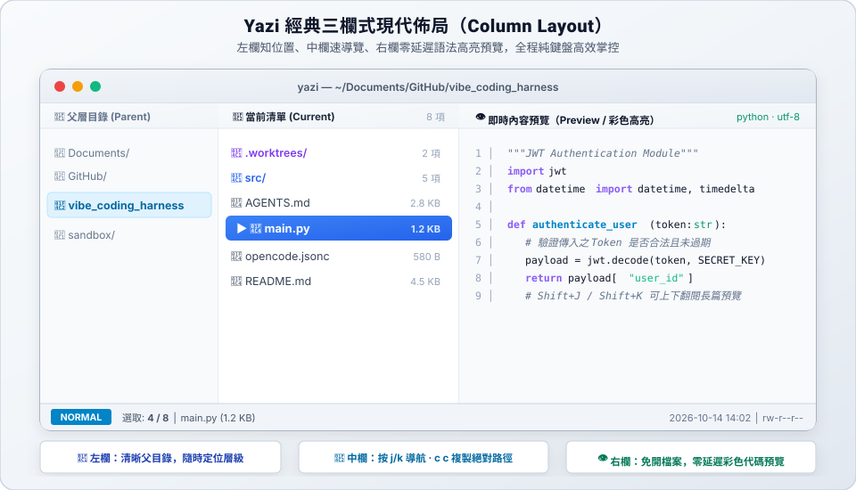
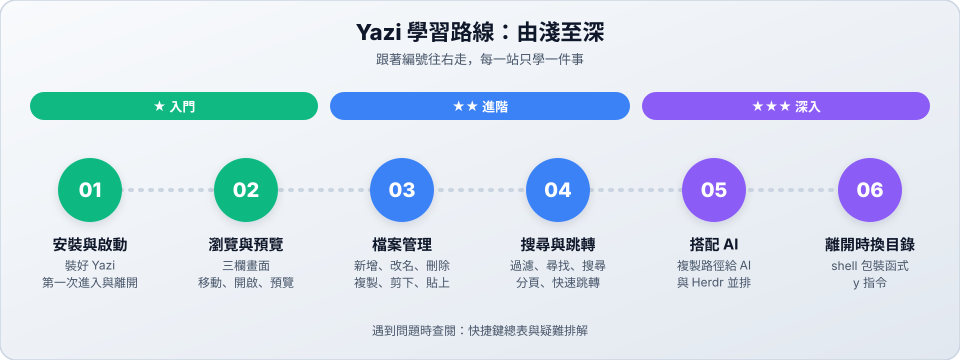

# Yazi：在終端機裡看檔案、管檔案

**Yazi** 是一套在終端機裡使用的檔案管理器。不用離開終端機、不用拿滑鼠，就能：

- 用**三欄畫面**瀏覽資料夾，右邊即時**預覽檔案內容**。
- 複製、搬移、改名、刪除檔案，每個動作只要按一個鍵。
- 一鍵**複製檔案路徑**，貼給 AI 當作提示的一部分。

---

## 學習路線

| 站 | 主題 | 難度 | 你會學到 |
| :---: | :--- | :---: | :--- |
| 01 | [安裝與第一次啟動](01-install.md) | ★ | 裝好 Yazi、進入與離開 |
| 02 | [瀏覽與預覽](02-browse.md) | ★ | 三欄畫面、移動、開啟、看隱藏檔 |
| 03 | [檔案管理](03-file-ops.md) | ★★ | 選取、複製、剪下、貼上、新增、改名、刪除 |
| 04 | [搜尋與跳轉](04-search.md) | ★★ | 過濾、尋找、搜尋、分頁、快速跳到常用資料夾 |
| 05 | [搭配 AI 與 Herdr](05-ai-workflow.md) | ★★★ | 驗收 AI 改的檔案、把路徑交給 AI |
| 06 | [離開時切換目錄](06-cwd-on-exit.md) | ★★★ | 用 `y` 指令啟動，離開後停在最後的資料夾 |

> [!TIP]
> **時間不多？** 讀完 01、02 就能開始使用；03、04 讓你用得順手；05、06 是搭配 AI 開發時的進階技巧。

---

## 📚 參考資料

| 文件 | 用途 |
| :--- | :--- |
| [快捷鍵總表與疑難排解](reference.md) | 所有常用按鍵、常見問題 |
| [官方文件](https://yazi-rs.github.io/docs/quick-start) | Yazi 官方網站 |

← [回到專案首頁](../README.md)
