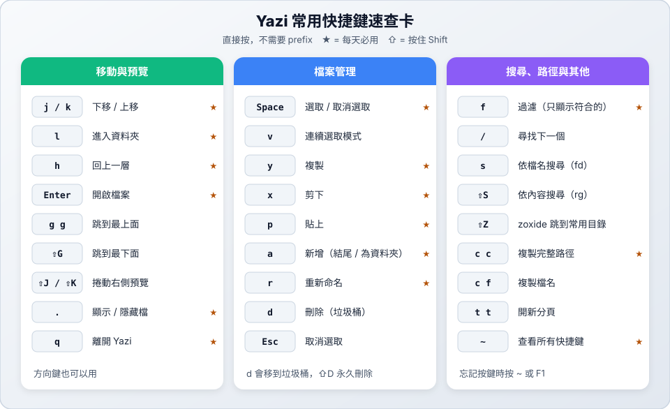

# 📚 參考：快捷鍵總表與疑難排解

> 📚 參考　｜　[章節首頁](README.md)

本頁按鍵以 Yazi 26.9.1 的預設設定與[官方文件](https://yazi-rs.github.io/docs/quick-start)為準。在 Yazi 裡隨時按 `~` 或 `F1` 可以查看目前生效的完整按鍵。

---

## 1. 快捷鍵總表

### 移動與預覽

| 按鍵 | 功能 |
| :--- | :--- |
| `j` / `k`（`↓` / `↑`） | 下移 / 上移 |
| `l`（`→`） | 進入資料夾 |
| `h`（`←`） | 回上一層 |
| `g` `g` / `⇧G` | 跳到最上面 / 最下面 |
| `⇧J` / `⇧K` | 往下 / 往上捲動預覽 |
| `.` | 顯示 / 隱藏隱藏檔 |
| `Tab` | 顯示檔案資訊 |

### 選取與檔案操作

| 按鍵 | 功能 |
| :--- | :--- |
| `Space` | 選取 / 取消選取 |
| `v` | 連續選取模式 |
| `Ctrl+A` / `Ctrl+R` | 全選 / 反向選取 |
| `Esc` | 取消選取 |
| `Enter`、`o` | 開啟 |
| `y` / `x` / `p` | 複製 / 剪下 / 貼上 |
| `⇧P` | 貼上並覆蓋同名檔案 |
| `d` / `⇧D` | 刪除（垃圾桶）/ 永久刪除 |
| `a` | 新增檔案（結尾 `/` 為資料夾） |
| `r` | 重新命名 |

### 複製路徑

| 按鍵 | 複製內容 |
| :--- | :--- |
| `c` `c` | 完整路徑 |
| `c` `d` | 所在資料夾路徑 |
| `c` `f` | 檔名 |
| `c` `n` | 不含副檔名的檔名 |

### 搜尋與跳轉

| 按鍵 | 功能 |
| :--- | :--- |
| `f` | 過濾 |
| `/` / `?` | 往下 / 往上尋找 |
| `n` / `⇧N` | 下一個 / 上一個符合 |
| `s` / `⇧S` | 依檔名（fd）/ 依內容（ripgrep）搜尋 |
| `Ctrl+S` | 取消搜尋 |
| `z` / `⇧Z` | fzf 跳轉 / zoxide 跳轉 |
| `g` `t` | 前往垃圾桶 |

### 分頁與離開

| 按鍵 | 功能 |
| :--- | :--- |
| `t` `t` | 開新分頁 |
| `1` ～ `9` | 切換分頁 |
| `[` / `]` | 上一個 / 下一個分頁 |
| `Ctrl+C` | 關閉分頁 |
| `q` / `⇧Q` | 離開（搭配 `y` 時：換目錄 / 不換目錄） |
| `~`、`F1` | 說明 |

---

## 2. 疑難排解

| 狀況 | 解法 |
| :--- | :--- |
| 找不到 `yazi` 指令 | 重新開終端機；確認 `brew` 安裝路徑在 `$PATH` 裡 |
| 圖示顯示成方塊或問號 | 安裝 Nerd Font（`brew install font-symbols-only-nerd-font`）並在終端機套用 |
| 按 `s` / `⇧S` 搜尋沒反應 | 安裝 `fd` / `ripgrep`：`brew install fd ripgrep` |
| 按 `⇧Z` 沒反應 | 安裝 `zoxide`：`brew install zoxide` |
| `c` `c` 複製後貼不出來 | Linux 需要安裝 `xclip` 或 `wl-clipboard`；macOS 不需要 |
| 圖片無法預覽 | 使用支援圖片的終端機（Ghostty、Kitty、WezTerm、iTerm2），並安裝官方建議的預覽工具 |
| 離開後沒有停在選的資料夾 | 要用 `y` 啟動，不是 `yazi`（見 [06 離開時切換目錄](06-cwd-on-exit.md)） |
